# The Hierarchy/Product Cartesian Mechanism — Implemented, Real, and Tested

Per direct, iterative design (the earlier drafts of this document — a combination node living under the item, applicable-hierarchies-per-location, pricing-resolution changes — are superseded by this, the real, settled, and now-implemented design). Kept in git history for the record of how the design arrived here, not deleted.

## 1. The real problem this solves

Inventory, Sales, and COGS are three real, separate financial accounts, but they can all exist for the exact same, real, underlying fact — "this specific product, sold or stocked in this specific real combination of circumstances" (a cold beer, in a can, sold as a single, at Riverside Cellars). Before this work, any such per-location, per-variant leaf independently re-derived its own name and identity. This mechanism gives every such combination one real, canonical identity, expanded once, that any number of real financial accounts can point back to.

## 2. The real, implemented structure



*(Regenerated via `make manual-diagrams` whenever the real `.mmd` source changes.)*

**`Hierarchy`** — a real, top-level node under a business, holding real, named groupings and their values (`Beer` → `Lager`/`Ale`, `Storage` → `Hot`/`Cold`). Genuinely user-extensible: nothing in the mechanism special-cases any particular grouping or value name.

**`Product`** — a second, real, top-level node, sibling to `Items`/`Locations`, holding two, real, different kinds of chain:

- **A Definition** — an ordered chain of dimension nodes (e.g. `Location → Item → Size → Container → Quantity → Storage`), each one's own `relation_id` pointing at the real Hierarchy *grouping* it represents.
- **An Instance** — one real, specific combination (e.g. `Riverside Cellars → Lager → 330ml → can → single → Cold`), each node's own `relation_id` pointing at the real Hierarchy *value* it represents. The instance's own first node additionally records, via a real dimension link, which Definition shape it follows.

**The one, sufficient distinction between a Definition node and an Instance node**: a Definition's `relation_id` always lands on a real Hierarchy grouping itself; an Instance's always lands one level deeper, on one of that grouping's own children. No separate flag is needed anywhere.

**New leaves under Inventory, Sales, and COGS** — created directly under these real, existing, unchanged accounts (never an intermediate per-item grouping node), each one's own `relation_id` pointing at the real Instance's own top node. This is the one, shared, canonical identity all three financial accounts refer back to.

## 3. Why the accounts themselves could not simply relocate under the combination

Confirmed directly by reading the real, live schema: `business_reports` (which drives every financial statement — Trial Balance, Balance Sheet, P&L) is a recursive walk starting from `Chart of Accounts`. An account that isn't structurally reachable from there — via `parent_id` — silently disappears from every financial report. This is why the new leaves stay genuine, structural children of Inventory/Sales/COGS; the cartesian identity is carried laterally, via `relation_id`, never by moving these accounts to live under `Product` instead.

## 4. A real, system-wide bug found and fixed while building this

`updateEntity`'s relation-setting resolved its target by a global, bare-name lookup (`resolveId`). This is genuinely ambiguous the moment two, real, differently-scoped entities share a name — exactly the case here, since a Product Instance node ("Riverside Cellars") and the real Location it represents ("Riverside Cellars") are two, separate, real entities with the identical name. Fixed by adding a real, optional `relationId` field throughout `updateEntity`, `Entity.relate`, `setEntityLink`, and `setDimensionParent` — the same, already-proven disambiguation pattern used earlier this session for `accountId`/`entityId`. Every caller in this new mechanism uses the explicit id, never the ambiguous name-based path.

## 5. The real, implemented functions

```ts
ensureHierarchyGrouping(businessName, groupingName, userId)
ensureHierarchyValue(businessName, groupingName, valueName, userId)
defineProductShape(businessName, dimensions: [dimensionName, groupingName][], userId)
ensureProductInstance(businessName, definitionDimensions, values: string[], userId)
ensureCombinationAccountLeaf(baseAccountName, instanceTopNode, userId)
```

All five are real, live, exported functions in `backend/src/db.ts`, backed by a real, direct, comprehensive test (`backend/test/db.test.ts`) that builds the full, six-dimension example end to end and confirms: the Definition/Instance relation_id distinction; that an instance's own top node correctly records its Definition; that every new leaf under Inventory/Sales/COGS points at the same, shared instance; and that these new leaves remain genuinely, structurally reachable from Chart of Accounts.

## 6. Real, honest, remaining scope

- **Wired into a real, live transaction flow**: `PosSaleLineInput` now accepts optional `combinationValues`/`combinationShape`; `completePosSale` uses them, taking priority over tier/location resolution, for Sales, COGS, and Inventory alike.
- **Pricing resolution per combination, implemented**: a real, optional `product_instance_id` column on `item_source` (using a `0` sentinel, matching the exact, existing fix for `currency`'s identical NULL-uniqueness problem) lets a business register a real, combination-specific price; `getItemPriceForCurrency` checks it first, falling back to the base item price.
- **A real, serious bug found and fixed while wiring this in, stated directly**: the initial implementation called `ensureCombinationAccountLeaf('Sales', ...)`/`ensureCombinationAccountLeaf('COGS', ...)` — bare names that collided with unrelated Vocabulary words sharing those exact names, silently posting to the wrong entities entirely and breaking the trial balance by exactly the sale amount. Found by running the extended minimal e2e proof and getting a genuine, non-zero imbalance, not assumed correct from the unit tests alone (which used different account names and never exercised this specific collision). Fixed by using the real, correct Chart-of-Accounts names (`Sales Revenue`, `Cost of Goods Sold`) throughout.
- **A second, real bug found in the same investigation**: `getTrialBalance`'s own duplicate-name detection (added to safely qualify genuinely ambiguous account names) was scoped globally across the entire database rather than to the specific business/ledger being reported on, causing coincidental collisions with unrelated accounts. Fixed by scoping the duplicate check to only the accounts with a real balance in the specific business/ledger being queried.
- **Minimal e2e coverage added**: `backend/scripts/proof-year-end-lifecycle.ts` (the fast, direct, backend-only lifecycle proof) now includes a real combination-sale step, confirming the combination-specific price resolves correctly, the base price stays unaffected, and the trial balance remains genuinely, exactly balanced both before and after year-end close.

Real, honestly still open at this point: `receiveStockAtLocation`/`transferStock` were not yet wired with combination support — see §7 below, where this was completed next.

## 7. Receiving and transfers, wired in — and a real, second, deeper architectural bug found

Per direct instruction, extended further: `receiveStockAtLocation` and `transferStock` both now accept optional combination parameters, posting a real, balanced financial Inventory-value entry (receiving debits Inventory/credits Accounts Payable; a transfer moves the value from the source location's own instance to the destination's).

**A second, deeper, real bug found while wiring this in, corrected directly per user confirmation**: `ensureProductInstance` originally returned the instance chain's own *first* node (always the Location dimension's value) as the identity every financial leaf should point to. This is exactly what was asked for at the time — but Location is genuinely *shared* across every item using that same location, so two, real, different items (or the same item transferred between two combinations) collided onto the identical leaf, corrupting real balances by summing unrelated postings together. Confirmed directly: caught by the extended minimal e2e proof failing with a real, non-zero imbalance, then root-caused via direct debugging, not guessed at. Corrected, per direct confirmation, to return the chain's own *terminal* node instead — the one genuinely unique to one, specific, full combination. `ensureCombinationAccountLeaf` was further hardened to look up an existing leaf by which real leaf's own "Product Instance" dimension link points at the given instance's exact id, rather than by name at all — since even a terminal value (e.g. "Cold") can, correctly, be shared by real, unrelated items whose own combinations happen to end the same way.

Verified: full backend test suite (171/171) plus check-docs-coverage (184 real, pre-existing gaps, zero new), and the proof script extended and run end to end — a combination-tagged receipt at a warehouse, a combination-tagged transfer to retail, both building and moving real, correct Inventory values, with the trial balance still genuinely, exactly balanced throughout.

## 8. A real frontend, built and directly verified — not just backend functions

Per direct instruction ("Are you satisfied that the tutorial/minimal e2e does?") — honestly, no, since no frontend existed for any of this. A real frontend was built:

- `getBusinessHierarchy`/`getBusinessProductShapes` — real, business-scoped listing functions (avoiding the exact, same bare-name ambiguity risk found and fixed throughout this design), exposed via a new `hierarchyRouter` (`GET/POST /api/hierarchy`, `/api/hierarchy/groupings`, `/api/hierarchy/values`, `/api/hierarchy/shapes`).
- A real, new `/setup/hierarchy` page, matching this application's existing visual and structural conventions directly (modeled on the working, real `vocabulary` setup page) — lists real groupings/values and real Product shapes, and lets a real user create new ones.
- Verified directly, not assumed: logged into the real, live, running backend via curl, round-tripped a real grouping and value through the real HTTP API, and added `/setup/hierarchy` to the real, existing `min-e2e-route-smoke` Playwright test — 78 real routes, 0 real failures, confirming the new page genuinely loads in a real browser.

Real, honest scope still open: no UI wiring yet in the stock-receipt or POS-sale forms to actually select a combination when recording a real transaction — a business can define Hierarchies and Product shapes through the UI now, but still cannot yet record a combination-tagged sale or receipt without calling the backend functions directly. The User Manual's own "Hierarchies" section describes the reporting concept correctly, but should not yet claim a full, real, click-through workflow exists.

## 9. Barcode scanning, climbing the instance tree - and a real, deeper limitation found

Per direct instruction ("the pos terminal uses the bar code and then looks up the product name climbing the Instance tree") - `climbInstanceTree(terminalNodeId)` walks a specific combination instance's own `parent_id` chain back up to the real `Product` root, reconstructing the full, ordered `combinationValues`. `getCombinationByUpc(upc)` resolves a real, scanned barcode (via `item_source.vendor_upc` + `product_instance_id`) directly to its exact combination - a cashier never manually picks Storage/Size/Container one at a time.

**A real, deeper limitation found and worked around, stated honestly**: the original plan was to also reconstruct the full `combinationShape` (dimension names, not just groupings) by walking a separate Definition chain in parallel. This is genuinely ambiguous once two, real, different shapes share a common prefix (both starting `Location → Item`) then diverge — the shared "Item" node ends up with multiple, real children, with no way to know which belongs to which shape. Found by a real, failing test, not assumed correct. Worked around by deriving the shape from the instance chain's own relation links directly instead — genuinely unambiguous, though the original dimension name (e.g. "Item") can no longer always be recovered, only its real grouping (e.g. "Beer").

**Wired into the real POS terminal, and confirmed live, not just unit-tested**: `/api/pos/lookup/:upc` checks the combination-specific barcode first (since it's genuinely more specific than a base item's own UPC), including `combinationValues`/`combinationShape` in the response. `PosSaleLineInput`'s own `saleLineSchema` (the route's real, live validation) had to be extended to accept these fields and made `unitPriceMinor` genuinely optional — found directly, the schema had silently never been updated to match the interface it validates against. The frontend's own, separate `PosSaleLineInput`/`ItemSummary` types, and `addToCart`, were updated to carry the combination through and correctly omit `unitPriceMinor` for a combination-tagged line, letting the server resolve its real, specific price.

Verified directly against the real, live, running servers, not assumed: logged in via curl, scanned a real barcode through `/api/pos/lookup/:upc` (confirmed the real combination came back correctly), then completed a real sale through `/api/pos/complete-sale` with no `unitPriceMinor` given — the real, combination-specific price (800/unit) resolved automatically, total 1600 for 2 units. `min-e2e-route-smoke` re-run and passing (78/78 routes, including `/pos`).

Verified: full backend test suite (173/173, including a new, direct test for `climbInstanceTree`/`getCombinationByUpc`), frontend type-check (0 errors).

## 10. Flat combination_ids storage - the chain-walking bugs are structurally impossible now

Per direct question ("would storing the sibling id chain as a flat JSON object simplify things a lot?") - yes, genuinely. Every bug found while building this mechanism (the shared-Location-prefix collision, the diverging-shapes ambiguity, the naming redundancy) traced back to the same root cause: reconstructing a combination by walking `parent_id` is fragile the moment two combinations share structure. A flat array sidesteps this entirely, since there's no shared structure left to collide with.

**The design, confirmed correct against this project's own append-only architecture**: `entities` gained a real, new, nullable `combination_ids TEXT` column - a flat, ordered JSON array of the real Hierarchy values' own, stable `entity_id`s (never their names, never a row id). `ensureProductInstance` is now one, single, real entity directly under `Product` (no chain of intermediate nodes at all), looked up by exact array match. `ensureCombinationAccountLeaf` copies the same array onto each leaf. `climbInstanceTree` collapsed from a multi-step parent_id walk to one query. `getCombinationDisplayName` is the one, live place a name is ever computed - always resolving the current ids to their current names, never trusted from a stored string.

**Why storing ids, not names, matters - confirmed directly, not assumed**: this schema's own `entity_update` trigger closes out a renamed entity's row and appends a replacement under the *same, stable* `entity_id` - the row changes, the id never does. That's what makes `combination_ids` genuinely rename-safe: renaming a real Hierarchy value ("Cold" to "Chilled") requires zero writes to any `combination_ids` array anywhere, since every array only ever held the stable id, and `getCombinationDisplayName` re-resolves it live. Verified directly, not assumed: the main cartesian test renames a real Hierarchy value mid-test and confirms every combination and leaf that references it reflects the new name immediately, with no update performed on the array itself. The one, real fix this depended on: the `entity_update_insert` trigger's own `INSERT` had to be extended to explicitly carry `combination_ids` forward from the row being closed out - it wasn't in the original column list, and would otherwise have silently dropped to NULL on every single rename.

**On SQLite JSON indexing, tested directly, not assumed**: a fixed, known JSON path (`json_extract(chain, '$[1]')`) genuinely gets a real index seek once an expression index is built on it. An arbitrary/unknown position search (via `json_each`) does not - confirmed via `EXPLAIN QUERY PLAN`, it falls back to a full scan every time. Since this project's shapes are user-defined and vary in length and meaning per business, a fixed-path index would be silently meaningless the moment two different shapes disagree about what position 1 means - so `combination_ids` is looked up only by exact, whole-array match (a real index on the column itself would still work for that), never by an indexed, arbitrary component.

Real, honest scope: `defineProductShape`'s own Definition-chain-of-entities mechanism (used only by `getBusinessProductShapes`, for the setup UI's own listing) was left unchanged - the walk-ambiguity bug it could theoretically hit only ever affected instance reconstruction, which no longer walks anything at all.

## 11. Storage space as currencies — convertStorageSpace

Per direct instruction, extended to a new domain: real storage/shelving
space, in every real form, is a real set of currencies exactly like
dollars — see `docs/storage-space-as-currency-design.md` for the full,
consolidated design. `convertStorageSpace` (backend/src/db.ts) converts
real stock between two, real, Cartesian storage combinations (e.g.
Hot-Carton to Cold-Bottle), reusing the exact, same "Storage Capacity
Remaining"/"Installed" balanced pair (checkpoint 395) at both ends — no
new "clearing" account needed, a genuine simplification found directly.
Directly, fully tested (`backend/test/db.test.ts`): a real conversion
posts one, balanced journal entry; every real currency group, including
the storage ones, stays genuinely balanced; a real, undefined reverse
direction genuinely refuses rather than silently succeeding.
