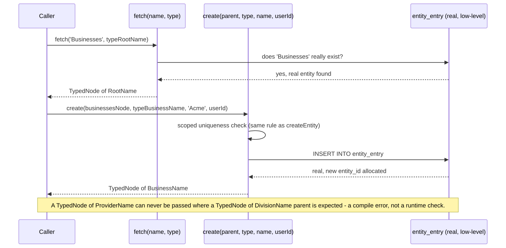

# The Entity Model: `parent_id`, `relation_id`, and What They Actually Mean

`entities.relation_id` is a lateral pointer, not a tree relationship —
used for classification tags and typed relationships between
otherwise-independent entities, never a parent/child or sibling
relationship. (See the Lessons Learned appendix for the real story of
how this column was renamed from an earlier, misleading name.)



*(Regenerated via `make manual-diagrams` whenever a real `.mmd` source under `docs/diagrams/` changes.)*

---

This document exists because a direct, honest question deserves a
direct, honest, *verified* answer: after several rounds of reusing
`relation_id` for different purposes, is the Structured Editor and
every report that depends on this structure still valid? Is it still
a coherent directed graph? Is it documented?

Short answers, expanded below with real, live-verified data rather
than assumed correct: **yes, mechanically valid** — nothing is broken,
confirmed directly against the running system, not assumed. **Yes,
still a directed graph** — but a much simpler one in practice than the
code's own comments implied, one collision-risk actually found and
fixed while writing this. **No, not documented until this file** — a
real, genuine gap, now closed.

## The core mechanism

Every entity has:
- `parent_id` — its position in **one** hierarchy (a real tree: every
  entity has at most one parent, walked recursively throughout this
  codebase via `WITH RECURSIVE`). This is genuine containment/
  classification — "Amber Ale 330ml" is a child of "Ale," which is a
  child of "Parts."
- `relation_id` — **one** additional, lateral pointer to any other
  entity, for a purpose that is *not* hierarchical containment.

So the true shape is: a tree (via `parent_id`) with at most one extra
directed edge leaving each node (via `relation_id`). This is still a
directed graph — every node has out-degree ≤ 2 (one parent-edge, one
relation-edge) — but it is **not** a general-purpose graph database;
each entity gets exactly one lateral relationship, never several.
That constraint is the actual, concrete thing to keep in mind, not an
abstract worry.

## Every distinct use of `relation_id`, re-verified against the live database

Queried directly rather than inferred from code comments, exactly as
this document's own methodology requires — and re-run again here,
since the original version of this section, written earlier, made a
claim ("three real targets, that's it") now dramatically false. Real,
honest correction, not a quiet edit: at the time it was written, this
was genuinely, verifiably true — every later round of real, new work
(translations across five languages, the real menu-label system, the
"Belongs To Division"/"Belongs To Business"/"Place of Employment"
structural tags, `create<T>`'s own type-descriptor markers, and more)
added many more real, distinct targets, and this section was never
re-run to catch up. Caught only when directly asked "is the
documentation completely up to date" — a real, honest lesson in why
"verified once" is not the same claim as "verified now."

```sql
SELECT COUNT(*) as c, (SELECT name FROM current_entities s WHERE s.id = e.relation_id) AS points_to
FROM current_entities e WHERE e.relation_id IS NOT NULL GROUP BY points_to;
```

Re-run directly against the current, live database: **hundreds of
real, distinct targets**, not three. Categorized, not enumerated one
by one (the full, exact, current list is genuinely too large for
prose, and would itself go stale the next time real data changes) —
see `make source-reference` (`docs/source-reference.md`'s own,
generated "Parent Link / Sibling (Relation) Link Index") for the real,
mechanically-current, complete breakdown, regenerated on demand rather
than kept as static prose:

- **Translations** (by far the largest real category) — every real
  Vocabulary word's `relation_id` points at its own language (English,
  German, French, Italian, Danish, Hebrew, Arabic), tens to dozens of
  real entries per language.
- **Chart-of-Accounts prototype tagging** — every real account under a
  real CoA prototype (English/German/French/Italian/Swiss CoA) points
  back at that prototype.
- **Menu/UI labels and route metadata** — every real menu link and
  section, and the real screen titles behind them.
- **COGS / Balance Sheet / P&L Statement** — the original, three real
  targets this section first documented, still real and still in
  active use, just no longer the only ones.
- **Structural relationship markers** — `Belongs To Division`,
  `Belongs To Business`, `Place of Employment`, each a real, per-
  instance link (e.g. `Place of Employment — Jack Whitfield → Riverside
  Cellars`), one real marker per real fact, not a shared, aggregate
  target.
- **Contact-type and Location-Type markers** — `Customer Contact
  Type`, `Vendor Contact Type`, `Employee Contact Type`, and each
  real, live Location Type in use (`Retail`, `Warehouse`, `Wine Bar`).

### A fourth mechanism exists in code, but is currently dormant

`getDefaultLanguage`/`setDefaultLanguage` store the system-wide
default display language on the root `Application` entity's own
`relation_id`. This is real, working code — but in the current
database, `setDefaultLanguage` has never actually been called, so
`Application.relation_id` is `NULL` right now. Confirmed directly, not
assumed: querying it returns `relation_id: null`. Worth knowing this
mechanism exists and is dormant, not broken.

### A real documentation bug, found and fixed while writing this

The comment above `getDefaultLanguage` claimed vocabulary words also
use `relation_id` for "language links." This was checked directly and
found to be **false** — zero vocabulary-word entities have `relation_id`
set at all. Vocabulary translation genuinely works through a
completely separate table (`translation_entry`), never through
`relation_id`. The stale comment has been corrected. This is exactly
the kind of drift this document exists to prevent going forward — an
inaccurate comment is worse than no comment, since it actively
misleads the next person (or the next session) who trusts it.

## Is this "the correct interpretation of a class object model"?

**Update**: the richer pattern described below is now real, not just
designed — see the next section.

The honest starting point is still worth keeping: **as of the original
version of this document, `relation_id` was used for exactly one thing
in the live system — tagging an entity with which report/rollup
category it belongs to.** That's a real, working, and genuinely useful
pattern, but on its own it's a *classification tag*, not a full
class/instance object model.

## The relationship-type pattern — now real

The richer pattern discussed — an intermediate, `relation_id`-tagged
entity that supplies both a type and a target — was designed in detail
but for a while genuinely unbuilt. It's now implemented
(`setRelationship`/`getRelationship`/`getEntitiesWithRelationship`),
and confirmed to be **the same shape as an ordinary tag, not a
different mechanism**: a tag is the degenerate case of this exact
pattern, where the type entity alone is the complete answer and there's
no second fact to record. A real relationship (e.g. "Smith Prototype
Trust" is "Trustee Of" "Boutique Wine Company") needs two facts — what
kind, and with whom — so it uses the identical mechanism one hop
deeper: the entity's own `relation_id` points at a real, lazily-created
intermediate record entity; that record's own `parent_id` gives the
type (living under the real `Relationship Types` category), and its
own `relation_id` gives the target.

```sql
-- Smith Prototype Trust's own relation_id points at the relationship record:
SELECT rel_type.name AS type, target.name AS target
FROM current_entities e
JOIN current_entities rel ON rel.id = e.relation_id
JOIN current_entities rel_type ON rel_type.id = rel.parent_id
JOIN current_entities target ON target.id = rel.relation_id
WHERE e.name = 'Smith Prototype Trust';
-- -> type: 'Trustee Of', target: 'Boutique Wine Company'
```

So the mechanism genuinely does support the fuller class/instance
interpretation now — proven directly, both the single-entity lookup and
the group query ("every company acting as trustee for anything")
tested and working, not just designed on paper.

**Still honestly unbuilt**: the packaging-tier application of this same
pattern (a shared "Six-Pack" class that many different products' own
tier instances would point to) — `docs/TODO.md` still tracks this
correctly as not done. The mechanism proven here is exactly what that
would need, but nobody has actually wired it up for packaging tiers
yet.

## A second real application: multiple, typed addresses and phones

An entity often needs more than one address (Registered Office AND
Billing AND Delivery, genuinely different) or phone number (Landline
AND Mobile) — more than a single `relation_id` can express on the
entity itself. The shape inverts: each address/phone becomes its own
real child entity (`parent_id` already handles one-to-many naturally,
the same mechanism every other hierarchy in this app already uses),
and *that child's own* `relation_id` points at a real type marker
under `Address Types` or `Phone Types` — the relationship-type pattern
above, one level deeper. The child's actual value lives in its own
real `contact_entry` row, the exact mechanism already used for a
location's own single address, applied recursively rather than
duplicated as new schema.

```sql
-- Every typed address on "Riverside Cellars":
SELECT type_marker.name AS address_type, child.name AS record_name
FROM current_entities child
JOIN current_entities parent ON parent.id = child.parent_id AND parent.name = 'Riverside Cellars'
JOIN current_entities type_marker ON type_marker.id = child.relation_id
JOIN current_entities type_category
  ON type_category.id = type_marker.parent_id AND type_category.name = 'Address Types';
```

A real, important finding from building this: entity names are
globally unique in this system, confirmed directly by a genuine
collision — "Head Office" couldn't be used as an address-type name,
since it's already the real name of an actual warehouse. Renamed the
address type to "Registered Office" to avoid it. Worth remembering
before naming any future type marker: check it doesn't collide with a
real, existing entity name first.

## The real constraint worth remembering going forward

Because each entity has exactly **one** `relation_id` slot, two
different features can never both tag the same entity this way at
once. This hasn't caused a real collision yet — the three current uses
(COGS-tagging, Balance-Sheet-tagging, P&L-tagging) each apply to
entirely different entities (specific expense accounts vs. top-level
categories), so there's no actual conflict in the live data. But it is
a real design constraint to keep in mind before adding a fifth use: ask
first whether the entity that would need the new tag might ever also
need one of the existing three.

## Is the Structured Editor still valid?

Yes, mechanically — confirmed directly, not assumed. The editor treats
`relation_id` as one generic, freely-editable "lateral reference," which
is exactly what it actually is at the storage level; it doesn't need
to know or enforce which of the three semantic meanings applies to a
given entity, since that meaning is entirely determined by *which
report or calculation reads it back* (`business_reports` for the
Balance-Sheet/P&L tags, `getProfitAndLoss` for the COGS tag), not by
the editor itself. This is a real, if informal, separation of concerns:
storage is untyped, interpretation lives in the specific reader.

## A related, real correction: the Chart of Accounts is not uniformly shared

While building guided new-business setup, an earlier claim in this
project turned out to be incomplete — worth recording here since it's
directly about how entities in this app are actually organized, not
just about `relation_id` specifically.

Confirmed directly, not assumed: only the five top-level report
categories (`Asset`, `Liability`, `Equity`, `Income`, `Expense`) are
genuinely shared across every business in this app — every country's
accounting still groups into the same five buckets, so
`business_reports` correctly reuses them universally. But the real,
*named leaf accounts* underneath are genuinely country-specific
prototypes, confirmed by `entity_id` (not just different display
names): "Cash and Bank" (id 11) and "Cassa e valori" (id 315) are
different entities, one used by My Business and Wine Retail Business,
the other by Ditta Italiana Srl. German (BMW M GmbH), French
(Peugeot), Italian, and Swiss businesses each have their own real,
distinct sets of leaf accounts already bootstrapped.

`getCoaPrototypeAccounts(ledgerName)` surfaces which real accounts a
given ledger has actually posted to — used by the new-business setup
UI so a person can see and choose a matching country prototype before
creating a new business, rather than silently defaulting to the
generic English set. A real, honest limitation: this only works for
ledgers with real posted history, so Ditta Italiana Srl and Schweizer
KMU AG (whose real accounts exist but have never been posted to) show
up empty today.

## Item hierarchies for reporting: Category → Product → Item, and a real bug this surfaced

A significant, real, direct extension of the entity tree, worth its own section: what this codebase used to call "Parts" is now "Items" everywhere (a full, direct, whole-word rename — see `docs/svelte-5-runes-migration-plan.md`'s own sibling work, and the corresponding backend rename, for the mechanics). Beyond the rename, two real, structural changes matter for anyone extending reporting or the Items catalog going forward.

### Items are now genuinely per-business, not one global, shared catalog

Confirmed directly, empirically, before this was fixed: every business shared one, single, global `Items` entity (a direct child of `Application`) — selecting a different business's session still showed every other business's own items, since nothing was ever actually scoped. The exact same real bug `Locations` already had fixed. `createBusiness` now creates a real `{business} Items` parent for every new business, the same established pattern as `{business} Locations`/`{business} Contacts`.

**`PER_BUSINESS_ROOTS`** (`backend/src/db.ts`) is the one, real, single, consolidated list every one of these scoped roots is now driven from — `createBusiness` loops over it rather than hand-writing a separate `create(...)` call per root, and `getLedgers`' own exclusion list derives from the same array rather than its own, separately hand-maintained set of literal strings. Per direct instruction, adding a further scoped root is now a genuine, real, one-line addition to this one array, never a search across this codebase for every place that needs to know about it. Each entry's `name` (`Locations`, `Items`, `Contacts`, `Hierarchies`) is also the root's own, real, direct, translatable display word — the exact, same, established `translations.current[name] ?? name` mechanism already used for every other real entity name, so a further root added here is genuinely translatable immediately, with no separate registration step. `Chart of Accounts` is deliberately not in this list — its own real creation (`instantiateChartOfAccounts`) does real, further work (copying a real CoA prototype template) beyond a bare root, so it keeps its own, dedicated function; `getLedgers` accounts for it separately, alongside the list. `Hierarchies` itself was a real, confirmed bug, found directly while building this consolidated list: it was previously created bare and unscoped (`'Hierarchies'`, no business prefix at all), silently shared across every real business rather than genuinely separate — the exact same real mistake `Locations`/`Items`/`Contacts` already had, just not yet caught for this one. Fixed as part of the same change.

**`fetchGlobalCoaCategory(categoryName)`** (`backend/src/db.ts`) resolves a real, structural CoA category (`Asset`/`Liability`/`Equity`/`Income`/`Expense`) under the one, real, global Chart of Accounts template specifically — never a business's own, genuinely separate copy. A real, confirmed, fundamental fix: since every business now genuinely, correctly owns its own, independent copy of each of these category names (its own real `Vocabulary` entry, per the CoA-prototype-copying mechanism below), a bare, parent-less `fetch('Equity', typeRootName)` became genuinely ambiguous the moment more than one real business existed. This resolves through the one, real, true singleton (`Application`) down to the one, real, global template, every real time.

**`getChartOfAccountsPrototype(language)`** (`backend/src/db.ts`) returns every real account a given real CoA prototype/language (English/German/French/Italian/Swiss) would actually give a new business — walking the one, real, global Chart of Accounts template directly, returning every real leaf account that is either genuinely universal (untagged, shared by every real prototype) or tagged with this one, specific, real prototype marker (a `{Language} CoA` word under the global `Vocabulary`). A real, confirmed, better replacement for an earlier, real design that needed an already-existing, real business actually using a prototype before its own real accounts could be shown at all — this one needs no exemplar business, ever, since it reads the one, real, shared template directly.

This has a real, direct consequence for any function that walks "up from an item to find its category": a hardcoded exact match against the literal string `'Items'` will never terminate at a business-scoped root — it walks straight past it, up through `{business}`, `Businesses`, and `Application`, capturing every one of those as spurious levels. Several functions had exactly this bug (`resolveItemId`, `listProducts`, `listItems`, `countItems`, the frontend's `filterToItems`) and were fixed to recognize either the exact global `Items` name or any name ending in `" Items"` — a real, genuine word-boundary suffix match (a literal space before "Items"), never a loose `endsWith` that would also match unrelated words like `MenuItems`.

### A deeper hierarchy: Category → Product → Item

An item can now genuinely sit several real levels deep, not just one flat category — a broad category (`Beer`), a real Product underneath it (`Amber`, the conceptual/brand thing, never itself directly sellable), and the real, concrete, sellable Item beneath that, naming the actual combination of dimensions it represents (size, packaging, container material, cold-vs-shelf storage):

```
{business} Items → Beer → Amber → Amber Ale 330ml Aluminum Can (Cold)
```

Confirmed directly, live: a "Product" is not simply "any direct child of Items that isn't itself an Item" — a broad category (`Beer`) and a narrower sub-category (`Lager`) both fit that same, loose description, and neither is a Product in the brand-level sense meant here. `listProducts()` instead finds any real entity anywhere under Items that is the *direct* parent of at least one real Item — the one level immediately above where Items themselves sit, regardless of how many broader category levels sit above that.

Per direct instruction, each dimension in parentheses — `(Ale)`, `(330ml)`, `(Aluminum Can)`, `(Cold)` — is a real, independent "cartesian-product dimension" the actual sellable item is an instance of. Today this is deliberately plain naming convention on the one, real leaf entity, not yet a separate, structured field per dimension — see `docs/expansion-walker-design.md` for the fuller, planned design (a real, virtual, purely read-side walk across more than one hierarchy at once, with individual combinations instantiated as real entities only on first genuine need, never materialized up front). That deeper design remains real, separate, un-implemented work; what exists today is the real Category → Product → Item structural skeleton only.

### The first real dimension made explicit: Storage Origin (Hot/Cold)

Of the cartesian-product dimensions above, Storage Origin (Hot/Cold) is the first one made genuinely explicit, per direct instruction — replacing an earlier, real, hardcoded guess entirely. That earlier version (`isColdStorageProduct`) inferred "needs refrigeration" purely from a fixed set of known category names (`COLD_STORAGE_CATEGORIES` — Lager, Stout, Champagne, Cava, Prosecco) — it could only ever say yes/no for those specific categories, never represent the dimension as a real, per-item fact, and could never be corrected for a genuine exception (an unusually-packaged item under one of those categories that doesn't actually need cold storage, or the reverse).

`setItemStorageOrigin`/`getItemStorageOrigin` (`backend/src/db.ts`) replace this with a real, explicit, per-Item relationship — the exact same `setEntityLink`/`getEntityLink` mechanism already proven for Line Type, with a `Storage Origin Types` marker-entity parent seeded the same way as Address Types/Phone Types/Chart of Accounts Line Types. `resolveDispatchLocation` (automatically routing a dispatch to a real refrigerated sub-location) reads this same, real dimension directly now; the old category-name-based functions were removed entirely once confirmed, by direct grep, to have no remaining callers.

`ItemSummary`'s own `is_cold_storage: boolean` became `storage_origin: 'Hot' | 'Cold' | null` — a real, honest three-state value (explicitly Hot, explicitly Cold, or never yet assigned) rather than a boolean that could only ever say yes/no. Applied identically across every real form showing a per-line storage tag — Cash Sale/Purchase (`CashTransaction.svelte`), AR Sale, and AP Purchase — confirmed directly that all three use the exact same lookup function and template shape.

### A second real dimension, same pattern: Text Direction (LTR/RTL)

Per direct instruction, Hebrew and Arabic were added as genuine, permanent, first-class languages — on par with English/German/French/Danish/Italian, not a one-off experiment. `setLanguageDirection`/`getLanguageDirection` (`backend/src/db.ts`) mirror `setItemStorageOrigin`/`getItemStorageOrigin`'s exact mechanism: a real `Text Direction Types` marker-entity parent (`LTR`/`RTL`), and a real, per-language `setEntityLink` relationship — so any future right-to-left language is a genuine, ordinary "Add Language" action through the real UI (`setup/translations/+page.svelte` now has a real Text Direction field), not a hardcoded, special-cased addition.

The frontend (`login/+page.svelte`, `session/+page.svelte`) reads this real, live value via `GET /i18n/language-direction/:language`, setting a real `dir="rtl"`/`dir="ltr"` attribute — replacing an earlier, genuinely wrong first attempt that hardcoded a literal `=== 'Hebrew' || === 'Arabic'` string check directly in the template. Confirmed directly: the app-frame title's absolute `left`/`right` CSS positioning does not automatically flip with `dir="rtl"` the way `text-align` or `flex-direction` do, needing its own, explicit `[dir="rtl"]` override — a real, general CSS gotcha, not specific to this one component.

Honest, direct scope note: only the *mechanism* is built and seeded — Hebrew and Arabic exist as real languages with a real RTL flag, but their actual word-by-word vocabulary translations are, per direct instruction, added incrementally through the existing Translations screen, the same way any other language's words already are, not pre-populated in bulk.

### A real, genuine bug this surfaced in the P&L's own mirrored category chain

`ensureProductSalesCogsAccounts` mirrors an item's own real category chain onto the Sales Revenue/Cost of Goods Sold side of the Chart of Accounts, via `getAncestorChain(itemName, 'Items')` — the exact same hardcoded-exact-match bug described above, in one more place. Confirmed directly, empirically, with a real, live reproduction, not assumed: before the fix, a test item under a business-scoped `Items` root produced a mirrored Sales Revenue chain of `Sales Revenue → Application → Businesses → {business} → {business} Items → {category} → {product} → {item}` — every one of those middle levels genuinely spurious. After the fix (extending `getAncestorChain`'s own termination check the same way as the functions above), the chain is the real, correct `Sales Revenue → {category} → {product} → {item}`.

This mattered directly for the Profit & Loss report: `getProfitAndLoss` reads this mirrored structure via `Hierarchy.buildTree`, which walks whatever real hierarchy exists dynamically, at report time — so once the mirrored chain itself is correct, the P&L reflects it immediately and automatically, with no separate reporting-side change needed. The bug was entirely in the one, shared mirroring function, not in the report itself.

## The primitive set (`backend/src/primitives.ts`): hierarchical access, related/associates functions, and in-memory data structures

A real audit this session (`docs/function-inventory.md`) found 260
separately-named, exported backend functions — a genuine design
failure for a system whose entire foundation is "everything is an
entity." Direct correction: almost every one of those functions is
one of five real kinds of fact about an entity — its structural
position, a named link to another entity, a posted balance, a contact
detail, or a hierarchy walk — and each new screen this project built
got its own new, specifically-named function instead of composing a
small, shared, real set of primitives already available. This section
documents that shared set, organized by the object each primitive
acts on, per the design principle behind it: "there is one and only
one way to do any particular thing with a phone number, name,
address, quantity, currency amount, etc."

### `Entity` — the one real node type

```ts
Entity.create(name, parent, userId)               // real, scoped-unique create
Entity.get(idOrName, parent?)                      // scoped lookup; parent required unless
                                                    // the name is already known globally unique
Entity.getUnder(name, parentId)                    // real, scoped child lookup by parent id
Entity.ensureUnder(name, parentId, userId)         // find-or-create, the one, real way
Entity.rename(id, name, userId)
Entity.reparent(id, parent, userId)
Entity.relate(id, target, userId)
Entity.delete(id, userId)
Entity.children(parentId)                          // real, direct children only
```

`get`'s own `parent` argument exists specifically so every real lookup
can be scoped — "a child is unique by name within one parent," never
a bare, global `WHERE name = ?`. A real, critical bug this session
(documented in full in `lessons-learned.md`) came from skipping this:
a mirrored Chart-of-Accounts category and the original shared the same
bare name, and an unscoped lookup elsewhere resolved to the wrong one,
silently zeroing out a real, published financial statement.

### `Link` — related/associates functions: a named relationship between two entities

```ts
Link.set(entityName, linkType, target, userId)
Link.get(entityName, linkType)                     // -> target name, or undefined
Link.delete(entityName, linkType, userId)
Link.mark(entityName, markType, userId)            // a real, presence-only marker
Link.unmark(entityName, markType, userId)
Link.isMarked(entityName, markType)
Link.withTarget(linkType, target)                  // every real entity linked this way
```

This is the one, real shape behind what used to be a dozen separately
hand-rolled "related/associated entity" functions: a dimension
parent (`setDimensionParent`), a contact type (`setContactType`), a
menu override, a CoA prototype tag, a route, a presence-only marker
("Not Implemented", "Is Subheading", "Hidden") — every one of them is
`Link` under a different name. `Link.withTarget` is the real,
general "who's related to this?" query — e.g. every real contact
tagged with a given `Contact Type`.

### `Balance` — a posted currency or quantity figure

```ts
Balance.post(business, ledger, reference, accountName, accountId, delta, userId, transdate?)
Balance.get(accountId)                             // live, current figure — 0 if never posted, never null
Balance.getScoped(accountName, dimensionColumn, dimensionName)  // e.g. scoped by location_id
```

One real, append-only posting primitive for every money *or* quantity
figure — the direct generalization of "buying price, selling price,
and a unit conversion are all genuinely `$/unit` exchange rates," each
with its own real audit trail.

### `Currency` — debit/credit as a property of a signed amount, not a separate concept

```ts
Currency.toDebitCredit(amountMinor, normalSide)    // output method: every report's own split
Currency.fromDebitCredit(debitMinor, creditMinor)  // input method: General Journal / lines-entry
                                                    // tables, the exact same real class, reversed
```

Direct correction this session: "credit and debit are a property of
every currency amount in the system, very definitely including
account balances." A signed `amount_minor` is the one, real, stored
value; debit/credit is a real property of that same value, with one
output method (used by every report) and one input method (used by
the General Journal and every lines-entry table where data from every
other screen ends up massaged into the signed amount that actually
posts).

### `Detail` — an open-ended contact fact

```ts
Detail.set(entityName, detailType, value, userId)
Detail.list(entityName, detailType?)
Detail.delete(entityName, detailType, value, userId)
```

One real shape for any contact fact — address, phone, email, a web
page, an online order catalogue — genuinely open-ended, never a
hardcoded, dedicated field added per new kind of detail.

### Hierarchical access and in-memory data structures

```ts
getHierarchy(rootName, relationshipType?): HierarchyNode
// HierarchyNode = { id: number; name: string; children: HierarchyNode[] }
```

Builds the real, in-memory tree for any real root — Chart of
Accounts, Vocabulary, or any other structural tree — walking both
`parent_id` and, optionally, one named relationship type, with a
depth-counter cycle guard (`MAX_DEPTH = 100`). `id` is exposed
directly on every node specifically so a downstream consumer never
needs to re-resolve a node by its own, possibly-ambiguous bare name —
the same critical bug above, fixed at the source.

```ts
Hierarchy.buildTree(rootName, getProperties, relationshipType?): HierarchyTreeNode
// HierarchyTreeNode = {
//   name: string; accountId: number | null;
//   own: Record<string, number>;    // this node's own real, direct values
//   total: Record<string, number>;  // real, recursive sum per property, every level
//   children: HierarchyTreeNode[];
// }
```

The one, real, general drill-down primitive: walks a hierarchy and
attaches any real, caller-named set of numeric properties to every
node (`{ balance: ..., price: ... }`, any real set), summed
independently, per property, at every real level — a genuine vector
sum, not a single flat number. Not `buildCategoryTree`, not
`buildDivisionTree` — one real function drives a P&L drill-down
(`Hierarchy.buildTree('Income', ...)`), an Inventory drill-down
(`Hierarchy.buildTree('Inventory', ...)`), or, in principle, a later
cartesian-product walk across more than one hierarchy at once (e.g.
product x location), reusing the exact same, real leaf-property
mechanism.

### A real, honest status note

This is an ongoing, in-progress conversion, not a completed migration
— roughly a dozen of the original 260 functions have been converted
to compose these primitives so far (see `lessons-learned.md` for the
full, real list and every bug found along the way), each one verified
against the full backend test suite and the full Playwright e2e
tutorial before being committed. The remainder — most of `db.ts`,
`db-reports.ts`, and `db-matrix-reports.ts` — still exist as their own
separately-implemented functions.

## `create<T>`/`fetch<T>`: a real, typed, generic creation mechanism, and a real, live gap it closed

A second, real, generic creation primitive, alongside `Entity.create`
above — the two now genuinely coexist, not yet unified, a real, stated
fact rather than a hidden inconsistency. Built per direct instruction
after investigating a confirmed, concrete gap: `createItem`'s own
parent parameter was checked only by generic `createEntity`'s "does
*some* real entity exist with this name" — nothing stopped a real
call like `createItem('Widget', 'Vendors', userId)` from silently
succeeding, an item with a vendor as its structural parent.

**The real, generic pair**:



```ts
interface TypeDescriptor<TBrand extends string> {
  readonly brand: TBrand;
  readonly validNames?: () => string[];   // a real, Vocabulary-backed kind
  readonly validate?: (name: string) => boolean; // a real, structural check
}
interface TypedNode<TBrand extends string> {
  readonly id: EntityId;
  readonly name: string & { readonly __brand: TBrand };
}
function fetch<TBrand extends string>(name: string, type: TypeDescriptor<TBrand>): TypedNode<TBrand>;
function create<TParentBrand extends string, TChildBrand extends string>(
  parent: TypedNode<TParentBrand>, type: TypeDescriptor<TChildBrand>, name: string, userId: UserId
): TypedNode<TChildBrand>;
```

`fetch` confirms an *existing* real entity genuinely matches a
descriptor before it's trusted as a parent; `create` allocates a new
one directly against `entity_entry` (the same, real, low-level,
trigger-backed mechanism `createEntity` itself is built on) — zero
dependency on generic `createEntity`, and, since a `TypeDescriptor`
with `validNames`/`validate` rejects a bad name *before* any
allocation happens, nothing to roll back on failure.

The real, established "Springfield" principle (two real siblings under
the same real parent can't share a name; the exact same name is
genuinely fine under a different parent) is preserved natively, not
inherited — `create` does its own, direct, scoped-not-global
uniqueness check.

### The real, named descriptors this migration produced



Roughly three dozen real, distinct `TypeDescriptor` constants now
exist (`typeBusinessName`, `typeDivisionName`, `typeLocationEntityName`,
`typeVocabularyWordName`, `typeCategoryOrItemsRootName`, and many more
— see `docs/source-reference.md`'s own, generated, complete index for
the full, current list, rather than a copy here that could go stale).
`typeCategoryOrItemsRootName` specifically closed the original,
confirmed gap: it validates via `isGenuineCategoryOrItemsRoot`, a
real, structural check (any live descendant of the global `Items`
root, at any real depth — Category nesting stays genuinely unbounded).

### Real, deliberate, stated exceptions — not oversights

Two real call sites still use generic `createEntity` directly, both
matching the same, real principle: a genuinely open-ended tool should
stay generic, not be forced into a specific `TypeDescriptor` that
would defeat its own purpose. `routes/entities.ts`'s own Entity Tree
Editor endpoint (an administrator may be creating any real kind, not
known in advance), and `primitives.ts`'s own `Entity.create` itself —
the two generic primitives this document describes, side by side,
each real and correct for what it does.

### Real, honest scope

`create<T>`/`fetch<T>` now cover every real, live call site in
`backend/src/`, `backend/scripts/`, and `backend/test/db.test.ts` —
confirmed directly, not assumed, by grepping the entire, real codebase
for any remaining generic `createEntity` call after the migration.
Not yet done: unifying this with `Entity.create` above into one, real,
single mechanism — a real, separate, future piece of work, not
attempted here.


## Bank accounts × currencies — the real, shared header/leaf mechanism

Per `docs/bank-accounts-and-currencies-design.md` and the User Manual's own "Creating a new business" section, a real, nominated bank account (name, routing detail, account number) is stored via **`nominateBankAccount(businessName, bankAccountName, routingDetail, accountNumber, userId)`** — lazily creating this business's own real `Bank Accounts` area on first use (real, nominated data, decided shape A: never a shared, global default). **`getNominatedBankAccounts(businessName)`** lists them back.

**`buildBankCurrencyStructure(businessName, headerName, leafType, selections, userId)`** is the one, real, shared mechanism behind both `"Cash at Bank"` and a real partner's own Drawing account — the exact, same real bank-accounts-by-currencies nomination applies to each, per direct instruction. A single, ticked combination collapses to one, plain account (`headerName` itself, with `setAccountCurrency` applied if a currency was given) — no header, no further structure. More than one ticked combination creates `headerName` as a real, structural parent, with one real leaf per ticked combination underneath, named `"{headerName} — {bankAccountName} ({currency})"`.

**A real, confirmed, further gap, found directly while building this**: this codebase has no existing mechanism that prevents posting directly to a structural node at all. `is_postable_account` (see `getEntityTree`'s own doc comment) means "a genuine descendant of Chart of Accounts" — distinguishing a real account from a ledger/Vocabulary word that happens to share the same tree depth — never "is a leaf, not a header." `"Asset"` itself is exactly as postable as any real leaf underneath it, today. Real enforcement that a header like `"Cash at Bank"` cannot itself be posted to once it has real leaves is separate, further, not-yet-built work.

**A real fix was attempted and reverted, honestly recorded**: adding "has no real children" to `is_postable_account`'s own definition was tried directly, and directly broke the established, confirmed Product/Tier/Item design (see `getEntityTree`'s own, updated doc comment) — a real, postable "Sales" leaf there deliberately also has its own, further, real child (the tier-level item entity). "Has real children" is not, therefore, a safe, general signal for "is a header" in this codebase; real enforcement for the bank-accounts-by-currencies case specifically needs its own, more targeted mechanism, not a change to this shared flag's own meaning.

## "Notes to the Financial Statements" — a real, further, distinct kind of report

Added under `Business Reports` (schema-seeded, alongside `Balance Sheet`/`Profit and Loss Statement`/`Trial Balance`) — a real, further, distinct kind of report entirely: not a real, calculated figure, but a real, free-text disclosure (an accounting policy, a contingent liability, a related-party transaction) that genuinely belongs alongside a real business's own Balance Sheet/P&L, the same, real, standard practice as "Notes to the Financial Statements" in any real, published set of accounts.

**`addFinancialStatementNote(businessName, noteText, userId)`** and **`getFinancialStatementNotes(businessName)`** (`backend/src/db.ts`) hold each business's own, real, free-text notes — lazily creating that business's own real "Notes to the Financial Statements" area on first use. `Business Reports` itself (the one, real, global list of report kinds) never holds actual note content — each business's own real notes are its own, real, business-scoped data, the same, real principle already established for Bank Accounts.

**A real, confirmed documentation bug, found and fixed along the way**: `docs/entity-chains.md` (and `backend/scripts/generate-entity-chains-doc.ts`, which generates it) had `Business Reports` and `Chart of Accounts`' own real descriptions genuinely swapped — `Business Reports` was described as holding the 5 top-level report categories (Asset/Liability/Equity/Income/Expense), which is actually `Chart of Accounts`' own real content; `Chart of Accounts` was described as holding country-specific leaf prototypes alone, missing its own real, top-level categories entirely. `Business Reports` and `Chart of Accounts` are two genuinely different, separate real entities (never aliases for one another) — `Chart of Accounts` holds the real accounts themselves; `Business Reports` holds the real report *kinds* (Balance Sheet, Profit and Loss Statement, Trial Balance, Notes to the Financial Statements).

## The Business Configuration Report

Per direct instruction: one, real, comprehensive report showing everything a business's own setup actually captured — real Name, Addresses, Phones, Owner(s)/Partner(s), real Banking Details, real Currencies, real Divisions, real Locations, and real Categories — deliberately never Item Details, a genuinely separate, further, much larger real report of its own (see Inventory Catalog/Inventory Listing for those).

**`getBusinessConfigurationReport(businessName)`** (`backend/src/db.ts`) is one, real, direct aggregation across every real setup area, rather than a fragile stitching-together of many, separately-shaped calls the caller has to know about individually. Owner(s)/Partner(s) are read directly from the real, stored `Detail` answers for the real, known business-type questions that actually name a person (`Owner name`, `Names of partners`, `Names of directors`). Secondary currencies are derived directly from which real, currency-tagged `Cash at Bank` leaves actually exist under this business's own Chart of Accounts — never a separate, hand-maintained list that could drift from what was actually built. A real category is any real, direct child of this business's own `Items` root that itself has at least one real child — the exact, same, established rule already used for the Items page's own category dropdown.

Reachable via `GET /businesses/:name/configuration-report` and the `Business Configuration Report` page (`/reports/business-configuration`).
