# Core Domain Reference

Current-state reference for the domain concepts that sit on top of
the entity model (previous chapter): sessions, scoped uniqueness,
money, identity resolution, translation, contacts, and hierarchies/
multi-dimensional reporting.

## Session-scoped business context

After login, or once a new business is set up, the session has a
current business and user. The HTTP layer reads them; the frontend
does not send them with every call.

`backend/src/session-context.ts` holds this context in
`AsyncLocalStorage`, so concurrent requests never see each other's
business. `runInSessionContext(context, fn)` runs `fn` inside a
context (the HTTP middleware for a request, a test or script for its
own run). Inside it, `Session.Business` (the business node,
`{ id, name }`), `Session.UserId` and `Session.Ledger` read like
properties; outside it, each throws.

`attachUser` (`auth-middleware.ts`) runs every request inside a
context. The current business is an attribute (`Business Name`) of the
session entity, set by `setSessionBusiness` and read by
`getSessionBusiness` (`auth.ts`); the `setSessionBusiness` dispatch
entry (`call-dispatch/auth.ts`) is how a person's choice of business
reaches it. The new business applies from the next request.

**Where the session is read.** Business-taking functions in `db.ts`,
`db-journal.ts`, `db-reports.ts` and the other domain modules take the
business as an explicit parameter, and `backend/test/db.test.ts` calls
them directly with no request or session. A dispatch entry supplies the
session's business as that argument. Three functions in `db-stock.ts`
read the session themselves:

- `setItemLocationLevelDetails` and `getInventoryListingByLocation` take
  the business (and ledger and user) as optional parameters, and fall
  back to `Session.Business`, `Session.Ledger` and `Session.UserId` when
  they are left out.
- `getStorageSpaceReport` takes no business at all and reports the
  session's business (*The Stock API*, "The Storage Space Report").

Nothing else outside `call-dispatch.ts` and `call-dispatch/*.ts` reads
the session context.

### Auth/user functions (`backend/src/auth.ts` unless noted)

Users and roles are entities under `System Users` and `System Roles`;
there is no user table (`check-schema-table-count`). A user's
`password_hash`, `active`, `page_size`, `number_format` and
`date_format` are attributes (`Entity.setAttr`). `detail_json` holds
only whole records: invoices and their lines, item sources, financial
statement notes and nominated bank accounts. Each global role a user
holds is a child of the user whose `relation_id` points at the role.

- `listUsers()` / `listRoles()` — every active user, every available role.
- `setUserRoles(userId, roleNames)` / `setUserActive(userId, active)` — admin control over roles and login. Removing a role revokes the role link (its tag child first), so the same role can be granted again later.
- `changePassword(userId, newPassword)` — admin reset, no current password required.
- `changeOwnPassword(userId, currentPassword, newPassword)` — self-service, requires the current password.
- `logout(token)` — closes one session record.
- `getSessionUser(token)` — resolves a live token to its user, `null` if missing/expired/unknown.
- `setOwnPageSize` / `setOwnNumberFormat` / `setOwnDateFormat` — personal display preferences.
- `hashPassword` / `verifyPassword` (`password.ts`, shared with self-registered customer accounts in `db.ts` to avoid a circular import) — every stored password goes through this; never stored or compared as plain text.

Tests (*Testing: Unit*, "Running the tests"):
- "password hashing: correct password verifies, wrong password is rejected" (`backend/test/auth.test.ts`)
- "two hashes of the same password are different (salted), but both verify correctly" (`backend/test/auth.test.ts`)
- "the bootstrap admin user exists with Administrator role and the documented default password" (`backend/test/auth.test.ts`)
- "login rejects a wrong password, and gives the same error for a nonexistent username (no user enumeration)" (`backend/test/auth.test.ts`)
- "a valid session token resolves to the correct user and roles; an invalid one resolves to null" (`backend/test/auth.test.ts`)
- "logout invalidates the session immediately" (`backend/test/auth.test.ts`)
- "createUser rejects a duplicate username and a too-short password" (`backend/test/auth.test.ts`)
- "a newly created user can log in with the exact role(s) assigned" (`backend/test/auth.test.ts`)
- "setUserRoles changes what a session created afterward reflects" (`backend/test/auth.test.ts`)
- "deactivating a user immediately kills their existing sessions and blocks new logins" (`backend/test/auth.test.ts`)
- "changePassword replaces the password — the old one stops working, the new one works" (`backend/test/auth.test.ts`)
- "changeOwnPassword requires proving the current password first — unlike the admin path, which does not need to" (`backend/test/auth.test.ts`)
- "setOwnPageSize: a real, user-settable preference, defaulting to 20, rejecting nonsense values" (`backend/test/auth.test.ts`)
- "setOwnNumberFormat/setOwnDateFormat: explicit, fixed-choice patterns — not locale inference — defaulting to 1 000.00 / dd/mm/yyyy, rejecting anything outside the fixed list" (`backend/test/auth.test.ts`)
- "the per-business role matrix is a real, genuine Cartesian Product — the same user can hold a different role in a different business, independent of their global role" (`backend/test/auth.test.ts`)

### Sessions

A session is a plain entity under `System Sessions`, named
`Session — {token}`, `relation_id` pointing at the user. `expires_at`
plus the session's own current `business_name`/`profit_center_name`
are three independent `Entity.setAttr`/`getAttr` facts, not a
`detail_json` blob — each settable on its own, with no read-modify-
write needed. A cleared Profit Center is represented by the empty
string (a real Profit Center name is never empty), since a value-entity
can be renamed to a new value but never to "no value." `login(username,
password)` creates the session entity and returns the token;
`logout(token)` clears its relation (`Entity.relate(id, null, ...)`),
not a delete. `getSessionUser(token)` also transparently expires a
session whose `expires_at` has passed.

`setSessionBusiness(token, businessName)` / `getSessionBusiness` set
and read the session's current business; the change applies from the
next request. `setSessionProfitCenter`/`getSessionProfitCenter` do the
same for the Profit Center. Neither checks whether the person may use
the business or Profit Center they pick.

### Access control: roles, Business Admin, and the per-business matrix

**Global roles** (`Administrator`, `Accountant`, `Bookkeeper`, and
similar) are set via `setUserRoles` above and checked by
`requireRole(...roles)` (`auth-middleware.ts`) — unchanged, original
behavior. Administrator is never implicitly included in every check —
a route meaning "Bookkeeper or Administrator" names both explicitly,
since an Administrator-only route (user management) must not become
reachable by a Bookkeeper just because Administrator ranks "higher."

**Business Admin** is a role held per business, never globally. Each
business has a User × Role matrix, built with the same
`defineProductShape`/`ensureProductInstance` mechanism as Container ×
Unit size and currency pairs:

- The matrix's two hierarchies, `User` and `Role`, are named once, in
  `ROLE_MATRIX_HIERARCHIES` (`db.ts`); `auth.ts` builds the matrix's
  shape from it, and `getBusinessHierarchy` leaves both out, so no
  screen or report offers them as a way to group locations.
- `getUserRoleMatrix(businessName)` — every user × every role for one
  business, and which cells are currently set.
- `setUserRoleInBusiness` / `unsetUserRoleInBusiness` — set/clear one
  cell; both idempotent. Clearing a cell sets the Product Instance's
  `combination_ids` to `NULL` (`entity_set_combination_ids`);
  `getUserRoleMatrix` lists only cells whose `combination_ids` is set.
- `userHasBusinessAdminRole(businessName, username)` — never throws: a
  business name that no longer resolves, or one with no Product root
  yet (no business-role ever assigned), both mean "no."
- `provisionBusinessAdminUser(businessName, createdBy)` — creates a
  business-prefixed admin user (`"{businessName} Admin"`) holding
  Business Admin in that one business only, generates its password,
  and returns it once, in plain text, the same show-once way the
  business-creation screen displays it — never otherwise recoverable,
  since only its hash is stored.

`requireRole`'s own fallback accepts holding Business Admin *in the
current session's business specifically* as equivalent to holding any
of the named roles — a scoped stand-in for "full access within this
one business," regardless of which specific role was named. A session
with no business selected, or a username not in that business's own
matrix, is "no" — this never widens access beyond one business. A
route that must stay out of Business Admin's reach entirely (creating
a business, managing the global user/role list) uses
`requireGlobalRole` instead, which only ever checks a user's real,
global roles.

The role name is the constant `BUSINESS_ADMIN_ROLE` (`'Business Admin'`,
`auth.ts`). `userMayActAsRole(user, roles, business)` is the one test
both `requireRole`s use: true when the user holds one of `roles`
globally, or holds Business Admin in `business`.

**Posting into a non-active ledger** (`canUserPostToLedger`, `auth.ts`)
is a related, narrower check: posting into a business's own current
active ledger is always allowed; posting into an already-rolled-over,
non-active ledger (a genuine correction/adjustment) requires
Administrator or Accountant globally, or Business Admin in that one
business. An old ledger is never locked by this: it stays postable
for corrections by those roles.

Tests (*Testing: Unit*, "Running the tests"):
- "provisionBusinessAdminUser gives a new business a real, dedicated admin user with Business Admin only in that one business, never any global role" (`backend/test/auth.test.ts`)
- "requireRole accepts a real, global role as before, and ALSO accepts Business Admin held in the session's current business — but requireGlobalRole never does" (`backend/test/auth.test.ts`)
- "Developer role, the global Employees/Manufacturers branches, and item_source all exist exactly once — the migration that restores these on an existing database is idempotent" (`backend/test/db.test.ts`)

### The HTTP middleware layer (`backend/src/auth-middleware.ts`)

`attachUser` resolves `req.user` from the bearer token but does not
itself reject the request — the login route skips it entirely; every
other route uses `requireAuth` (below), which does reject. On a
resolved user, it also resolves the session's current business/Profit
Center onto `req.businessName`/`req.profitCenter`, and runs every
downstream handler inside the session context (`runInSessionContext`)
with that user and business — a stored business name that no longer
resolves (deleted since) falls through to running with no session
context, rather than throwing. `requireAuth` simply checks `req.user`
is set and rejects with 401 if not.

## Scoped uniqueness, and the physical (product × location) recording grid

Two live siblings under the same parent can't share a name; the same
name is fine under a different parent or at a different depth: a
company, a division, a location and an employee can all be named
"Springfield" at once. The trigger `entities_name_unique`
(`backend/schema/00-core.sql`) enforces it, before every insert into
`entities`, against the current rows only (`current_entities`), so a
renamed entity's earlier row keeps its old name. A partial unique
index cannot express "current row", which is why it is a trigger.
The one exception is a language's children: two concepts may have the
same word in one language, so translations under a language may share
a name (`createEntityRaw` and the Gleam engine's `validate_write` make
the same exception; *Translations*).

Only **product** and **location** map to a real, physical, posted-to
account. Division, category, and any other business-defined Hierarchy
are purely computed reporting rollups — resolved at report time from
a lateral, optional tag (`getHierarchyParent`), never a real position
in either the Locations tree or the Items catalog tree, and never a
stored column on the journal line (`journal_line` has no `division_id`
column at all, nor any equivalent for category). A product's Sales/
COGS leaves always post flat, directly under the real "Sales Revenue"/
"Cost of Goods Sold" accounts (or under a real Profit Center
sub-account, where one applies) — a product's own category tag, if
any, never shapes real Chart-of-Accounts structure. Every product,
tiered or not, resolves to its own `{Product} — {Location}` Sales/
COGS/Inventory leaf once a location is known (`ensureItemLocationLeaf`,
`ensureItemTierLocationLeaf`).

Purchase Orders and Sales Orders carry an optional `location` field
(delivery/dispatch instructions). AR Sale, Cash Sale, AP Purchase, and
Cash Purchase each carry one location per invoice (not per line — none
of the four have genuine line-item detail beyond an optional single
item). `ensureLocationScopedAccount` generalizes the `{account} —
{location}` pattern for an account with no specific product.

The underlying mechanism (`setHierarchyParent`/`getHierarchyParent`,
see "Hierarchies," below) generalizes
to any further lateral classification with zero new structural code —
a region, a brewer, or any other lateral fact about a product or
location.

Tests (*Testing: Unit*, "Running the tests"):
- "createEntityRaw: scoped, not global, uniqueness — the exact, same real rule everywhere else in the entity tree, verified specifically for Vocabulary and its own real translations" (`backend/test/db.test.ts`)

## Money: integer minor units, never floating-point

Every monetary value is stored as an integer count of the currency's
own smallest unit (a "minor unit" — not assumed to be "cents," since
not every currency divides the same way: JPY/KRW have none, BHD/KWD
have three decimal places). Every column, function parameter, and
type uses the `*_minor` suffix throughout the backend, frontend, and
tests. `decimalPlacesFor(unitCode)` (`format.ts`) gives the correct,
per-currency scale.

`parseMinorUnits` (`frontend/src/lib/money.ts`), which turns a typed
amount into minor units, multiplies by 100 whatever the currency, so
it is right only for two-decimal currencies (`docs/TODO.md`).

## Entity identity resolution: scoped lookups, and branded types

An unscoped, bare-name lookup (`SELECT id FROM current_entities WHERE
name = ?`, no `parent_id` qualifier) cannot distinguish two real,
different entities that share a name. Two mechanisms prevent it:

**ID-alongside-name.** `journal_entry_staging` carries an optional
`account_id` column alongside `account` (the name);
`commitStagedEntry` uses the staged `account_id` when a caller gave
one, and resolves the name (`resolveStagedAccountId`) only for an
ordinary, user-typed value. `createEntity`, `resolvePostingRoot`,
`ensureItemSalesCogsAccounts`, `ensureItemTier`,
`ensureItemLocationLeaf`, `ensureItemTierLocationLeaf`,
`ensureItemInventoryAccount`, and `ensureItemLocationInventoryAccount`
all resolve and return a real id alongside the name for this reason.
`resolveItemId` is the shared way to resolve an item's entity id
specifically: it returns the id of the entity of that name whose
ancestor chain reaches `Items` (or a business's `… Items` root), and
`undefined` for any other entity of that name.

A number of bare-name lookups remain for structurally singular,
low-collision-risk anchors (`Chart of Accounts`, `Vocabulary`,
`Income`, `Expense`, `Divisions` on the backend; filtering by
`Accounts Receivable`/`Accounts Payable` on the frontend) — not fixed
structurally, since the benefit is marginal for names an ordinary
business would not independently duplicate.

**Branded (nominal) types**, system-wide, for the compile-time risk
one level up (a plain `string` can't stop a caller from passing a
ledger name where a business name belongs):

```typescript
export type BusinessName = string & { readonly __brand: 'BusinessName' };
// ...LedgerName, AccountName, DivisionName, LocationName, EmployeeName,
//    CustomerName, ProviderName, PartName, and more

export function asBusinessName(name: string): BusinessName {
  return name as BusinessName;
}
```

Every `as…Name` function is where a plain string becomes branded: a
database read or a parsed HTTP body is cast once, where it is read.
Every business, ledger, account, division, location, employee,
customer, vendor and item parameter in the backend is branded. An
item's name and its quantity account's name are often the same string
but not the same kind: `ItemName` is cast to `AccountName` where it is
staged as a posting line.

Tests (*Testing: Unit*, "Running the tests"):
- "a real business can genuinely be named "Equity" (or "Asset", "Chart of Accounts", "Hierarchies", any other real, structural word this codebase itself already uses) - per direct instruction: a business name and a real, structural CoA category/root name share no real namespace at all, so no real collision should ever be possible" (`backend/test/db.test.ts`)

## Language-neutral translation

English is a language like any other, not the source text. Each
language has one child per concept it has a word for, named the word,
whose `relation_id` points at the concept (*The Entity Model*, "What
`relation_id` is used for").

```typescript
export function setTranslation(conceptName: string, languageName: string, text: string, userId: UserId): void {
  // creates a new entity named `text` under the language, relation_id -> the concept;
  // replaces any stale prior entity under that language for that concept
}
```

`getVocabularyWords()` — read by the Translations admin screen — finds
a concept as any entity with at least one direct child translation
under any language, not merely a direct child of a `Vocabulary` node
(a word like `Balance Sheet` lives under `Business Reports`, its real
menu parent, not under `Vocabulary` directly).

Two concepts can have the same word in one language ("Setup" and
"Configuration" are both "Configuration" in French); see
`setTranslation` under "Vocabulary, translation, and localized
alternates", below.

Tests (*Testing: Unit*, "Running the tests"):
- "languages list and localized_text fallback/override work end to end" (`backend/test/db.test.ts`)
- "French works as a genuine, complete third language — no special-casing needed for a third language to work at all" (`backend/test/db.test.ts`)

## Contact field storage: 27 independent attr facts, not one JSON blob

`contact` and `contact_entry` (`00-core.sql`) are views that give
every entity with contact details (customers, vendors, employees,
locations, items, and the typed address, phone and contact-person
records) the same flat columns, read by `getContact`, `getItem`,
`signOn` and the report queries. Each of the 27 fields (`person_name`
through `item_retail_price_minor`) is its own attribute
(`Entity.setAttr`), and an entity is a contact when it carries the
`Contact` tag. `mergeContactDetail` (`db.ts`) is the one write path
(`setContact`, `setPosPin`, `setItem`, `setLocation`,
`registerCustomer`, `verifyCustomer`, `recordReminderSent`,
`resetReminderLevel`, …): it tags the entity `Contact` and, per field,
calls `Entity.setAttr` for a value or `Entity.clearAttr` for `null`.

Two consequences:

- These attribute children do not stop the entity being revoked:
  `revokeEntity` ignores the names in `FACT_ATTR_CHILD_NAMES`, so a
  revoked contact keeps its details as history.
- A typed value (a location's city) is now an entity name, so it can
  equal another entity's name; `getHierarchy` therefore resolves
  relationship children by id (`getEntitiesWithRelationship` returns
  `sourceId` and `targetId`).

Tests (*Testing: Unit*, "Running the tests"):
- "a new entity has no contact until one is set" (`backend/test/db.test.ts`)
- "setContact then getContact round-trips correctly" (`backend/test/db.test.ts`)
- "setContact is a full replace, not a partial merge — calling it again with fewer fields clears the rest" (`backend/test/db.test.ts`)

## Contact types: one contact, any combination of roles

`Contacts` (business-scoped) is the one structural home every
contact's `parent_id` points to, regardless of how many roles it
plays. A "contact type" (`Customer`, `Vendor`, `Employee`, or any
further, user-defined type — itself an extensible Vocabulary concept)
is a named relationship, not a structural parent, since a contact can
hold more than one type at once:

```typescript
export function setContactType(contactName: string, typeName: string, userId: UserId): void {
  setEntityLink(contactName, `Contact Type: ${typeName}`, typeName, userId);
}
export function getContactTypes(contactName: string): string[] { /* ... */ }
export function getContactBaseAccounts(contactName: string): string[] { /* derives from types */ }
```

Each contact type carries its own base account via the hierarchy-link
mechanism: `Customer` → `Accounts Receivable`, `Vendor` → `Accounts
Payable`, `Employee` → `Accounts Payable` also (payroll owed is a
payable obligation, not a receivable one). A contact's effective base
account(s) are derived, never stored directly.

`Contacts` is deliberately hidden structurally — a person never sees
a generic "Contacts" list or picks "Contacts" as a parent. Every
user-facing screen (Vendors, Employees, Customers) is its own filtered
view through one specific type; creating "a new vendor" means,
underneath: create the contact entity under `Contacts`, then
`setContactType(name, 'Vendor', userId)`. `createContact<TBrand>`
(`backend/src/db.ts`) is the one shared implementation behind
`createProvider`/`createCustomer`/`createEmployeeContact`, each its
own dispatch key in `call-dispatch/entities.ts` (via `POST /api/call`).

A contact's typed people, phones and addresses are child records made
by one generic mechanism (*The Entity Model*, "Entity retrieval"):
`addTypedContactPerson(entity, type, { name, phone, email })`,
`getTypedContactPersons(entity)` and `deleteTypedContactPerson(entity,
type)`; `listPhoneTypes()` lists the phone types under `Phone Types`,
and `ensurePhoneType` adds one the first time a phone of that type is
saved.

Each `addTypedAddress` call creates its own record; two contacts
never share an address or phone record.

Tests (*Testing: Unit*, "Running the tests"):
- "addTypedAddress/getTypedAddresses/addTypedPhone/getTypedPhones: multiple, genuinely typed addresses and phones per entity, zero new tables — reusing parent_id + relation_id + contact recursively" (`backend/test/db.test.ts`)
- "createProvider genuinely tags the new contact as a real Provider type, per docs/contact-types-and-translations.md" (`backend/test/db.test.ts`)
- "a real contact can genuinely hold more than one real type at once - a Provider later also registered as a Customer keeps both, per docs/contact-types-and-translations.md" (`backend/test/db.test.ts`)
- "createEmployee genuinely tags the new contact as a real Employee type, per docs/contact-types-and-translations.md - Employee correctly derives Accounts Payable as its own base account too, per the same, direct, deliberate accounting point" (`backend/test/db.test.ts`)

## Application vocabulary vs. sample business data

Two different things:

1. **Application vocabulary** — every UI label, button, column
   heading the interface displays, translated through the mechanism
   above. Lives as direct children of one `Vocabulary` entity (plus a
   small, named exception: report names under `Business Reports`,
   translated through the identical mechanism).
2. **Sample business data** — a demo business's own account names,
   product names, customer/vendor names. Wine Retail Business's
   accounts are named in English because it's a modeled Australian
   business, not because they've been translated — switching the
   interface language never changes any of these.

Vocabulary lives under `Vocabulary`; a business's data lives under
the business. A new database has the English vocabulary only
(`00-core.sql`, `db-seed.ts`). Other languages are loaded from
`shared-fixtures/translations.csv` by the step runner
(`make load-translations-api`). No business, sample or otherwise, is
seeded: the Wine Retail data is built through the application by the
tutorial fixtures and by `make demo-full-year`
(`backend/scripts/simulate-wine-retail-month.ts`).

## Hierarchies and multi-dimensional reporting

A leaf account adds up to its business along more than one path. Its
`parent_id` gives the structural one: the Chart of Accounts placement
(a product's flat Sales/COGS leaf, or a location's account). Each
further hierarchy — Division, Category, or any other the business
defines — is a computed path only: it never shapes the chart, and the
leaf's name does not encode it. Each such hierarchy is a separate,
reversible link, independent of `parent_id`:

```typescript
export function setEntityLink(entityName: string, linkType: string, targetName: string, userId: UserId): string {
  // creates "{entityName} — {linkType}" as a child of entityName, relation_id -> targetName
}
export function setHierarchyParent(entityName: string, hierarchyName: string, parentName: string, userId: UserId): void {
  setEntityLink(entityName, `Hierarchy: ${hierarchyName}`, parentName, userId);
}
// getHierarchyParent / getHierarchyChildren / getHierarchyAncestorChain /
// deleteHierarchyParent / getHierarchyLinksPointingAt complete the set.
```

The record's name includes the hierarchy name, so one entity can have
any number of hierarchy links, none of them using its `relation_id`.
The term is **hierarchy link**; **dimension** means something else:
`definitionDimensions` (a product's variant axes) and the drag-and-drop
hierarchy editor.

**A business's reporting hierarchies are its own.** They organise its
reports in a completely flexible way: different views of its locations
against its item sales and cost of goods sold (the Profit and Loss, Sales
and Margin), and of its locations against its item inventories (Stock on
Hand, Stock Movement). A hierarchy is of the items or of the locations,
and each report crosses one of each kind (*User Manual*, "Making your
reports insightful and more useful with Hierarchies").

**No hierarchy name is in the code.** A business names its own
hierarchies; "Division" and "Category" are only suggestions in the User
Manual and words in the Vocabulary. A business can have none, or
several of each kind (Region and Store Format for its locations,
Category and Bottle Size for its items). `make check-hierarchy-names`
(`scripts/check-hierarchy-names.ts`) collects every hierarchy name the
fixtures create and fails if one appears as a string literal in
`backend/src`, `frontend/src`, `tui/src`, the step runner and its
frontend API client, or the code of `application/application.entities`.
Comments, the Vocabulary seed (`db-seed.ts`) and a word shown through a
translation lookup are not code that names a hierarchy; nor is a
literal naming an entity of the application's own that a tutorial's
hierarchy happens to share a name with (the gate's `APPLICATION_NAMES`:
`Storage`, the Chart of Accounts branch of each location's storage
accounts). Once a tutorial defines its hierarchies, its steps refer to
them by name freely. The hierarchies the application defines for itself
(Department, Profit Center, Storage Tier, and the role matrix's User and
Role) record nothing in `Hierarchy Of` and are described where they are
used.

**A hierarchy records what it is of.** Each hierarchy under
`{business} › Hierarchy` has a `Hierarchy Of` relation to the business's
`Items` or `Locations` branch, set when it is created and never
changed: `ensureHierarchy(business, name, userId, of)` (`of`
is `'Items'` or `'Locations'`), the `createHierarchy` call (whose
`of` argument is required), and `inst.hierarchy(name, of)` in
the core. `hierarchyKind(hierarchyId)` reads it back (undefined for an
application hierarchy); `HIERARCHY_KINDS` lists the two kinds. An
existing hierarchy asked for with the other kind is refused. A value is added only to a hierarchy that exists
(`ensureHierarchyValue`, `inst.valueOf`).
`getBusinessHierarchy` returns `{ hierarchy, of, values }`, values
excluding the relation records (`HIERARCHY_RELATIONS`). An item is tagged only with item
hierarchies and a location only with location hierarchies (`setGroup`,
`setHierarchyTag` and `checkHierarchyTag` refuse otherwise); a value may be tagged under
another value of its own hierarchy, to nest. A hierarchy link only
classifies, so it never blocks deleting the item or location it is
on: `revokeEntity` untags it.

**Values nest to any depth, and an item or a location is in one place.**
A value of a hierarchy may hold other values of it, locations (or items)
or both, arbitrarily: a Division value "South Australia" can hold the
value "Adelaide Metro" and the location "Mount Barker" side by side, and
"Adelaide Metro" its own shops. Each value, item and location has at
most one parent in a hierarchy, because its tag (`{name} — Hierarchy:
{hierarchy}`) is one link that moving replaces; so a location is in one
place. A value is never put under itself or under a value it holds
(`checkHierarchyTag` refuses the cycle). The location hierarchy's tree
(`getHierarchyTree(business, hierarchy)`) lists every value and every
tagged location or item with its parent (`null` at the top), values
first; Business Setup and the Business Structure popup's org chart draw
it, and the Profit and Loss rolls a value up through the values it
holds (`getProfitAndLossByHierarchyTree`). The core keeps a value's
parent as a relation named after the hierarchy, the same as an item's
or a location's (`ops.setGroup`), and `ops.hierarchyTree` lists it.

**Hierarchy prototypes.** A hierarchy's tree of values, without the
business's own items or locations, can be saved as a prototype for any
business to start from, as a Chart of Accounts prototype is.
`saveHierarchyPrototype(business, hierarchy, prototype, userId)` copies
the values, nested as they are, under `Application › Hierarchy
Prototypes › {prototype}`, which records what the hierarchy is of (its
`Hierarchy Of` relation, to `Items` or `Locations`) and keeps each value
under its parent as a real child, since a prototype has no tags. A
prototype's name is unique; saving over one is refused.
`listHierarchyPrototypes()` lists `{ prototype, of, values }`.
`createHierarchyFromPrototype(business, prototype, hierarchy, userId)`
creates the business's hierarchy (of the prototype's kind) with every
value, each tagged under its parent, refused when the business already
has a hierarchy of that name; the business then adds its own locations
or items. Setup → Hierarchies saves a hierarchy as a prototype ("Save
as prototype") and starts a new one from a prototype; Business Setup's
and the popup's "+ New Hierarchy" offer the prototypes of their kind.
The calls are `listHierarchyPrototypes`, `saveHierarchyPrototype` and
`createHierarchyFromPrototype`; the core's are `ops.saveHierarchyPrototype`
and `ops.createHierarchyFromPrototype`, keeping prototypes under the
core's global instance.

**Screens choose among the business's hierarchies**, each shown by its
own name:

- The Items catalog is organised by one item hierarchy, chosen from the
  business's item hierarchies (the first created comes first); items in
  none of its values are listed unassigned. With no item hierarchy the
  items are listed unassigned and "+ New Hierarchy" names one.
- Business Setup and the Business Structure popup do the same with the
  location hierarchies; the popup's items step with the item hierarchies.
- The P&L and the pivots offer Item and each item hierarchy on one
  side, Location and each location hierarchy on the other (the
  redundancy guard goes by what each hierarchy is of,
  `getAxisValues`'s `groups`).
- The Stock Movement report groups by any location hierarchy, location,
  provider or any item hierarchy; each row carries `hierarchyValues`, the value
  of every hierarchy for its item and location.
- The Sales report's summary is by one item hierarchy, chosen on the
  screen (the first created by default), or by item when the business
  has none; `getSalesReport(..., itemHierarchy?)` returns
  `group_summary` and the `hierarchy` it used.
- The Business Configuration Report lists each hierarchy with what it
  groups and its values; the products are listed as Products.

Everything takes the hierarchy name as a parameter:

- `getHierarchyGroups(business, hierarchyName)` (the business's own values of the hierarchy, each with the value it is tagged under), `getHierarchyGroupForAccount(accountName, hierarchyName)`, `getHierarchyGroupForLocation(locationName, hierarchyName)`
- `getProfitAndLossByHierarchy(business, ledger, hierarchyPath, ...)`, `getProfitAndLossForHierarchyGroup(business, ledger, hierarchyPath, groups, groupName, ...)`, `getProfitAndLossByHierarchyTree(business, ledger, hierarchyPath, hierarchyName, ...)`
- `getLedgerBalancesByHierarchyStructural(business, ledger, hierarchyPath, fromDate?, toDate?, excludeCloseEntries?)` — resolves each account to its group by walking `hierarchyPath` (an ordered list of hierarchy names) one `getHierarchyParent` hop at a time; `['Location']` for a one-hop breakdown, `['Location', 'Region']` for a two-hop one through a location hierarchy the business called Region.
- `closeBooks`/`previewCloseBooks`/`computeCloseLines` take an explicit `hierarchyPath: string[] = []`; their result's informational summary field is `groupBreakdown`.
- `MatrixAxis` is `'Item' | 'Location' | 'Consolidated' | (string & {})`; any other axis name is a hierarchy, which `resolveKey` looks up on the item for an item hierarchy and on the location for a location hierarchy. `resolvePostingRoot` posts every product's Sales/COGS leaves flat, whatever its hierarchies.
- The frontend's generic `HierarchyGroupTreePicker.svelte`/`HierarchyGroupPLNode.svelte`/`HierarchyGroupTreeNode.svelte` each take a `hierarchyName` prop; every screen reads the business's hierarchies live (`getHierarchy`/`getAxisValues`).
- A business with no hierarchy at all (one item, one location) works the same way.

`getOrganizationChart` uses relationship records instead (`Belongs To
Group`, `Belongs To Business`): a location belongs to a group, or to
itself when it has none, and a group belongs to the business.

`getHierarchy(rootName, relationshipType?)` builds the tree for any
hierarchy: by `parent_id`, by a named relationship, or both.

Tests (*Testing: Unit*, "Running the tests"):
- "values nest to any depth, holding values and locations side by side; a location is in one place; a value never goes within itself or a value it holds" (`backend/test/db.test.ts`)
- "a hierarchy prototype keeps the tree of values, nested as it was and without the business's locations, and starts the same hierarchy in another business" (`backend/test/db.test.ts`)
- "hierarchy-prototype" (`shared-fixtures/tests/hierarchy-prototype.csv`)
- "a hierarchy records what it is of: its items or its locations; it is never asked for as the other kind, a value is added only to one that exists, and an item and a location are tagged only with their own kind" (`backend/test/db.test.ts`)
- "setHierarchyParent/getHierarchyParent/getHierarchyChildren/getHierarchyAncestorChain: the generic, reusable hierarchy-link mechanism (docs/multi-dimensional-reporting.md) — a real, reversible up/down index per named hierarchy, never touching an entity's own relation_id, and never a "dimension" in the matrix-stock-report/drag-and-drop sense" (`backend/test/db.test.ts`)
- "getLocationForAccount/getHierarchyGroupForAccount: the real, structural replacement for journal_line.division_id — walking a real account to its own, real, structural location and hierarchy group, not reading a separate tag" (`backend/test/db.test.ts`)

### The product/tier/leaf structure

A product that is sold in more than one real unit (Bottle, Carton,
Six-Pack, each at its own price) is a non-sellable, non-postable
summary node with one real, separate, sellable leaf per tier:

```
Amber Ale 330ml            (a summary category — never sold, never postable)
    ├── Bottle              (a distinct, sellable leaf — own price, own UPC)
    ├── Carton              (a distinct, sellable leaf — own price, own UPC)
    └── Six-Pack            (a distinct, sellable leaf — own price, own UPC)
```

`ensureItemTier` creates a separate tier-level item beside the base
product, never re-parenting the base product, which would stop its
other tiers finding their posting root (*The Entity Model*, "Tier and
location as structural leaves"). `completePosSale` calls it for a sale
with a tier. `realAccountIds()` (`db-reports.ts`, used by
`getBusinessReports`, `getChartOfAccounts` and `getEntityTree`) walks
the Chart of Accounts but does not descend into an entity that has
contact details (an item), so an item's quantity children (`On Order`,
`Units Sold`) never appear as money accounts. `getLedgerBalances` does
not walk the chart: it reads every account with postings
(`allAccountIds()`, *Reports Reference*), and quantity postings are
excluded because they are in a unit currency.

### "Header Account": the Accounts Receivable/Payable case

A Vocabulary word (`Customers`, `Vendors`) stays structurally under
`Vocabulary` — its own real, correct, structural home — while
additionally reaching `Accounts Receivable`/`Accounts Payable` via a
hierarchy link named `Header Account`. `getBalanceSheet` discovers
this generically via `getHierarchyChildren('Accounts Receivable',
'Header Account')`, never a hardcoded name check. The general
principle: an entity's single, structural `parent_id` should always
reflect its genuine structural identity; wherever a report needs an
entity to "also" belong somewhere it doesn't structurally live, the
hierarchy-link mechanism is the tool, never a second, competing
`parent_id`.

## A live, generated snapshot

`docs/entity-chains.md` is generated from a database after a
full-year simulation. Regenerate it after a structural change with
`node --import tsx backend/scripts/generate-entity-chains-doc.ts`.

## Contacts, credit, and aging

A customer/vendor's credit status (`getCreditStatus`) compares their
entity's own live balance (already the true, current outstanding
amount) against their configured `credit_limit_minor` — a
non-blocking check; callers decide whether to warn or refuse. Aging
buckets (`getAgedInvoices`/`getAgedSummary`) are derived per-account
from `payment_terms_days` (null → conventional 30/60/90; 0 → cash-only,
whose single bucket boundary is 0 itself — nothing is ever exempt from
aging), never a fixed 30/60/90 for every account.

- `getAgingBuckets(paymentTermsDays)` returns those buckets: for a term
  T, `1-T`, `T+1-2T` and `2T+1-3T`; for 0, one `Due immediately`
  bucket; for `null`, the 30-day term.
- `getReminderCandidates(business, ledger, asOfDate)` groups every
  overdue AR invoice by customer: the outstanding total, the oldest
  days overdue, the customer's current reminder level and the next one
  (one higher, at most 3).
- `getCounterpartyHistory(business, ledger, counterparty)` lists every
  line of that counterparty's posted invoices, manual and POS, newest
  first.

Tests (*Testing: Unit*, "Running the tests"):
- "payment_terms_days persists per customer/vendor, since account management practice genuinely varies (30/60/90 for one, 7/14/21 for another, cash only for a third)" (`backend/test/db.test.ts`)
- "getAgingBuckets derives 1x/2x/3x buckets from a single term, matching real variation across customers" (`backend/test/db.test.ts`)
- "getCreditStatus: a real customer/vendor's own real balance checked against their own real, configured credit limit" (`backend/test/db.test.ts`)
- "aged invoices: bucketed by each customer's own payment terms, and partial payment allocation genuinely reduces what is outstanding" (`backend/test/db.test.ts`)
- "Reminders: escalate per customer, cap at level 3, and reset independently of any other contact edit" (`backend/test/db.test.ts`)
- "aged summary rolls up per customer (matching SQL-Ledger's Summary aging view), and counterparty history shows real line-item activity" (`backend/test/db.test.ts`)

## Invoices — AR and AP share one mechanism

Invoices are the real billing event, distinct from the physical
Dispatch Note/Goods Receipt. AR and AP mirror each other (same shape,
debit/credit sign flipped) — `postInvoice` debits the customer for AR,
credits the vendor for AP; a Credit Note/Debit Memo is the same
mechanism run in reverse, correcting an invoice, so its effect on the
counterparty and on revenue/expense is the opposite of an ordinary
invoice's. `postInvoice`'s `revenueOrExpenseAccount` parameter is
normally one account name (a lump-sum line), but can be a function
instead, posting one line per `invoice_detail_line` to each product's
own Sales/COGS leaf, so each product's revenue is kept apart.

**The counterparty is found among the contacts.** `createInvoice` finds
it with `resolveCounterpartyId(name)`, under `Customers`, `Accounts
Receivable`, `Vendors`, `Accounts Payable` or `Employees`, never as a
same-named entity elsewhere (`Cash Sale` is also a screen title in
Vocabulary). The invoice is related to that id, and `postInvoice` and
`allocatePayment` stage the counterparty line by that id, so the
balance lands on the contact, which the Balance Sheet counts under
Accounts Receivable or Payable. A staged line naming a contact is found
the same way (`resolveStagedAccountId`, *The Journal API*). Payment
terms are the contact's `payment_terms_days`, 30 when unset.

`counterpartyAccountOverride` posts the counterparty side to another
account instead of the customer's AR account; the invoice keeps its
counterparty. `completePosSale` and `completeCashPurchase` do not use
it (below).

`allocatePayment` records that a receipt/payment was applied against a
specific invoice (needed since a receipt can span several invoices)
**and** posts the payment: cash against the counterparty's account.
With `skipJournalPosting: true` it records only the allocation, for a
payment already posted elsewhere. The allocation is recorded only
after its posting succeeds.

`getCustomerStatement` counts only allocations made by its "as of"
date (`allocation_date`); `getInvoiceOutstandingMinor` counts every
allocation, for the outstanding amount now.

Tests (*Testing: Unit*, "Running the tests"):
- "createInvoice: a customer named like a vocabulary word is the counterparty, and its balance is in Accounts Receivable" (`backend/test/db.test.ts`)

Reading invoices:

- `listInvoices(business, ledger, options)` returns invoices newest
  first; `options` filters by `invoiceType` (`AR` or `AP`) and by
  `source` (`manual`, the default, `pos`, or `all`), and pages with
  `limit` and `offset`. `countInvoices` counts with the same filters.
  The Sales and Purchase Invoices screen (`invoices/+page.svelte`)
  shows `manual` by default and pages by the user's own page size
  (`pageSize()`, `$lib/pagination`), like every list
  (`invoices-source-filter-and-pages`, *Testing*, "Standalone tests").
- `getInvoice(id)` reads one invoice with its lines, or `undefined`.
  `createInvoice` uses it to check the invoice a credit note refers to,
  `exportInvoiceAsUbl` and `getPickingList` to read the invoice.
- `getInvoiceLine(reference, business, ledger)` reads the single
  invoice line recorded for a non-invoice posting by `recordInvoiceLine`
  (*The Journal API*); `invoice.ts` prints it.

Tests (*Testing: Unit*, "Running the tests"):
- "real multi-line invoices: header + lines, due date derived from the counterparty's own payment terms, posting creates the actual GL entry" (`backend/test/db.test.ts`)
- "Credit Note reverses an invoice correctly — the same mechanism run in reverse, not a parallel schema" (`backend/test/db.test.ts`)
- "Credit Invoice (restocks) vs Credit Note (does not) — matching SQL-Ledger's real distinction, applied per-line based on whether restocking was actually requested" (`backend/test/db.test.ts`)
- "allocatePayment: actually posts the real GL movement, not just a tracking record — confirmed directly, since this exact gap once let $920,626.23 in "paid" sales never reach Cash and Bank" (`backend/test/db.test.ts`)
- "getCustomerStatement: shows every real, posted invoice for one customer — paid, partially paid, and outstanding — correctly respecting a real, historical "as of" date, not just the current, real-time balance" (`backend/test/db.test.ts`)
- "postInvoice: a real, forced failure (posting to a non-existent account) genuinely rolls back everything - the invoice stays a real, untouched draft, no real, orphaned journal entry or staged lines survive" (`backend/test/db.test.ts`)

## E-invoicing (UBL 2.1)

`exportInvoiceAsUbl`/`parseUblInvoice` handle the mandatory UBL 2.1
fields (the base of Peppol BIS Billing 3.0 and PINT A-NZ), not every
optional rule; the output is not certified for a Peppol network.
Import extracts the fields with regular expressions, not an XML
parser, so it reads documents shaped like the ones the export writes.

`checkEInvoiceDiscrepancies(parsed, poReference?)` is the 3-way
match against a given purchase order. It reports the provider when it
differs from the one the order was placed with (the memo of the
order's `{poReference}-PLACE-VALUE` line), and the total when it
differs from the order's value by more than one minor unit per line.
It returns nothing when no order reference is given or the order is
not found.
`importUblInvoiceAsDraft` imports an e-invoice as a draft AP invoice,
never posted: someone reviews and posts it, like any invoice. Any
discrepancy is written into the invoice's description.

Tests (*Testing: Unit*, "Running the tests"):
- "e-invoicing: a real, posted invoice exports as a real UBL 2.1 document, and a real, incoming one round-trips back through a genuinely separate ledger as a draft, never auto-posted" (`backend/test/db.test.ts`)
- "e-invoicing: a real 3-way match catches a genuine mismatch between a purchase order and an incoming e-invoice" (`backend/test/db.test.ts`)
- "e-invoice-export-and-import" (`shared-fixtures/tests/e-invoice-export-and-import.csv`)

## Picking, packing, dispatch, and restocking

Built on the existing invoice mechanism (an unposted invoice *is* an
approved order — no new "order" concept needed) and each item's shelf
position at a location (`shelf_side`, `rack`, `level`, set by
`setItemLocationLevelDetails`, *The Stock API*).
`getPickingList` sorts by shelf order — rack (alphabetical), then
level (low to high, so a person works one level at a time), then
shelf side — with shelf detail printed last so the column can be torn
off before the list goes out with the delivery, without a customer
ever seeing the warehouse layout. A line with no shelf recorded sorts
last, not first.

`confirmPickedLine` records a tick-off as a fact, not as a journal entry:
it has no financial or quantity meaning. The fact is an entity named
`<invoice reference>-PICK-<line id>` under the business's own
`Picked Lines` entity, and its row records who ticked the line and when.
Ticking it again does nothing. The stock itself is reduced once, later,
at `dispatchOrderFromPickingList`.
`dispatchOrderFromPickingList` is the "delivery run/courier pickup
completed" moment: posts the invoice (recognizing revenue) and
dispatches physical stock via the same `dispatchItems` mechanism POS
sales already use.

Restocking retail outlets from a warehouse (`getRestockPickingList`/
`confirmRestockPickedLine`/`dispatchRestockFromPickingList`; a tick-off
is `<run reference>-PICK-<item>` under the warehouse's business's
`Picked Lines`) is a
deliberately separate case — an internal transfer has no customer and
no revenue, so it's not an invoice, but needs the same
shelf-order/tick-off/refuse-until-complete pattern. Built on
`transferItems` rather than `dispatchItems`/`postInvoice`. Each line's
transfer reference must be distinct per product within a run, since
`journal.reference` must be unique per (business, ledger) and a shared
base reference across products in the same run would collide.

Tests (*Testing: Unit*, "Running the tests"):
- "picking/packing/dispatch: a real order becomes a real, shelf-ordered picking list, requires every real line ticked off before it can dispatch, and reduces real, physical stock at the exact location it was actually picked from" (`backend/test/db.test.ts`)
- "restocking retail outlets from warehouses: the same real, shelf-ordered picking and refuse-until-complete pattern, but a real internal transfer, not an invoice — a real, distinct reference per real line, since a shared reference across different real products in the same run would genuinely collide" (`backend/test/db.test.ts`)

## POS and cash-register flows

`completePosSale` completes a register sale in one transaction: it
creates and posts an AR invoice to the customer, dispatches the stock
from the location of the sale, posts COGS against Inventory, and, for
cash or card, allocates the payment in full. The invoice posts to the
customer's own AR account (no `counterpartyAccountOverride`), so a
cash sale differs from an on-account sale only in being paid at once.
Stock at the location is checked for every line before anything is
written. An item with no known cost posts no COGS line.
`completeCashPurchase` is the purchase side: an AP invoice to the
provider, stock received at the chosen location (any location, not
only a warehouse), then paid at once.

Both take any customer or provider; the Cash Purchase/Cash Sale screen
(`frontend/src/lib/components/CashTransaction.svelte`) always passes
`'Cash'` (see "Cash Sale and Cash Purchase", below).

A POS terminal (`terminalName`) resolves its own currency
(`getEffectiveSaleCurrency`) and auto-fills any line's unspecified
`unitPriceMinor` from that item's matching `item_source` row for that
currency, so two terminals at one location can sell in different
currencies. A sale in a currency the location has not nominated is
refused ("Where currency lives, and precedence", below).

`getItemByUpc` finds an item by exact UPC and returns `undefined` for
none. `getCombinationByUpc` does the same for a product combination
(*The Entity Model*, "The Hierarchy / Product cartesian mechanism").

Tests (*Testing: Unit*, "Running the tests"):
- "completePosSale: the real, live, end-to-end border scenario - two real terminals, one real location, one real product, sold in two different, real currencies" (`backend/test/db.test.ts`)
- "POS terminal: a complete register sale posts the invoice, dispatches stock from the exact location sold at, and allocates payment atomically, with change due calculated correctly" (`backend/test/db.test.ts`)
- "completePosSale honors an explicit transdate instead of always using the real current date — the actual bug that broke every backdated/simulated sale" (`backend/test/db.test.ts`)
- "completePosSale: a real, immediate cash sale posts a genuine invoice to the customer's own AR account, then a genuine payment that nets it straight back to zero" (`backend/test/db.test.ts`)
- "completePosSale defaults to real, per-product Sales accounts — not one shared aggregate that could never distinguish one product's margin from another's" (`backend/test/db.test.ts`)
- "a item's real retail_price_minor is a genuine lookup field, reachable via every real path a POS screen actually uses — not something the operator types in" (`backend/test/db.test.ts`)
- "POS clerk sign-on/sign-off: a real employee needs a real PIN, can only be signed on at one real location at a time, and signing off closes the real shift record cleanly" (`backend/test/db.test.ts`)
- "completePosSale: the real, live wiring — a real sale with a real tier now genuinely ensures its own, real tier-level item, not just its own Sales/COGS accounts" (`backend/test/db.test.ts`)
- "completePosSale: the real, live wiring — a real sale with both a real tier and a real, known location now genuinely ensures its own, real (tier, location) leaf, the real, actual posting target" (`backend/test/db.test.ts`)
- "completePosSale: a real, genuine combination sale correctly resolves its own, real, combination-specific price, and posts through the new Sales/COGS/Inventory leaves, per direct instruction" (`backend/test/db.test.ts`)
- "completePosSale, through a real, foreign-currency terminal at a real, nominated-currency location, correctly resolves the real, foreign price AND correctly posts the real payment into its own, real, currency-tagged "Cash at Bank" sibling - the real gap found and reported earlier this session, now closed per docs/multicurrency-design.md" (`backend/test/db.test.ts`)

### Account resolution split between frontend and backend

For a canned entry, which accounts to use follows from the form's
inputs and is worked out in the frontend
(`frontend/src/lib/canned-journal.ts`;
`docs/canned-journal-to-frontend-design.md`). Whether an item's
per-location account exists only the server knows, so a server-side
resolver answers it:
`resolveOpenContainerAccounts` for Open Container, which only
reclassifies which storage-space/Inventory tier stock already sits in.
A transfer is not split this way: `transferItems` moves the stock and
its value in one call (*Stock API*, "Receive: a physical-only
variant..."). Cash Purchase and Cash Sale resolve everything
server-side, in `completeCashPurchase`/`completePosSale` (see "POS and
cash-register flows" above).


## Customer self-registration

A customer can register at a self-service terminal without a staff
login:

- `registerCustomer(input, userId)` creates the customer under the
  `Customers` root (not under a business's `Contacts`), sets its contact
  type to `Customer`, saves the contact fields, stores a password hash
  and sets `verification_status` to `pending`. A name that already
  exists is refused.
- `authenticateCustomer(name, password)` is true only for a customer
  with a stored password hash that matches.
- `listPendingCustomers()` lists every contact still `pending`, by name.
- `verifyCustomer(name, approve)` moves a pending customer to `active`
  or `rejected`; any other status is refused.
- `completePosSale` refuses to sell on account to a customer whose
  status is `pending` or `rejected`.

Tests (*Testing: Unit*, "Running the tests"):
- "customer self-registration: a customer is a customer — same contact invoices already use, pending until staff verifies, and the real gate blocks on-account selling until then" (`backend/test/db.test.ts`)
- "registerCustomer genuinely tags the new contact as a real Customer type, per docs/contact-types-and-translations.md" (`backend/test/db.test.ts`)

## Cash Sale and Cash Purchase

Procure-to-pay and order-to-cash: orders fulfilled over time, plain
on-account purchases and sales, and the Cash shortcut for each. Every
path moves the stock and posts the money in one backend call, so a
failure leaves nothing half done.



**Purchase Order / Sales Order** are memo-only when placed — no
financial or stock effect at all (`stagePurchaseOrder`/
`stageSalesOrder` in `backend/src/db-journal.ts`). **Stock Receipt**
and **Stock Dispatch** are where an order actually becomes real:
`stageOrderReceipt`/`postOrderReceipt` and `stageOrderDispatch`/
`postOrderDispatch` each combine the physical quantity movement with
the AP/AR invoice, `fulfillOrder`, and `recordInvoiceLine` (so it
shows in aging) — all in one atomic step, never two. **AP Payment**/
**AR Receipt** (the remittance advice/customer receipt side) is a
separate, later step — `allocatePayment`, the one function behind
both directions, deriving its posting sign from `invoice.invoice_type`
rather than needing an AR and an AP variant.

**Plain on-account Purchase/Sale** (AP Purchase, AR Sale, with no order
behind it) moves stock with the invoice. `postOnAccountInvoice`
(`db.ts`) takes an `OnAccountInvoiceInput` and, in one transaction,
creates the invoice, receives (AP) or dispatches (AR) every line whose
item is one of the business's catalog items at `locationName`, and
posts the invoice to `revenueOrExpenseAccount` and `taxAccount`. A
catalog item with no location is refused before anything is written;
a failed receipt or dispatch rolls the invoice back. The web screens
(`onAccount`, `frontend/src/lib/screen-runtime.ts`) and the terminal
screens (`tui/src/screens/Purchase.svelte`, `ARSale.svelte`) call it
through the `postOnAccountInvoice` dispatch entry
(`call-dispatch/invoices.ts`).

Tests (*Testing: Unit*, "Running the tests"):
- "postOnAccountInvoice: an on-account purchase receives its catalog items at the location and posts the invoice to the provider, in one call" (`backend/test/db.test.ts`)
- "postOnAccountInvoice: a sale that cannot be dispatched leaves nothing behind — no invoice and no stock movement" (`backend/test/db.test.ts`)
- "postOnAccountInvoice: a catalog item with no location is refused before anything is written" (`backend/test/db.test.ts`)

**Cash Sale and Cash Purchase** are the same thing in one instant:
`completePosSale`/`completeCashPurchase` post an invoice to the `Cash`
customer or provider, move the stock, and allocate the payment in
full. `migrateForCashCustomerAndProvider` (`backend/src/db-seed.ts`)
creates both: a customer under `Customers` and a provider under
`Accounts Payable`, each named `Cash` with `payment_terms_days` 0.
There is no separate path straight to Cash and Bank.

Every path ends in the General Journal, through the same staging and
posting as every other screen (*The Journal API*).

Tests (*Testing: Unit*, "Running the tests"):
- "completeCashPurchase: a real, immediate cash purchase posts a genuine invoice to the vendor's own AP account, then a genuine payment that nets it straight back to zero" (`backend/test/db.test.ts`)

## Employee payroll and timecards

`payEmployeeWages` treats an employee as an AP counterparty and posts
one entry with: gross pay (an expense); the Medicare levy withheld
from the employee's pay (a liability to the ATO, reducing what the
employee is owed); and the employer's superannuation on top of gross
pay (an expense and a liability to the super fund, not touching the
employee's balance). `MEDICARE_LEVY_RATE = 0.015` is a flat rate; the
app does not collect the income needed for a bracketed scale.

Timecards (`signOn`/`signOff`/`getActiveShiftsAtLocation`/
`getOpenShiftForEmployee`) validate a PIN (`setPosPin`/`verifyPosPin`)
directly, not through the app's users/roles login — a different kind
of credential. Signing on is the timecard: a shift's `created_at` is
when the employee signed on, and `payEmployeeWages`'s hours mode sums
the shifts. A second sign-on while a shift is open (the `Open` tag on
the Shift entity, under the employee) is refused.

`setLocationOpenHours`/`setEmployeeSchedule` store one child entity per
open day or scheduled shift, related to the day entity, as typed
addresses and phones are. A shift may fall outside the location's open
hours (cleaning, stocking, an early delivery). What is limited: at
most `MAX_HOURS_PER_DAY` (12) a day and `MAX_HOURS_PER_WEEK` (48) a
week across all locations together, and no employee at two locations
at once, checked against the other locations' saved shifts.

`getLocationOpenHours(location)` reads back the open days, each with
its `opens_at` and `closes_at`, Monday first; `getScheduleAtLocation(location)`
lists every employee's shifts at that location, by day.

Tests (*Testing: Unit*, "Running the tests"):
- "payEmployeeWages: a real employee treated as AP — real Medicare levy withheld from their own pay, real superannuation as a genuine, separate employer cost, hourly or salaried" (`backend/test/db.test.ts`)
- "Location open hours and employee weekly scheduling, built entirely on the real entity tree — no new table, each real record is its own, real, named child entity" (`backend/test/db.test.ts`)

## Where currency lives, and precedence

Currency is set at two levels (`docs/multicurrency-design.md`):
**Location**, the set of currencies traded there
(`nominateLocationCurrency`/`getLocationCurrencies`), and
**Business**, one home currency, the default
(`setBusinessHomeCurrency`). Division and Category, being reporting
hierarchies, have none. A sale in a currency its location has not
nominated is refused.

`getBusinessHomeCurrency(business)` reads the business's `Home
Currency` attribute, or `null` when none was set.

Tests (*Testing: Unit*, "Running the tests"):
- "a business nominates one real home currency, stored as an attribute of the business - per multicurrency-design.md, "Where currency lives, and precedence"" (`backend/test/db.test.ts`)
- "a location nominates a real SET of currencies it trades in, not a single value - per multicurrency-design.md, "Where currency lives, and precedence"" (`backend/test/db.test.ts`)
- "the fully worked example from multicurrency-design.md: a real sale through a real, nominated-currency location posts every real leg (Revenue, Tax, COGS, Cash) to its own, real, currency-tagged sibling, never converted, genuinely balancing entirely within its own real currency group" (`backend/test/db.test.ts`)

## Currency exchange is a cartesian product, not one rate per currency

N currencies give N×N ordered pairs (From × To); the N self-pairs are
always 1, leaving N×(N−1) rates. A pair is a Product Instance whose
two dimensions (`From Currency`, `To Currency`) both use the
`Currency` hierarchy (*The Entity Model*, "The Hierarchy / Product
cartesian mechanism"). Buy and sell rates are item sources of the
pair, from the providers `FX Market (Buy)` and `FX Market (Sell)`, so
a currency is bought and sold like any item. `setCurrencyExchangeRate`
gives each rate as minor units of the home currency per minor unit of
`fromCurrency`, buy and sell separately; a self-pair is refused.

`ensureCurrencyPair(business, from, to)` creates (or finds) the pair's
Product Instance. `getCurrencyExchangeRate(business, from, to, side)`
reads the buy or sell rate: 1 for a self-pair, `null` when the pair,
either currency or the rate was never set.

Tests (*Testing: Unit*, "Running the tests"):
- "Currency exchange is genuinely a cartesian product (From x To), never one rate per currency - per direct instruction: N currencies means N*N ordered pairs, N of them trivial self-pairs always exactly 1, leaving N*(N-1) real, distinct, independently-configurable buy/sell rates" (`backend/test/db.test.ts`)

## Cash flow — bank account registration, cash position, and forecasting

Three layers, per `docs/cash-flow-and-growth-planning.md`:

1. **`registerBankAccount`** marks an existing GL account as
   representing cash (Inventory and AR also sit under Asset but are
   not cash). `scopeName` is a business or division name
   (one division may bank with a different bank than another); `business`
   is a separate, required fact from `scopeName`, since the shared
   Chart of Accounts means a GL account like "Cash and Bank" can be one
   single global entity used by every business — without an explicit
   business link there'd be no honest way to know which business a
   registered account belongs to once `scopeName` is a division.
2. **`getCashPosition`** sums every registered bank account for one
   business's ledger, grouped by currency (a €500 and a $500 are not
   the same €1000 without a genuine exchange rate) — never blended into
   one meaningless total. Each currency group's headroom (balance plus
   overdraft limit) is null if any account in that group has no
   arranged facility, since an unlimited headroom can't honestly be
   computed from an unknown limit.
3. **`getCashFlowForecast`** is a forward-looking projection (distinct
   from the historical Cashflow Statement), combining three sources in
   date order: anticipated AR receipts (every outstanding AR invoice's
   own due date), committed AP payments, and anticipated recurring cash
   movements (`journal_occurrences` filtered to lines touching a
   registered bank account, explicitly excluding `journal.recurrence =
   'once'` — without that exclusion, every historical one-off POS sale
   and AP payment ever posted would flood into the "recurring" source
   too, since `journal_occurrences` expands every journal into its own
   occurrences). `starting_cash_minor` is deliberately home-currency
   only — a multi-currency forecast is future work. A
   shortfall is only ever evaluated against a known overdraft limit;
   none is reported when the limit is unknown, rather than silently
   treating "unknown" as "zero headroom."

   `getBankAccounts(business, ledger)` lists the registered accounts
   with their balance, currency and overdraft limit;
   `unregisterBankAccount(account)` removes both links and clears the
   overdraft limit (an in-place update of `account`, plan step 4 in
   `docs/engine-single-writer-plan.md`).

Tests (*Testing: Unit*, "Running the tests"):
- "registerBankAccount/getBankAccounts/getCashPosition: Layer 1 of the real, dedicated cash-flow/growth-planning design — real, registered bank accounts scoped correctly to one real business, grouped by real currency, with honest overdraft headroom" (`backend/test/db.test.ts`)
- "getCashFlowForecast: Layer 2 of the real, dedicated cash-flow/growth-planning design — anticipated AR receipts, committed AP payments, and genuinely recurring cash movements, never one-off historical postings" (`backend/test/db.test.ts`)
- "getCashFlowForecast: Layer 3 — a real, honest first-shortfall date and amount, evaluated against the real, arranged overdraft limit, never a bare "goes negative" check" (`backend/test/db.test.ts`)

## Vocabulary, translation, and localized alternates

The global Vocabulary (scoped through `Application`, distinct from
each business's own separate "Vocabulary" entity) holds the canonical
word per concept. `ensureVocabularyAlternate` lets a business (or
user) choose a different word for a concept (e.g. "Suppliers" instead
of "Vendors") — the word and its translations stay owned by the global
Vocabulary by default; a local, business-owned word is only created
the first time a new name (not already known anywhere) is
chosen, after first checking whether that text already exists as a
global synonym for some other concept and reusing it rather than
duplicating. The concept's own "Header Account" hierarchy link (the
same mechanism `getConceptsWithAlternates` reads) always points at
whichever entity now carries the chosen name. `setVocabularyPreference`/
`getLocalizedText` apply a 3-tier fallback — a user-scoped preference
first, then business-scoped, then the global default — the same shape
already proven for the menu (`getMenuTree`, also 3-tier: user, then
business, then global). A menu override lives as a direct child entity
of the menu item itself (`setEntityLink`), never a table or JSON.

- `setMenuOverride(menuItemKey, scope, scopeId, label, hidden)` makes
  (or reuses) the item's `{item} — Override: {scope} {scopeId}` child,
  links its `Label` to a Vocabulary word (created when new), and sets or
  clears its `Hidden` tag; `deleteMenuOverride` clears both.
- `deleteVocabularyPreference(concept, scope, scopeId)` removes a
  scoped preference, so the next tier applies again.
- `getVocabularyAlternates(word)` lists every word that shares the
  word's `Header Account` concept; a word with none returns itself.

`setTranslation` looks the concept up under the global Vocabulary
first, since other entities can share its name (every business's
`Actual` ledger), and relates the translation to the concept by id
(`Entity.relate` with `targetId`). Two concepts may have the same word
in one language: each translation is its own entity, relating to its
own concept (*Translations*).

Tests (*Testing: Unit*, "Running the tests"):
- "setTranslation: two concepts may have the same word in one language, each translation relating to its own concept" (`backend/test/db.test.ts`)
- "the system default display language lives on Application, reachable before any session exists, and setting it preserves append-only history" (`backend/test/db.test.ts`)

## The "active" ledger

A per-business pointer at "the one ledger ordinary trading posts into
right now," flipped by `rolloverToNewPeriod` (see
`pm-reports-reference.md`) — deliberately *not* a hard lock on the old
ledger, which stays postable forever for corrections. It's the
frontend's Session screen default and the one fact `requirePostableLedger`
(the shared helper `stageLine`/`postJournalEntry` call, `call-dispatch/journal.ts`)
checks before allowing a posting into a different ledger. Stored as a
dedicated marker entity (a direct child of the business), pointing at
the ledger entity **by id**, never by bare name — a ledger's own name
("Actual") is deliberately not globally unique, so the general-purpose
`setRelationship`/`getRelationship` helpers (which resolve a target by
bare name) would silently resolve to the wrong business's "Actual" the
moment more than one business exists.

## `getEntityTree` business scoping

`getEntityTree(businessName?)` (`backend/src/db.ts`) walks the whole
tree by default: every business, every Chart of Accounts prototype,
all of Vocabulary, which the Entity Tree admin screen and the
prototype pickers need. Given a `businessName`, it walks only that
business's subtree, from the business entity under `Businesses`
(its `PER_BUSINESS_ROOTS` are all its children). The `getEntityTree`
dispatch entry (`call-dispatch/entities.ts`) and `getEntityTree(business?)`
in `frontend/src/lib/api.ts` pass it through. The Items catalog and the
Business Structure popup use the scoped form; manufacturers and
providers are global, so the Items page fetches them separately,
unscoped (*Frontend Reference*, "`entities` vs. `globalEntities`").

Tests (*Testing: Unit*, "Running the tests"):
- "getEntityTree(businessName): scoped to one business's own subtree - a real regression guard for the business-lookup condition (a business entity sits under "Businesses", never at parent_id NULL)" (`backend/test/db.test.ts`)

## Reporting periods — a real financial-year start date and frequency

`closeBooks` and `rolloverToNewPeriod` (`backend/src/db-reports.ts`)
take any `asOfDate` and any ledger name. The business's reporting
period lets screens suggest those values.

`setBusinessReportingPeriod`/`getBusinessReportingPeriod`
(`backend/src/db.ts`) store a real ISO `financialYearStart` date and a
`ReportingFrequency` (`'annual' | 'biannual' | 'quarterly' |
'monthly'`) the same way `setBusinessHomeCurrency` stores the home
currency: as attributes of the business entity (`Financial Year
Start`, `Reporting Frequency`). `createBusiness` takes both as optional
trailing parameters; without them a business has no reporting period
and the screens below fall back to free entry.

`getReportingPeriods(businessName, asOfDate?)` steps forward from
`financialYearStart` in whole months (12, 6, 3 or 1, `PERIOD_MONTHS`)
to the first period ending on or after `asOfDate` (today by default),
labelling each `"2026-27"` (annual), `"H1 2026-27"` (biannual),
`"Q1 2026-27"` (quarterly) or `"Jul 2026"` (monthly). It uses
`Date.UTC`, so month lengths and leap years are handled.

`setup/new-business/+page.svelte` has a date field and a frequency
choice beside the free-text `financialYearLabel`, which names the
Budget ledger. The Close Books/Rollover screen
(`setup/yearend/+page.svelte`) shows a "Reporting period" picker when
the business has periods (`getReportingPeriods`,
`call-dispatch/businesses.ts`); picking one fills in `asOfDate` and
suggests the new ledger name `Actual <period label>`, which the person
can change. `closeBooks` accepts any date, not only a period boundary.
Locking a period against posting is separate (*The Journal API*,
"Period-lock functions").

Tests (*Testing: Unit*, "Running the tests"):
- "createBusiness + getReportingPeriods: a real financial-year start date and frequency, understood well enough to compute real quarter/month boundaries — omitted entirely, a business behaves exactly as before" (`backend/test/db.test.ts`)

## Entity tree performance: two indexes

`getEntityTree` walks the tree recursively over `current_entities`,
which picks the newest row per entity. Two indexes in
`backend/schema/00-core.sql` serve that walk:

```sql
CREATE INDEX entities_parent_id ON entities(parent_id);
CREATE INDEX entities_entity_id_current_row ON entities(entity_id, created_at DESC, row_id DESC);
```

The first serves the child lookup; the second lets `current_entities`
find each entity's newest row without a sort. Measured on a database
after a full tutorial run (about 3,170 current entities), they took
`getEntityTree()` from 25.3 ms to 16.6 ms a call. Materialized paths
and nested sets were rejected: a reparent would have to rewrite every
descendant, against the append-only design. A closure table is the
fallback if indexing stops being enough. `entities_entity_id_current`
and `entities_entity_id_all` remain; the planner still uses them.

## Quantity-on-hand by location: per-location accounts

An item's quantity at a location is the balance of its own
per-location quantity account, as its value is the balance of its
per-location Inventory account; `journal_line` has no location column.

- `ensureItemLocationInventoryAccount` (`db.ts`) gives an item its
  `{item} — {location}` account under its Inventory account.
- `ensureItemLocationQuantityAccount` gives it `{item} — {location} —
  Qty`, a child of the item (beside `On Order`, `Units Sold`, `Count
  Adjustment`, `Write-off`), in the item's unit of measure. The `— Qty`
  suffix keeps its name apart from the Inventory account.
- Both are tagged with their location (`setHierarchyParent(…,
  'Location', …)`).
- `receiveItems`, `receiveStockPhysical`, `dispatchItems`,
  `transferItems` and `completeStockTake` stage their quantity lines
  against the `— Qty` account by id. A transfer is two lines on two
  accounts, so `journal_line`'s unique index (one line per account per
  date in a journal) needs no exception.
- `getItemLocation`'s `quantity_on_hand` reads that account's
  `balance_minor` through `resolveItemLocationQuantityAccountId`, which
  never creates an account: none reads as zero.
- `allQtyLocationAccounts()` (`db-stock.ts`) reads every `— Qty` account
  with its item, location and balance, for the stock listing and the
  stock-out report. `getLocationCapacityStatus`,
  `getInventoryListingByLocation`, `countInventoryListing`,
  `getStockMovementReport`, `getStockOutRiskReport` (`db-stock.ts`) and
  `getStockOnHandMatrix` (`db-matrix-reports.ts`) read the same accounts,
  finding item and location from the account's parent and its
  `— Hierarchy: Location` link, as `getLocationForAccount` does.

`tier` on `ensureItemLocationQuantityAccount` matches the Inventory
side; no caller passes it. Storage areas (Hot/Cold, Carton/Bottle)
are tracked by the combination accounts instead
(`ensureProductInstance`, `ensureCombinationAccountLeaf`,
`docs/storage-space-as-currency-design.md`).

### Locations are found under their business

Every location has a same-named node under its business's Chart of
Accounts › `Storage` (`ensureLocationStorageRoot`), so a location must
never be found by bare name. `resolveBusinessLocationId(business,
location)` finds it under the business's `Locations`, and
`resolveHierarchyValueId(business, hierarchy, value)` finds a hierarchy
value under the business's `Hierarchy`; neither creates anything.
They are passed as `setHierarchyParent`'s `entityId` and `targetId` by:

- `createAndConfigureLocation`, tagging a new location with its group;
- `ensureItemLocationInventoryAccount` and
  `ensureItemLocationQuantityAccount`, tagging the accounts with their
  location, when the business is given;
- the `setHierarchyTag` dispatch entry (`call-dispatch/hierarchy.ts`),
  for the session's business (`sessionBusinessName`, `call-dispatch.ts`).

Tests (*Testing: Unit*, "Running the tests"):
- "a location is tagged as itself, never as its same-named Storage node: its Division and its per-location accounts point at the business's own location" (`backend/test/db.test.ts`)

## Deleting: the incoming-links guard and the name-based wrappers

Every screen's Delete goes through `revokeEntity`, whose guards are in
*The Entity Model*, "Revoking an entity". The incoming-links guard
uses `getEntityLinksPointingAt(targetName)`: the link records
(`{entity} — {linkType}`) related to the target that still carry their
link-type tag. Requiring the tag means:

- a link removed by `deleteEntityLink`/`deleteHierarchyParent` (which
  untag it and keep it as history) no longer blocks;
- `setRelationship` records (`{type} — {entity} → {target}`, children
  of the type, never tagged) do not count, so a location whose `Belongs
  To Group` record points at itself can still be revoked.

`getHierarchyLinksPointingAt` filters this to hierarchy links, for the
editor's warning panel (`editor/+page.svelte`) and the vocabulary
alternates.

Name-based delete wrappers, for screens whose data carries no ids:

- `deleteHierarchy`/`deleteHierarchyValue` (`db.ts`) find the
  hierarchy or value under the business's `Hierarchy`
  (`Entity.getUnder`) and call `revokeEntity`: a hierarchy with values
  has children, and a value still used by a location is still pointed
  at. Dispatch entries `deleteHierarchy` and
  `deleteHierarchyValue` (`call-dispatch/hierarchy.ts`); that file's
  `deleteHierarchyTag` only untags.
- `deleteLocation` does the same for a location.
- `getTranslationsReferencing(conceptName)` lists the languages other
  than English that a word is translated into. English is left out
  because every word gets an English translation of itself when it is
  created. `deleteTranslationConcept` refuses while any are listed,
  otherwise revokes the word (dispatch entry `deleteVocabularyWord`,
  `call-dispatch/i18n.ts`). It leaves the English translation: it has
  the word's own name, and revoking both would put two entities of one
  name under `Revoked`. A new word with exactly the same text then
  collides with that leftover translation.

Tests (*Testing: Unit*, "Running the tests"):
- "revokeEntity refuses to delete an entity with children" (`backend/test/db.test.ts`)
- "revokeEntity deletes an item tagged into a category: its own Category link record never blocks it" (`backend/test/db.test.ts`)
- "revokeEntity works for a genuinely childless, unposted entity" (`backend/test/db.test.ts`)
- "revokeEntity refuses to delete a business's last real Actual or last real Budget ledger, but allows removing a real, genuine duplicate" (`backend/test/db.test.ts`)
- "getEntityLinksPointingAt/revokeEntity: a Hierarchy value still assigned to a live entity cannot be revoked, but can once nothing points at it any more" (`backend/test/db.test.ts`)
- "getEntityLinksPointingAt/revokeEntity: a Location still referenced by a real per-location quantity account cannot be revoked, but can once that account is retagged elsewhere" (`backend/test/db.test.ts`)
- "deleteHierarchy/deleteHierarchyValue: name-based wrappers resolve the real entity and reuse revokeEntity's own guards — a hierarchy with a live value still refuses, exactly like revokeEntity itself already does" (`backend/test/db.test.ts`)
- "deleteLocation: name-based wrapper resolves the real entity and reuses revokeEntity's own guards — a hierarchy tag on it only classifies it, so it is untagged, never a reason to refuse" (`backend/test/db.test.ts`)
- "getTranslationsReferencing/deleteTranslationConcept: a word still genuinely translated somewhere cannot be deleted, but can once every real translation of it is gone" (`backend/test/db.test.ts`)
- "revokeEntity closes the entity out but deliberately keeps its contact record — a historical fact about a now-closed entity, not something that disappears" (`backend/test/db.test.ts`)
- "revokeEntity records who revoked it, and moves it permanently out of its old structural position" (`backend/test/db.test.ts`)

## Design note (not yet built): converting a sole trader to a partnership

Not implemented; a design for review.

`setupEquityStructure` (`backend/src/db.ts`) is already additive and
idempotent per structure: its `ensure()` helper only creates an
account if one of that exact name doesn't already exist, and
`sole_trader`'s own case does nothing destructive (no accounts are
removed). That means the mechanical half of a conversion is almost
free: calling `setupEquityStructure(business, 'partnership', userId,
coaPrototype, partnerNames)` again on an existing sole-trader business
would create each named partner's `"<business> — <partner> Capital"`
and `"<business> — <partner> Drawing"` accounts without disturbing
anything already there.

The part that can't be automated is what happens to the
sole trader's *existing* accumulated `Owner's Equity` balance — it
doesn't split itself among incoming partners; that's a real business
decision (buy-in amounts, agreed capital contributions, how retained
earnings-to-date get allocated) that only a human can make. The real
design, then, is a short wizard — likely a new step on
`BusinessStructurePopup.svelte` or its own screen — that:

1. Changes the business's recorded `EntityStructure` (not currently
   stored anywhere as mutable state — `entityStructure` is only ever
   an input to `createBusiness`/`setupEquityStructure`, never read
   back; this conversion is also the first real need for storing it,
   as an attribute of the business, like the home currency and the
   reporting-period fields above).
2. Calls `setupEquityStructure` again with the new structure and
   partner names, creating the new equity accounts.
3. Shows the business's current `Owner's Equity` balance and proposes
   (never auto-posts) a journal entry zeroing it into the new
   partners' Capital accounts in whatever split the person enters —
   the same stage-then-preview pattern `setup/yearend/+page.svelte`'s
   Close Books already uses, reused rather than reinvented.
4. Leaves the old `Owner's Equity` account exactly where it is
   afterward (never deleted — this system never deletes real,
   historical accounts), simply zeroed and no longer posted to going
   forward, consistent with how a closed ledger's accounts are
   handled elsewhere.

No backend change is needed to make step 2 possible today; steps 1 and
3 are the real, new work, and are a self-contained, separately
scoped/estimated feature from everything else in this document.
