# Core Domain Reference

Current-state reference for the domain concepts that sit on top of
the entity model (previous chapter): sessions, scoped uniqueness,
money, identity resolution, translation, contacts, and hierarchies/
multi-dimensional reporting.

## Session-scoped business context

Once a login occurs (or a new business is established), that becomes
the current, connected session's own business (and user) context —
read implicitly by the HTTP layer, not re-sent by the frontend on
every call.

**Built and working**: `backend/src/session-context.ts` is an
`AsyncLocalStorage`-backed context primitive, genuinely isolated per
concurrent request — a plain, reassignable module-level variable would
leak one request's business into another, concurrent one.
`runInSessionContext(context, fn)` is the one entry point every real
caller uses to run inside an established context (the HTTP middleware
for a request, a test or script for its own run) — `Session.Business`/
`Session.UserId`/`Session.Ledger` must never be read outside of it.

Exposed to callers as plain-looking properties — `Session.Business`,
`Session.UserId`, `Session.Ledger` — never a function call: a
JavaScript getter accessor makes both things true at once (reads like
a plain variable; the value underneath is still safely, separately
resolved per concurrent request). `Session.Business` is the actual
business node (`{ id, name }`), not a bare string, so it points
directly at the entity, ready to `fetch`/`create` straight under it
with no further lookup. Each getter throws ("read outside a real
session context") if called when no context is running, rather than
returning `undefined` silently.

`attachUser` (`auth-middleware.ts`) runs every request inside it.
`setSessionBusiness`/`getSessionBusiness` (`auth.ts`) persist the
current business onto the session entity's own `detail_json`
(alongside `expires_at`), the same database-backed session record
`req.user` already comes from — no WebSocket or persistent connection
needed. `POST /api/session/business` is the one route a person's
business selection reaches this session through.

**Deliberate boundary**: this is an HTTP-layer concern only.
`db.ts`/`db-stock.ts`'s own 100+ business-taking functions keep
`businessName` as an explicit, real parameter — they stay pure and
directly testable with no implicit session dependency
(`backend/test/db.test.ts` calls every one of them directly, with no
request or session involved). A route's job is simply to supply the
session's current business as the argument these functions already
expect.

**Not yet done**: converting those 100+ functions to read
`getCurrentBusiness()` instead of taking an explicit parameter is
further, not-yet-started work; nothing in `db.ts` reads the session
context today.

### Auth/user functions (`backend/src/auth.ts` unless noted)

Users and roles are plain entities under `System Users`/`System
Roles` — no permanent table beyond the four
(`check-schema-table-count`, Build & Tooling chapter). A user's own
detail (`password_hash`, `active`, `page_size`, `number_format`,
`date_format`) lives in that entity's own `detail_json`. Each granted
(global) role is a direct child entity under the user, `relation_id`
pointing at the role — the same pattern already used for
`vocabulary_preference`.

- `listUsers()` / `listRoles()` — every active user, every available role.
- `setUserRoles(userId, roleNames)` / `setUserActive(userId, active)` — admin control over roles/login ability. Re-granting a role previously revoked from the same user used to collide under the global name-uniqueness constraint, because untagging alone left the old link entity alive; fixed by revoking the whole link (tag child first, since `revokeEntity` refuses to revoke an entity that still has children), freeing the `(userId, roleName)` slot for a fresh grant.
- `changePassword(userId, newPassword)` — admin reset, no current password required.
- `changeOwnPassword(userId, currentPassword, newPassword)` — self-service, requires the current password.
- `logout(token)` — closes one session record.
- `getSessionUser(token)` — resolves a live token to its user, `null` if missing/expired/unknown.
- `setOwnPageSize` / `setOwnNumberFormat` / `setOwnDateFormat` — personal display preferences.
- `hashPassword` / `verifyPassword` (`password.ts`, shared with self-registered customer accounts in `db.ts` to avoid a circular import) — every stored password goes through this; never stored or compared as plain text.

### Sessions

A session is a plain entity under `System Sessions`, named
`Session — {token}`, `relation_id` pointing at the user, `detail_json`
holding `expires_at` plus the session's own current `business_name`/
`profit_center_name`. `login(username, password)` creates one and
returns the token; `logout(token)` clears its relation (`Entity.relate
(id, null, ...)`), not a delete. `getSessionUser(token)` also
transparently expires a session whose `expires_at` has passed.

`setSessionBusiness(token, businessName)` / `getSessionBusiness` set
and read the session's current business — and, on set, also update
the currently-running request's own live `session-context.ts` state,
so a person switching business mid-session sees it take effect
immediately, not just on their next request.
`setSessionProfitCenter`/`getSessionProfitCenter` are the identical
mechanism for a third, independent field on the same session record.
Both are trust-model only, honestly: there is no per-user restriction
on which business or Profit Center a person may pick — setting either
to one a person shouldn't actually use goes entirely unchecked today.

### Access control: roles, Business Admin, and the per-business matrix

**Global roles** (`Administrator`, `Accountant`, `Bookkeeper`, and
similar) are set via `setUserRoles` above and checked by
`requireRole(...roles)` (`auth-middleware.ts`) — unchanged, original
behavior. Administrator is never implicitly included in every check —
a route meaning "Bookkeeper or Administrator" names both explicitly,
since an Administrator-only route (user management) must not become
reachable by a Bookkeeper just because Administrator ranks "higher."

**Business Admin** is a fifth global role, granted *per business*
through a matrix, never globally — a genuine Cartesian Product (User ×
Role, scoped per Business), built on the same `defineProductShape`/
`ensureProductInstance` mechanism already used for Container × Unit
size and Currency Exchange pairs, never a bespoke relationship or
table:

- `getUserRoleMatrix(businessName)` — every user × every role for one
  business, and which cells are currently set.
- `setUserRoleInBusiness` / `unsetUserRoleInBusiness` — set/clear one
  cell; both idempotent. Clearing a cell supersedes the Product
  Instance's own `combination_ids` to `NULL` (via
  `entity_set_combination_ids`) rather than removing the row —
  `revokeEntity` only ever supersedes `relation_id`, which a Product
  Instance's identity never used, so clearing a cell this way is what
  actually makes `getUserRoleMatrix` (which filters on
  `combination_ids IS NOT NULL`) stop listing it; the row itself still
  exists historically, as this codebase's append-only design requires.
- `userHasBusinessAdminRole(businessName, username)` — never throws: a
  business name that no longer resolves, or one with no Product root
  yet (no business-role ever assigned), both mean "no."
- `provisionBusinessAdminUser(businessName, createdBy)` — creates a
  business-prefixed admin user (`"{businessName} Admin"`) holding
  Business Admin in that one business only, generates its password,
  and returns it once, in plain text, the same show-once way the
  business-creation screen displays it — never otherwise recoverable,
  since only its hash is stored.

`requireRole`'s own fallback accepts holding Business Admin *in the
current session's business specifically* as equivalent to holding any
of the named roles — a scoped stand-in for "full access within this
one business," regardless of which specific role was named. A session
with no business selected, or a username not in that business's own
matrix, is "no" — this never widens access beyond one business. A
route that must stay out of Business Admin's reach entirely (creating
a business, managing the global user/role list) uses
`requireGlobalRole` instead, which only ever checks a user's real,
global roles.

**Posting into a non-active ledger** (`canUserPostToLedger`, `auth.ts`)
is a related, narrower check: posting into a business's own current
active ledger is always allowed; posting into an already-rolled-over,
non-active ledger (a genuine correction/adjustment) requires
Administrator or Accountant globally, or Business Admin in that one
business — the same three roles `requireRole`'s own fallback already
treats as "full access within this business" elsewhere. Deliberately
not a hard lock: an old ledger stays postable forever for real
corrections, only restricted to a smaller role set once it's no longer
current (see the ledger rollover design in the Historical log).

### The HTTP middleware layer (`backend/src/auth-middleware.ts`)

`attachUser` resolves `req.user` from the bearer token but does not
itself reject the request — the login route skips it entirely; every
other route uses `requireAuth` (below), which does reject. On a
resolved user, it also resolves the session's current business/Profit
Center onto `req.businessName`/`req.profitCenter`, and runs every
downstream handler inside the session context (`runInSessionContext`)
with that user and business — a stored business name that no longer
resolves (deleted since) falls through to running with no session
context, rather than throwing. `requireAuth` simply checks `req.user`
is set and rejects with 401 if not.

## Scoped uniqueness, and the physical (product × location) recording grid

Two names, sibling and non-sibling, follow one rule:

```sql
CREATE UNIQUE INDEX entities_name_current ON entities(parent_id, name)
WHERE deleted_at IS NULL;
```

Two direct siblings under the same parent can't share a name; the
same name is fine under a different parent or at a different tree
depth — a company, a division, a location, and an employee can all
correctly be named "Springfield" at once.

Only **product** and **location** map to a real, physical, posted-to
account. Division and category are purely computed reporting rollups
— walked at report time from a location's own division-tree parent or
a product's own category-tree parent — never a stored column on the
journal line (`journal_line` has no `division_id` column at all).
Every product, tiered or not, resolves to its own `{Product} —
{Location}` Sales/COGS/Inventory leaf once a location is known
(`ensureItemLocationLeaf`, `ensureItemTierLocationLeaf`).

Purchase Orders and Sales Orders carry an optional `location` field
(delivery/dispatch instructions). AR Sale, Cash Sale, AP Purchase, and
Cash Purchase each carry one location per invoice (not per line — none
of the four have genuine line-item detail beyond an optional single
item). `ensureLocationScopedAccount` generalizes the `{account} —
{location}` pattern for an account with no specific product.

The underlying mechanism (`setDimensionParent`/`getDimensionParent` —
see "Hierarchies," below, for its current, generic name) generalizes
to any further lateral classification with zero new structural code —
a region, a brewer, or any other lateral fact about a product or
location.

## Money: integer minor units, never floating-point

Every monetary value is stored as an integer count of the currency's
own smallest unit (a "minor unit" — not assumed to be "cents," since
not every currency divides the same way: JPY/KRW have none, BHD/KWD
have three decimal places). Every column, function parameter, and
type uses the `*_minor` suffix throughout the backend, frontend, and
tests. `decimalPlacesFor(unitCode)` (`format.ts`) gives the correct,
per-currency scale.

**Known, deliberately unfixed gap**: `parseMinorUnits` (`money.ts`) —
what a typed form amount gets converted into before posting — still
hardcodes `* 100`, correct for 2-decimal currencies only, wrong for
JPY/KRW (should be `* 1`) or BHD/KWD (should be `* 1000`). Tracked in
`docs/TODO.md`.

## Entity identity resolution: scoped lookups, and branded types

An unscoped, bare-name lookup (`SELECT id FROM current_entities WHERE
name = ?`, no `parent_id` qualifier) cannot distinguish two real,
different entities that happen to share a name — this is the single
most common real bug class in this codebase's history. Two real
mechanisms address it:

**ID-alongside-name.** `journal_entry_staging` carries an optional
`account_id` column alongside `account` (the name);
`post_journal_entry_insert`/`post_quantity_movement_insert` both
resolve via `COALESCE(account_id, (SELECT id FROM current_entities
WHERE name = account))` — the direct id is preferred when a caller
has one, falling back to the name lookup for an ordinary, user-typed
value. `createEntity`, `ensureCategoryChain`,
`ensureItemSalesCogsAccounts`, `ensureProductTierPart`,
`ensureItemLocationLeaf`, `ensureItemTierLocationLeaf`,
`ensureItemInventoryAccount`, and `ensureItemLocationInventoryAccount`
all resolve and return a real id alongside the name for this reason.
`resolvePartId` is the shared way to resolve a product's entity id
specifically, confirming its ancestor chain reaches `Parts`.

A number of bare-name lookups remain for structurally singular,
low-collision-risk anchors (`Chart of Accounts`, `Vocabulary`,
`Income`, `Expense`, `Divisions` on the backend; filtering by
`Accounts Receivable`/`Accounts Payable` on the frontend) — not fixed
structurally, since the benefit is marginal for names an ordinary
business would not independently duplicate.

**Branded (nominal) types**, system-wide, for the compile-time risk
one level up (a plain `string` can't stop a caller from passing a
ledger name where a business name belongs):

```typescript
export type BusinessName = string & { readonly __brand: 'BusinessName' };
// ...LedgerName, AccountName, DivisionName, LocationName, EmployeeName,
//    CustomerName, ProviderName, PartName, and more

export function asBusinessName(name: string): BusinessName {
  return name as BusinessName;
}
```

Every `asXxxName` constructor is the one, explicit boundary where an
ordinary string becomes branded — a database read or a zod-parsed
HTTP body is cast exactly once, at the point it's read; every function
downstream carries the correct, branded type automatically. Applied
across the entire backend's business/ledger/account/division/
location/employee/customer/vendor/part parameter surface — confirmed
exhaustively (an empty-result grep for any remaining `(business:
string, ledger: string)` pair), not assumed. A product's own name and
its quantity-tracking account name are often the identical string but
are not the same *kind* — `PartName` is cast to `AccountName`
explicitly, visibly, at the exact point it's staged as a posting line.

## Language-neutral translation

English is a peer language, not a privileged source text. A
language-neutral *concept* entity holds no text of its own; every
language (English included) is a peer with its own vocabulary of
direct child entities — one child per concept it has a word for, that
child's own `relation_id` pointing back at the shared concept. See the
Testing/fixtures chapter and `docs/pm-system-overview.md` for how this
plays out for the application's own UI vocabulary.

```typescript
export function setTranslation(conceptName: string, languageName: string, text: string, userId: UserId): void {
  // creates a new entity named `text` under the language, relation_id -> the concept;
  // replaces any stale prior entity under that language for that concept
}
```

`getVocabularyWords()` — read by the Translations admin screen — finds
a concept as any entity with at least one direct child translation
under any language, not merely a direct child of a `Vocabulary` node
(a word like `Balance Sheet` lives under `Business Reports`, its real
menu parent, not under `Vocabulary` directly).

Two different concepts can genuinely share the same word in the same
language ("Setup" and "Configuration" both translate to
"Configuration" in French). `setTranslation` detects this via the
scoped-uniqueness constraint and logs it as a flagged collision for
further review rather than crashing or silently resolving it.

## Contact types: one contact, any combination of roles

`Contacts` (business-scoped) is the one structural home every
contact's `parent_id` points to, regardless of how many roles it
plays. A "contact type" (`Customer`, `Vendor`, `Employee`, or any
further, user-defined type — itself an extensible Vocabulary concept)
is a named relationship, not a structural parent, since a contact can
genuinely hold more than one type at once:

```typescript
export function setContactType(contactName: string, typeName: string, userId: UserId): void {
  setEntityLink(contactName, `Contact Type: ${typeName}`, typeName, userId);
}
export function getContactTypes(contactName: string): string[] { /* ... */ }
export function getContactBaseAccounts(contactName: string): string[] { /* derives from types */ }
```

Each contact type carries its own base account via the hierarchy-link
mechanism: `Customer` → `Accounts Receivable`, `Vendor` → `Accounts
Payable`, `Employee` → `Accounts Payable` also (payroll owed is a
payable obligation, not a receivable one). A contact's effective base
account(s) are derived, never stored directly.

`Contacts` is deliberately hidden structurally — a person never sees
a generic "Contacts" list or picks "Contacts" as a parent. Every
user-facing screen (Vendors, Employees, Customers) is its own filtered
view through one specific type; creating "a new vendor" means,
underneath: create the contact entity under `Contacts`, then
`setContactType(name, 'Vendor', userId)`. `createContact<TBrand>`
(`backend/src/db.ts`) is the one shared implementation behind
`createProvider`/`createCustomer`/`createEmployee`, consolidated
behind one route (`POST /entities/contact`).

**Open question, not yet decided**: whether two contacts can share one
address/phone record, or whether each must always hold its own,
independent copy even when the values coincidentally match (no
structural sharing mechanism exists today — each `addTypedAddress`
call always creates an independent record).

## Application vocabulary vs. sample business data

Two genuinely different things:

1. **Application vocabulary** — every UI label, button, column
   heading the interface displays, translated through the mechanism
   above. Lives as direct children of one `Vocabulary` entity (plus a
   small, named exception: report names under `Business Reports`,
   translated through the identical mechanism).
2. **Sample business data** — a demo business's own account names,
   product names, customer/vendor names. Wine Retail Business's
   accounts are named in English because it's a modeled Australian
   business, not because they've been translated — switching the
   interface language never changes any of these.

Structurally separate from the very first parent link: vocabulary
lives under `Vocabulary`; a business's own data lives under that
business's own entity. The application's vocabulary translations are
split one-file-per-language (`backend/schema/10-vocab-{english,
german,french,danish,italian}.sql`); Wine Retail Business's sample
data currently still lives inside `00-core.sql` itself rather than its
own file (a flagged, not-yet-done cleanup).

## Hierarchies and multi-dimensional reporting

A single leaf account is reachable via more than one independent,
equally-valid accumulation path to the same business root — e.g. a
division/location path and a product-category path for the same
"Amber Ale 330ml — Sales" leaf. Neither path is the account's "real"
`parent_id` with the other as secondary; both are genuine, complete,
independent summation paths, and a leaf's own name never encodes
which hierarchy it's being viewed through (the *path* carries that
meaning, not the *name*).

`parent_id` gives exactly one such path for free (whichever dimension
is chosen as the entity's structural placement — for a GL account,
that's the Chart of Accounts/product-category placement). Every
further, equal dimension needs its own real, separate, reversible
index, independent of `parent_id`:

```typescript
export function setEntityLink(entityName: string, linkType: string, targetName: string, userId: UserId): string {
  // creates "{entityName} — {linkType}" as a child of entityName, relation_id -> targetName
}
export function setHierarchyParent(entityName: string, hierarchyName: string, parentName: string, userId: UserId): void {
  setEntityLink(entityName, `Hierarchy: ${hierarchyName}`, parentName, userId);
}
// getHierarchyParent / getHierarchyChildren / getHierarchyAncestorChain /
// deleteHierarchyParent / getHierarchyLinksPointingAt complete the set.
```

Since the record name includes the hierarchy name, one entity can hold
any number of independent, coexisting hierarchy links, none of them
touching the entity's own `relation_id` (which stays free for whatever
else it already means to that entity). **"Hierarchy link"** is the
correct, current term for this mechanism; **"dimension"** is reserved
for two unrelated things — `definitionDimensions` (a product's own
variant axes: Size/Pack/Color) and the drag-and-drop hierarchy editor.

**"Division" is not a privileged concept anywhere in the code.**
Everything that once had Division-specific naming has been
generalized to take an ordinary, business-chosen hierarchy name as a
parameter:

- `getHierarchyGroups(hierarchyName)`, `getHierarchyGroupForAccount(accountName, hierarchyName)`, `getHierarchyGroupForLocation(locationName, hierarchyName)`
- `getProfitAndLossByHierarchy(business, ledger, hierarchyPath, ...)`, `getProfitAndLossForHierarchyGroup(business, ledger, hierarchyPath, groups, groupName, ...)`, `getProfitAndLossByHierarchyTree(business, ledger, hierarchyPath, hierarchyName, ...)`
- `getLedgerBalancesByHierarchyStructural(business, ledger, hierarchyPath, fromDate?, toDate?, excludeCloseEntries?)` — resolves each account to its group by walking `hierarchyPath` (an ordered list of hierarchy names) one `getHierarchyParent` hop at a time; `['Location']` for a one-hop breakdown, `['Location', 'Division']` for a two-hop one.
- `closeBooks`/`previewCloseBooks`/`computeCloseLines` take an explicit `hierarchyPath: string[] = []`; their result's informational summary field is `groupBreakdown`, not `divisionBreakdown`.
- `MatrixAxis` is `'Product' | 'Category' | 'Location' | 'Consolidated' | (string & {})` — no fixed `'Division'` member; `resolveKey`'s fallback tries a hierarchy-parent lookup on the product, then its location, for any axis name not already structurally known.
- The frontend's generic `HierarchyGroupTreePicker.svelte`/`HierarchyGroupPLNode.svelte`/`HierarchyGroupTreeNode.svelte` each take a `hierarchyName` prop; the matrix-report pages read a business's configured hierarchies live (`getHierarchy`/`getAxisValues`) rather than hardcoding `'Division'` in an axis list.
- `BusinessStructurePopup.svelte`'s "Locations & Divisions" tab likewise treats `Division` as just the one, conventional hierarchy name it happens to tag Locations against — see `docs/pm-frontend-reference.md`'s "Business Structure popup" section for the full design, including the hierarchy-tag-vs-structural-reparent distinction it depends on.
- A business that names a hierarchy "Division" gets identical reports, close-books breakdown, and org-chart grouping as before — nothing privileges that one name over any other a business might choose.

`getOrganizationChart`'s own HR-specific relationship is a separate
mechanism (`Belongs To Group`, formerly `Belongs To Division`) — a
genuinely different concern from the reporting hierarchy above; a
single-location "division" with no separate division entity of its
own is picked up as either a `Belongs To Business` target, or any
target of a `Belongs To Group` relationship whose own locations trace
back to that business.

`getHierarchy(rootName, relationshipType?)` is the one, generic
tree-builder for any hierarchy — plain structural nesting
(`parent_id`), a named relationship, or, in the genuine edge case
above, both at once.

### The product/tier/leaf structure

A product that is sold in more than one real unit (Bottle, Carton,
Six-Pack, each at its own price) is a non-sellable, non-postable
summary node with one real, separate, sellable leaf per tier:

```
Amber Ale 330ml            (a summary category — never sold, never postable)
    ├── Bottle              (a distinct, sellable leaf — own price, own UPC)
    ├── Carton              (a distinct, sellable leaf — own price, own UPC)
    └── Six-Pack            (a distinct, sellable leaf — own price, own UPC)
```

`ensureProductTierPart` creates a new, additional, distinct tier-level
part alongside the existing base product (never re-parenting the
shared, ambiguous one — re-parenting breaks the moment a product has
more than one tier, since the second tier can no longer walk back to
its own category chain). Wired into the live POS sale posting path.
The `real_accounts` recursive CTE (`getLedgerBalances` and relatives)
stops walking the moment it reaches an entity with a real `part` row —
never descending into that part's own quantity-domain children
("On Order"/"Units Sold"), which would otherwise corrupt a Trial
Balance/Balance Sheet total with unit counts instead of money.

### "Header Account": the Accounts Receivable/Payable case

A Vocabulary word (`Customers`, `Vendors`) stays structurally under
`Vocabulary` — its own real, correct, structural home — while
additionally reaching `Accounts Receivable`/`Accounts Payable` via a
hierarchy link named `Header Account`. `getBalanceSheet` discovers
this generically via `getHierarchyChildren('Accounts Receivable',
'Header Account')`, never a hardcoded name check. The general
principle: an entity's single, structural `parent_id` should always
reflect its genuine structural identity; wherever a report needs an
entity to "also" belong somewhere it doesn't structurally live, the
hierarchy-link mechanism is the tool, never a second, competing
`parent_id`.

## A live, generated snapshot

`docs/entity-chains.md` is a generated (not hand-written) snapshot of
the live entity tree after a full-year simulation — every name, count,
and chain in it is read directly off a real database at generation
time. Regenerate via `node --import tsx
backend/scripts/generate-entity-chains-doc.ts` after any structural
change, rather than trusting a stale copy; it is not duplicated here
since it would go stale the moment this file isn't updated in lockstep.

## Contacts, credit, and aging

A customer/vendor's credit status (`getCreditStatus`) compares their
entity's own live balance (already the true, current outstanding
amount) against their configured `credit_limit_minor` — a
non-blocking check; callers decide whether to warn or refuse. Aging
buckets (`getAgedInvoices`/`getAgedSummary`) are derived per-account
from `payment_terms_days` (null → conventional 30/60/90; 0 → cash-only,
whose single bucket boundary is 0 itself — nothing is ever exempt from
aging), never a fixed 30/60/90 for every account.

## Invoices — AR and AP share one mechanism

Invoices are the real billing event, distinct from the physical
Dispatch Note/Goods Receipt. AR and AP mirror each other (same shape,
debit/credit sign flipped) — `postInvoice` debits the customer for AR,
credits the vendor for AP; a Credit Note/Debit Memo is the same
mechanism run in reverse, correcting an invoice, so its effect on the
counterparty and on revenue/expense is the opposite of an ordinary
invoice's. `postInvoice`'s `revenueOrExpenseAccount` parameter is
normally one account name (a lump-sum line), but can be a function
instead, posting one line per `invoice_detail_line` to each product's
own Sales/COGS leaf — this is the fix for "the same two aggregate
accounts absorb every product's revenue."

`counterpartyAccountOverride` lets a sale post straight to a payment
account instead of the customer's AR balance — for a genuinely
immediate cash sale, which has no real receivable at all, even
momentarily; the invoice record's own counterparty is untouched either
way, for history/receipt purposes.

`allocatePayment` records that a receipt/payment was applied against a
specific invoice (needed since a receipt can span several invoices)
**and** posts the real GL movement this represents. This GL-posting
behavior was added after a confirmed, live finding: it previously only
recorded the allocation as a tracking fact without ever touching the
ledger, so a "paid" sale's cash never actually reached Cash and Bank
and the customer's AR balance never actually went down — confirmed
against real data, where $920,626.23 in sales marked paid via this
function had only $500 ever actually reach Cash and Bank.
`skipJournalPosting: true` is for the case where the cash-side GL
effect already happened once elsewhere (an immediate cash sale's
initial posting) — only the allocation record is needed, not a second
journal entry. The allocation record is only written after the
underlying journal posting has genuinely succeeded (or was correctly
skipped), not before, so a "successful" allocation can never be
recorded while the actual cash movement failed to post.

`getCustomerStatement` deliberately does not reuse
`getInvoiceOutstandingMinor` as-is — that sums every allocation ever
made regardless of date, correct for "right now" but wrong for a
historical "as of" statement, which must only count payments actually
allocated by that date. Recomputed directly, filtered by
`allocation_date`.

## E-invoicing (UBL 2.1)

`exportInvoiceAsUbl`/`parseUblInvoice` target the core, mandatory UBL
2.1 fields (the structure Peppol BIS Billing 3.0/PINT A-NZ build on)
rather than every optional business rule in the full schema — a
genuinely UBL-structured document, not a claim of full
network-certified compliance. Import uses deliberately simple,
regex-based field extraction rather than a full XML parser dependency,
since the fields needed back out are a small, well-known set within a
document this same export function already produces in a predictable
shape.

`checkEInvoiceDiscrepancies` is the "3-way match" — compares an
incoming e-invoice against the PO it claims to be for (matched by
vendor and a close-enough total, with a 1-cent-per-line rounding
tolerance), surfacing genuine mismatches. Returns empty both when
everything matches and when no matching PO can be found at all — the
caller decides separately how to handle "no PO found."
`importUblInvoiceAsDraft` imports a parsed e-invoice as a draft AP
invoice, deliberately never auto-posted — the existing draft status is
itself the approval gate (no GL effect until someone reviews and posts
it, the same mechanism every other invoice uses); any discrepancy
found is recorded directly in the invoice's description so it's
visible to whoever reviews the draft.

## Picking, packing, dispatch, and restocking

Built on the existing invoice mechanism (an unposted invoice *is* an
approved order — no new "order" concept needed) and the existing
`item_location` shelf fields, not the old abstract Qty/Value
stock-dispatch mechanism, which never knew about real shelves.
`getPickingList` sorts by shelf order — rack (alphabetical), then
level (low to high, so a person works one level at a time), then
shelf side — with shelf detail printed last so the column can be torn
off before the list goes out with the delivery, without a customer
ever seeing the warehouse layout. A line with no shelf recorded sorts
last, not first.

`confirmPickedLine` is the third and final exception to the
single-financial-posting-path rule described above: a bare `journal`
row with no `journal_line` and no account at all, since a tick-off has
no financial or quantity meaning whatsoever — the real stock reduction
happens once, later, at `dispatchOrderFromPickingList`.
`dispatchOrderFromPickingList` is the "delivery run/courier pickup
completed" moment: posts the invoice (recognizing revenue) and
dispatches physical stock via the same `dispatchItems` mechanism POS
sales already use.

Restocking retail outlets from a warehouse (`getRestockPickingList`/
`confirmRestockPickedLine`/`dispatchRestockFromPickingList`) is a
deliberately separate case — an internal transfer has no customer and
no revenue, so it's genuinely not an invoice, but needs the same
shelf-order/tick-off/refuse-until-complete pattern. Built on
`transferItems` rather than `dispatchItems`/`postInvoice`. Each line's
transfer reference must be distinct per product within a run, since
`journal.reference` must be unique per (business, ledger) and a shared
base reference across products in the same run would collide.

## POS and cash-register flows

`completePosSale` completes a full register sale as one atomic
operation — creates and posts a genuine AR invoice to the given
customer, dispatches stock from the specific location the sale
happened at, and (for cash/card) immediately `allocatePayment`s it in
full — rather than three separate calls that could leave a sale
half-completed. The invoice posts to that customer's own real
Accounts Receivable account, never a direct-to-Cash-and-Bank
shortcut: `postInvoice`'s `counterpartyAccountOverride` parameter is
deliberately never passed here, so the balance is genuine, even if
only for the instant before `allocatePayment` closes it again. This
is what makes a POS/Cash sale structurally indistinguishable from an
on-account one, right up until it's paid off — see "Cash Sale and
Cash Purchase" below. Stock availability at the exact location is
checked for every line before anything is written. It also posts COGS
and reduces Inventory for the sale (added after a confirmed finding
that this function previously posted revenue/tax only, with no real
COGS effect and no Inventory reduction in live use) — a product with
no known supplier/cost registered yet simply posts no COGS/Inventory
line for itself, rather than a fabricated cost. `completeCashPurchase`
mirrors this exactly for the purchase side: a genuine AP invoice to
the given provider, posted to that provider's own real Accounts
Payable account (same `counterpartyAccountOverride`-free posting),
physical stock received at an explicit chosen location (any location,
not just a warehouse — a wholesale purchase might receive directly
into a retail outlet), then immediately paid off.

Both functions take an arbitrary customer/provider name — they're not
hardcoded to any one counterparty. `frontend/src/lib/components/
CashTransaction.svelte` (the Cash Purchase/Cash Sale screen) is simply
the one caller that always passes the same name, `'Cash'` — see "Cash
Sale and Cash Purchase" below for why.

A POS terminal (`terminalName`) resolves its own currency
(`getEffectiveSaleCurrency`) and auto-fills any line's unspecified
`unitPriceMinor` from that item's matching `item_source` row for that
currency — two terminals at the same location can transact in
genuinely different currencies. A sale resolving to a currency the
location never nominated is rejected outright, per "Where currency
lives, and precedence" below.

Barcode scanning at the register: `getItemByUpc` is an exact match
(a scanner types the UPC and hits Enter) and returns `undefined` for
no match, never a fuzzy search or a NULL-UPC coincidence.
`getCombinationByUpc` is the combination-aware counterpart (see
"Barcode scanning" in `pm-entity-model.md`).

### Account resolution split between frontend and backend

Per `docs/canned-journal-to-frontend-design.md`: for a canned
Transfer, everything about *which* account is a deterministic,
given-the-form's-own-inputs computation that lives in the frontend
(`frontend/src/lib/canned-journal.ts`). The one thing that cannot move
there is whether a specific item's real, location-qualified
cartesian-product account (Inventory/Sales/COGS leaf) already exists —
a genuinely stateful fact only the server can safely decide, since two
concurrent users' browsers can't both safely decide whether an account
already exists. `resolveTransferAccounts` is the narrow, server-side
resolver for this — it never resolves or returns a division/category:
every dimension is already baked into the account's own name.
`resolveOpenContainerAccounts` is the equivalent for Open Container,
which (unlike Transfer) has no physical quantity-on-hand side effect —
it only reclassifies which storage-space/Inventory tier the same stock
already sits in. Cash Purchase and Cash Sale used to have their own
narrow resolvers here too (`resolveCashTransactionAccounts`/
`resolveSaleAccounts`), computing a canned journal client-side exactly
like Transfer does — removed entirely once both screens moved onto
`completeCashPurchase`/`completePosSale` (see "POS and cash-register
flows" above), which resolve everything server-side as part of their
one atomic call.

## Cash Sale and Cash Purchase

Below is the complete, abridged shape of procure-to-pay and
order-to-cash in this application — Purchase/Sales Orders fulfilled
over time, plain on-account Purchases/Sales, and the Cash shortcut for
each — and how all of it lands in the General Journal. Every path
here combines the physical stock movement and the financial posting
into one step; none of them ever move stock and post money as two
separate, independently-failable actions.



**Purchase Order / Sales Order** are memo-only when placed — no
financial or stock effect at all (`stagePurchaseOrder`/
`stageSalesOrder` in `backend/src/db-journal.ts`). **Stock Receipt**
and **Stock Dispatch** are where an order actually becomes real:
`stageOrderReceipt`/`postOrderReceipt` and `stageOrderDispatch`/
`postOrderDispatch` each combine the physical quantity movement with
the AP/AR invoice, `fulfillOrder`, and `recordInvoiceLine` (so it
shows in aging) — all in one atomic step, never two. **AP Payment**/
**AR Receipt** (the remittance advice/customer receipt side) is a
separate, later step — `allocatePayment`, the one function behind
both directions, deriving its posting sign from `invoice.invoice_type`
rather than needing an AR and an AP variant.

**Plain on-account Purchase/Sale** (AP Purchase, AR Sale — no PO/SO
behind it) follows the same "stock and invoice together" rule now too:
any line matching a real catalog item is received/dispatched
automatically alongside the invoice, per "Stock receipt on an
on-account Purchase"/"Stock dispatch on an on-account Sale" in
`docs/pm-frontend-reference.md`. It was a real, confirmed gap until
this was wired up — `createInvoice`+`postInvoiceById` alone never
touched physical stock at all.

**Cash Sale and Cash Purchase** are the same mechanism again, collapsed
into a single instant: `completePosSale`/`completeCashPurchase`
(`backend/src/db.ts`, see "POS and cash-register flows" above) post a
genuine invoice to the one real "Cash" customer/provider — seeded once
by `migrateForCashCustomerAndProvider` in `backend/src/db-seed.ts`, a
Customer under `Customers` and a Provider under `Accounts Payable`,
both literally named "Cash", both `payment_terms_days: 0` — dispatch
or receive the stock, and then immediately `allocatePayment` the whole
thing to zero. So a Cash Sale/Purchase is structurally indistinguishable
from an on-account Sale/Purchase to the "Cash" party, right up until
the instant it's reconciled; there is no separate, direct-to-Cash-and-
Bank code path any more (the old `resolveCashTransactionAccounts`/
`resolveSaleAccounts`/`cashPurchaseLines`/`posSaleLines` mechanism —
see "Account resolution split between frontend and backend" above —
was removed entirely, not merely stopped being called).

**Every one of these roads ends at the General Journal** — the
ordinary, generic staging+posting mechanism (`stageLine`/
`postJournalEntry`) that every other screen in this application
(including the plain General Journal "Save" button) already uses.
There is no separate posting mechanism for "a cash transaction" versus
"an on-account one": by the time any of these reach the journal, the
difference between them is already gone.

## Employee payroll and timecards

`payEmployeeWages` treats an employee as an AP counterparty (the same
mechanism a vendor invoice uses) but posts a genuine multi-line entry,
not a simple two-sided one: gross pay (an expense), a Medicare levy
withheld from the employee's own pay (a liability owed to the ATO, not
a business cost — reduces what they're owed), and a superannuation
employer contribution on top of gross pay (an additional business
cost **and** a separate liability to a super fund, never touching the
employee's own balance) — three independent amounts, not one derived
from another. `MEDICARE_LEVY_RATE = 0.015` is a real, current flat
Australian rate, deliberately not a bracketed/progressive scale (which
would need an annual-income-threshold input this app doesn't collect).

Timecards (`signOn`/`signOff`/`getActiveShiftsAtLocation`/
`getOpenShiftForEmployee`) validate a PIN (`setPosPin`/`verifyPosPin`)
directly, not through the app's users/roles login — a different kind
of credential for a different purpose. Signing on genuinely *is* the
timecard (`payEmployeeWages`'s hours-worked mode sums these shifts
directly), so a shift's own `created_at` is its real signed-on-at
timestamp, with no separate attribute needed. A second sign-on while
already signed on elsewhere is refused — the matching query must look
for the "Open" tag on the Shift entity itself (one level under the
employee), not the employee directly, which was a confirmed bug that
silently let a double sign-on through.

`setLocationOpenHours`/`setEmployeeSchedule` are both built on the
entity-tree mechanism already proven for typed addresses/phones — one
named child entity per open day/scheduled shift, tagged to the real
day entity. A proposed shift is validated against that location's open
hours *unless* it's being scheduled outside them for a reason other
than serving customers (cleaning, stocking, receiving a delivery before
doors open) — what's genuinely limited instead is a hard cap on hours
per day (`MAX_HOURS_PER_DAY = 12`) and per week, checked across every
location an employee works combined, and a hard rule that the same
employee cannot work two different locations at the same time, checked
against every *other* location's already-saved shifts (never this
location's own shifts, which are the ones about to be replaced).

## Where currency lives, and precedence

Per `docs/multicurrency-design.md`: operational currency facts exist
at exactly two levels — **Location** (a set of currencies actually
traded there, `nominateLocationCurrency`/`getLocationCurrencies`) and
**Business** (one home/reporting currency, the default/fallback,
`setBusinessHomeCurrency`). Division and Category are deliberately
absent — both are pure reporting rollups, never operational units, and
never nominate a currency of their own. A sale resolving to a currency
a location never nominated is rejected, not silently allowed through.

## Currency exchange is a cartesian product, not one rate per currency

With N distinct currencies in active use there are N×N ordered pairs
(From × To), of which exactly N are trivial self-pairs (always exactly
1 — USD to USD is not a real exchange), leaving N×(N−1) real,
independently-configurable rates. This reuses the same Hierarchy/
Product cartesian mechanism already built for product combinations: a
currency pair is a Product Instance whose two dimensions ("From
Currency", "To Currency") both point at the same "Currency" Hierarchy
grouping — no change needed to `defineProductShape` at all. Buy and
sell rates per pair reuse `item_source` directly, keyed by two standing
vendor rows ("FX Market (Buy)"/"FX Market (Sell)") against the pair's
own `productInstanceId` — buying or selling a currency is, by design,
no different from buying or selling any other item.
`setCurrencyExchangeRate` expresses each rate as "how many minor units
of the home/reporting currency equal one minor unit of
`fromCurrency`," with buy and sell set independently (a genuine
bid/ask spread, never one shared number); a self-pair is rejected
outright, since its rate is always, definitionally 1.

## Cash flow — bank account registration, cash position, and forecasting

Three layers, per `docs/cash-flow-and-growth-planning.md`:

1. **`registerBankAccount`** marks an existing GL account as genuinely
   representing cash (Inventory and AR also sit under Asset but are
   genuinely not cash). `scopeName` is a business or division name
   (one division may bank with a different bank than another); `business`
   is a separate, required fact from `scopeName`, since the shared
   Chart of Accounts means a GL account like "Cash and Bank" can be one
   single global entity used by every business — without an explicit
   business link there'd be no honest way to know which business a
   registered account belongs to once `scopeName` is a division.
2. **`getCashPosition`** sums every registered bank account for one
   business's ledger, grouped by currency (a €500 and a $500 are not
   the same €1000 without a genuine exchange rate) — never blended into
   one meaningless total. Each currency group's headroom (balance plus
   overdraft limit) is null if any account in that group has no
   arranged facility, since an unlimited headroom can't honestly be
   computed from an unknown limit.
3. **`getCashFlowForecast`** is a forward-looking projection (distinct
   from the historical Cashflow Statement), combining three sources in
   date order: anticipated AR receipts (every outstanding AR invoice's
   own due date), committed AP payments, and anticipated recurring cash
   movements (`journal_occurrences` filtered to lines touching a
   registered bank account, explicitly excluding `journal.recurrence =
   'once'` — without that exclusion, every historical one-off POS sale
   and AP payment ever posted would flood into the "recurring" source
   too, since `journal_occurrences` expands every journal into its own
   occurrences). `starting_cash_minor` is deliberately home-currency
   only — a genuinely multi-currency forecast is future work. A
   shortfall is only ever evaluated against a known overdraft limit;
   none is reported when the limit is unknown, rather than silently
   treating "unknown" as "zero headroom."

## Vocabulary, translation, and localized alternates

The global Vocabulary (scoped through `Application`, distinct from
each business's own separate "Vocabulary" entity) holds the canonical
word per concept. `ensureVocabularyAlternate` lets a business (or
user) choose a different word for a concept (e.g. "Suppliers" instead
of "Vendors") — the word and its translations stay owned by the global
Vocabulary by default; a local, business-owned word is only created
the first time a genuinely new name (not already known anywhere) is
chosen, after first checking whether that text already exists as a
global synonym for some other concept and reusing it rather than
duplicating. The concept's own "Header Account" hierarchy link (the
same mechanism `getConceptsWithAlternates` reads) always points at
whichever entity now carries the chosen name. `setVocabularyPreference`/
`getLocalizedText` apply a 3-tier fallback — a user-scoped preference
first, then business-scoped, then the global default — the same shape
already proven for the menu (`getMenuTree`, also 3-tier: user, then
business, then global). A menu override lives as a direct child entity
of the menu item itself (`setEntityLink`), never a dedicated
`menu_override` table or JSON.

`setTranslation` prefers the Vocabulary concept over any other
same-named entity when resolving which entity a translation attaches
to (several unrelated entities can share a name — every business's own
"Actual" ledger, for instance) — and sets `relation_id` directly from
an already-resolved concept id via the low-level `entity_update`
insert, rather than through `supersedeEntity`'s own generic,
non-Vocabulary-scoped relation resolution, which was a confirmed bug:
re-resolving "Actual" by bare name there could silently attach a
translation to the wrong one of several same-named ledger entities.
A genuine collision (two different concepts wanting the exact same
word under the exact same language) is flagged to a log file
(`docs/flagged-translation-collisions.log`) rather than silently
worked around with a suffix, and never halts any other, unrelated
translation.

## The "active" ledger

A per-business pointer at "the one ledger ordinary trading posts into
right now," flipped by `rolloverToNewPeriod` (see
`pm-reports-reference.md`) — deliberately *not* a hard lock on the old
ledger, which stays postable forever for corrections. It's the
frontend's Session screen default and the one fact `POST /post`
checks before allowing a posting into a different ledger. Stored as a
dedicated marker entity (a direct child of the business), pointing at
the ledger entity **by id**, never by bare name — a ledger's own name
("Actual") is deliberately not globally unique, so the general-purpose
`setRelationship`/`getRelationship` helpers (which resolve a target by
bare name) would silently resolve to the wrong business's "Actual" the
moment more than one business exists.

## `getEntityTree` business scoping

`getEntityTree(businessName?)` (`backend/src/db.ts`) walks the whole
`current_entities` recursive structure from the system root by
default — every business, every Chart-of-Accounts prototype, all
Vocabulary — because several callers (the Entity Tree admin screen,
CoA-prototype pickers) genuinely need everything. Most callers don't:
a business's own `PER_BUSINESS_ROOTS` (Locations, Items, Contacts,
Vocabulary, Ledgers, Profit Centers) are all children of the business
entity, so passing a `businessName` anchors the recursive walk at that
business's own entity instead of the system root, returning just its
subtree. `GET /entities?business=<name>` carries this through over
HTTP; `frontend/src/lib/api.ts`'s `getEntityTree(business?)` wraps it.
Unscoped remains the default everywhere it was already in use — this
is purely additive. The Items catalog and Business Structure popup
were the first callers updated, since an unscoped entity tree (every
business's data, returned to every one of ~20 screens) was the real
root cause of Create Item's reported slowness.

**A real, confirmed bug in the business-lookup query itself, found
only once a genuinely clean browser run was pursued (not assumed from
an earlier commit message)**: the original lookup read
`WHERE name = ? AND parent_id IS NULL` — but no real business entity
is ever a top-level, `parent_id IS NULL` row; every one sits under the
real `"Businesses"` entity, the same, established pattern every other
business lookup in `db.ts` already uses
(`parent_id = (SELECT id FROM current_entities WHERE name = 'Businesses')`).
This meant the scoped query matched no business, ever, and silently
returned `[]` for every real business — not a rare edge case, the
*only* case. Confirmed directly via a live browser session reading
its own fetched entities over the wire, not assumed; fixed in
`getEntityTree` itself, with a regression test
(`backend/test/db.test.ts`) asserting a fresh business's own scoped
tree is non-empty, rooted at the business entity at depth 0, and
genuinely excludes both `Root`/`Businesses` and a second, different
business's own entities. This also surfaced a second, real
consequence on the Items catalog specifically — see
`docs/pm-frontend-reference.md`'s "`entities` vs. `globalEntities`"
note: manufacturers and providers are global entities, never part of
any one business's own scoped subtree, so the page needs a second,
separate, unscoped fetch for them.

## Reporting periods — a real financial-year start date and frequency

`closeBooks`/`rolloverToNewPeriod` (`backend/src/db-reports.ts`) were
already fully period-length-agnostic: both take an arbitrary
`asOfDate` and an arbitrary ledger name, with nothing in either
function assuming a full year. What was missing wasn't capability, it
was the business itself knowing its own period boundaries — a person
had to work out "what's Q2 2026-27's end date" by hand and type an
arbitrary ledger name, with no validation against the business's real
financial-year structure.

`setBusinessReportingPeriod`/`getBusinessReportingPeriod`
(`backend/src/db.ts`) store a real ISO `financialYearStart` date and a
`ReportingFrequency` (`'annual' | 'biannual' | 'quarterly' |
'monthly'`) the same way `setBusinessHomeCurrency` already stores
`home_currency` — in the business entity's own `detail_json`, not a
new table. `createBusiness` takes both as new, trailing, optional
parameters; omitted (every pre-existing caller, including all of
`backend/test/db.test.ts`'s fixtures), a business has no stored
reporting period at all and every downstream feature here falls back
silently to the prior free-form behavior.

`getReportingPeriods(businessName, asOfDate?)` is the real calendar
math: starting from `financialYearStart`, it steps forward in
whole-month increments (12/6/3/1 months per `PERIOD_MONTHS`) through
the first period that ends on or after `asOfDate` (today by default),
labeling each one by convention — `"2026-27"` for annual,
`"H1 2026-27"`/`"H2 2026-27"` for biannual, `"Q1 2026-27"`..`"Q4
2026-27"` for quarterly, `"Jul 2026"`-style for monthly — reusing the
financial-year-label convention the free-text field on New Business
already established, just computed from a real date instead of typed
by hand. It's whole-month arithmetic via `Date.UTC`, so it's correct
across different month lengths and leap years (tested directly:
February's real, shorter length).

**Where this surfaces**: `setup/new-business/+page.svelte` gets a real
date field and a frequency `<select>`, alongside (not replacing) the
pre-existing free-text `financialYearLabel`, which still only names
the Budget ledger. `GET /businesses/:businessName/reporting-periods`
exposes `getReportingPeriods` over HTTP; the Close Books/Rollover
screen (`setup/yearend/+page.svelte`) shows a "Reporting period"
picker when the current business has any (`[]` otherwise, so the
section doesn't render at all for a business with no stored period),
which fills in `asOfDate` and suggests a new ledger name
(`"Actual <period label>"`) for the Rollover section below — a real
suggestion the person can still freely override, not a hard constraint.

**What this deliberately does not do**: there is still no "period is
closed/locked" flag, and no validation preventing a close on a date
that isn't a real period boundary — `closeBooks` keeps its existing,
deliberately permissive behavior (any date, including one mid-period,
for a genuine correction). This is additive period *awareness*, not a
new period-locking subsystem; a harder lock was not part of what was
asked for and would be a materially larger, separate feature.

## Entity tree performance: two real indexes, measured before and after

Raised as an open question — whether `getEntityTree`'s recursive CTE
walk needed Materialized Path, Nested Sets, or a Closure Table to
scale. Measured first, directly, via `EXPLAIN QUERY PLAN` on the real
`entities` table (confirmed on a real, ~4,800-row/~3,170-current-row
dev database — a full tutorial run's worth of data): no real,
persistent index on `parent_id` existed at all (SQLite was rebuilding
its own `AUTOMATIC COVERING INDEX (parent_id=?)` from scratch, every
single call), and `current_entities`' own per-row correlated subquery
(`SELECT row_id FROM entities e2 WHERE e2.entity_id = e.entity_id
ORDER BY created_at DESC, row_id DESC LIMIT 1`) fell back to a real,
repeated `USE TEMP B-TREE FOR ORDER BY` on almost every row, because
the one existing `entity_id`-only index (`entities_entity_id_current`)
didn't cover that exact sort order. 200 real, repeated calls to the
full `getEntityTree()` query averaged **25.251ms/call** before any
change.

Given that — an append-only table with frequent reparents, where the
"current row" is resolved by recency rather than stored structurally
— Materialized Path and Nested Sets are a poor structural fit (both
need an update to every descendant's own path/bounds on a reparent,
which this schema's append-only, insert-a-new-row design already
avoids elsewhere by design; forcing it back in for the tree shape
alone would fight the schema, not help it). Plain indexing, matching
what the real queries already do, was the right first step, with a
real Closure Table (a frequently-read, rarely-reparented case) flagged
as the only structurally-compatible fallback if indexing alone proves
insufficient at real scale.

Two real, additive indexes added to `backend/schema/00-core.sql`:

```sql
CREATE INDEX entities_parent_id ON entities(parent_id);
CREATE INDEX entities_entity_id_current_row ON entities(entity_id, created_at DESC, row_id DESC);
```

Re-measured the same way, same real database (freshly reinitialized
from schema, same tutorial fixture reloaded, same real row counts):
every `AUTOMATIC COVERING INDEX (parent_id=?)` became a real `SEARCH e
USING INDEX entities_parent_id (parent_id=?)`, and almost every
per-row `current_entities` resolution became a real `SEARCH e2 USING
COVERING INDEX entities_entity_id_current_row (entity_id=?)` with no
`TEMP B-TREE` sort at all (the one remaining `TEMP B-TREE FOR ORDER
BY` in the plan is the query's own, final, unrelated `ORDER BY
w.depth, e.name` over the already-assembled result set — expected,
not a resolution cost). 200 calls averaged **16.634ms/call** after —
a real ~34% reduction, confirmed, not estimated. Both existing,
narrower indexes (`entities_entity_id_current`, `entities_entity_id_all`)
are left in place; the planner still reaches for them in a few other
call sites inside the same query, so removing either was not tested
and not assumed safe.

Full verification after adding these: `tsc --noEmit` clean, backend
unit tests (233/233), API-path and browser-path tutorial e2e (62/62
each) — a purely additive schema change, no existing query's shape or
semantics changed.

## Quantity-on-hand by location: real per-location accounts, not a side-channel column

`journal_line.location_id` — a column tagging a quantity-movement line
with which real location it physically happened at — was removed per
direct instruction, once it exposed a real, confirmed inconsistency:
the VALUE side of a location move already worked a different, better
way. `ensureItemLocationInventoryAccount` (db.ts) provisions a real,
per-location Inventory account, and a transfer posts ordinary journal
lines directly between two of them — location is encoded by WHICH
account a line hits, never a side-channel tag. The QUANTITY side,
instead, posted every location's quantity against one single, shared,
global `"{item}"` account and used `location_id` to fake per-location
scoping — the real inconsistency, not the column itself being
"wrong" in isolation.

**The fix**: a new `ensureItemLocationQuantityAccount` (db.ts),
mirroring `ensureItemLocationInventoryAccount` exactly, provisions a
real, per-location quantity account — a direct child of the item
entity (the same level as `ensureItemQuantityAccounts`' own siblings:
On Order, Units Sold, Count Adjustment, Write-off), carrying the
item's own unit-of-measure as its account currency. Named
`"{item} — {location} — Qty"` (a distinct `" — Qty"` suffix, never
`"{item} — {location}"` alone) specifically so it can never collide,
by name, with `ensureItemLocationInventoryAccount`'s own account for
the same item/location/tier — a different, real account, under a
different parent (Chart of Accounts → Inventory), but this codebase
already had one documented, confirmed bug class from two different,
real entities sharing one name (see
`journal_entry_staging.account_id`'s own comment in 00-core.sql).
`receiveItems`/`receiveStockPhysical`/`dispatchItems`/`transferItems`/
`transferStock`/`completeStockTake`'s simple (non-combination) paths
now stage their quantity line against this real account instead of
the item's own global one, with an explicit `accountId` (same pattern
their own "On Order"/"Units Sold"/"Count Adjustment" counter-accounts
already used). `getItemLocation`'s `quantity_on_hand` is now a direct
read of that account's own `balance_minor` (via a new, read-only
`resolveItemLocationQuantityAccountId`, which never provisions an
account just by being asked about a location an item never moved to —
undefined reads as zero).

Once a transfer's two lines hit two genuinely different accounts, the
original reason for `location_id`'s existence disappears entirely:
`journal_line`'s unique index — "no two lines for the same account on
the same date within one journal" — no longer needs a `WHERE
location_id IS NULL` exception, since a transfer's two lines never
again share `(journal_id, account_id, effective_date)`. Restored to a
plain index, no exception. `journal_entry_staging.location` (a TEXT
column that existed purely so two staged lines could share
`(reference, business, ledger, account, account_id)` by differing
only in `location`) was removed the same way, for the same reason.

**Storage-area/tier granularity is a separate, already-correct,
untouched system.** `tier` exists on `ensureItemLocationQuantityAccount`
for API parity with the inventory side, but no simple-path caller
passes one — same as the inventory side, where `tier` is also always
left undefined on these same call sites. Real storage-area tracking
(Hot/Cold, Carton/Bottle) is the `combinationShape`/
`ensureProductInstance`/`ensureCombinationAccountLeaf` system's own
job (see `docs/storage-space-as-currency-design.md`), which already
tracks quantity correctly, with no location_id of any kind, via its
own per-combination "On Hand"/"Units Received From" accounts — this
fix only brings the single-location, no-tier path up to the same
standard the value side already met there.

**Report/query callers updated** (each previously joined
`journal_line` to `current_entities` via `jl.location_id`; all now
read a real per-location account's own `balance_minor` directly, or
resolve item/location from the account's own parent and
`" — Hierarchy: Location"` link record, the same way
`getLocationForAccount` already does):
`getItemLocation`, `getLocationCapacityStatus`,
`getInventoryListingByLocation`, `countInventoryListing`,
`getStockMovementReport`, `getStockOutRiskReport` (db-stock.ts), and
`getStockOnHandMatrix` (db-matrix-reports.ts). `Balance.getScoped`
(primitives.ts), the one-off `'location_id'`-dimension helper these
all used, was deleted outright — nothing else called it.

**A real, separate, pre-existing ambiguity bug, found and fixed in
passing**: `setHierarchyParent`'s bare, unscoped name lookup for its
`parentName` argument can resolve to the wrong entity when two
different, real entities share that exact name under different
parents — confirmed directly: a location's own name collides with its
own, same-named Storage-capacity node under Chart of Accounts →
Storage → `{location}` (`docs/storage-space-as-currency-design.md`).
`ensureItemLocationQuantityAccount` now resolves the location
unambiguously (scoped to the business's own real Locations root, via
`resolveBusinessLocationsRootId`) and passes it as `setHierarchyParent`'s
explicit `targetId`, rather than relying on the ambient, ambiguous bare
lookup. `ensureItemLocationInventoryAccount` has the same latent
exposure and was not touched — out of scope for this fix, flagged
here for whoever next touches per-location account provisioning.

Verified: `tsc --noEmit` clean (backend and frontend), `svelte-check`
0 errors, backend unit tests 233/233, frontend unit tests all passing,
API-path and browser-path tutorial e2e 62/62 each.

## revokeEntity's incoming-links guard, and the name-based delete wrappers it unlocked

Built as shared primitive #4 of the Insert/Enter/Escape/Delete keyboard
idiom (`/root/.claude/plans/stateful-snacking-adleman.md`): every
screen the plan converts gets real Delete-key capability, which meant
first confirming `revokeEntity` (db.ts) is actually safe to wire up
everywhere, not just the two checks it already had (live children,
live journal postings).

**The real, confirmed gap.** A link record — `setHierarchyParent`/
`setEntityLink`'s own `${entityName} — ${linkType}` naming convention —
is a child of the entity it TAGS, with its own `relation_id` pointing
at the entity it tags TO. Revoking the *target* (a Location, a
Hierarchy value, any entity ever used as the second argument to
`setHierarchyParent`) leaves that link's `relation_id` dangling,
invisible to `revokeEntity`'s existing children/postings checks, which
only ever look at the entity actually being revoked. (The plan's
separately-flagged `journal_line.location_id` exposure — a location
revoked while still referenced by location-tagged postings — no
longer applies at all: that column was removed entirely by this
session's earlier location-id work, in favor of real per-location
accounts that already are ordinary postings targets.)

**`getEntityLinksPointingAt(targetName)`** is the general form:
reconstructs `setEntityLink`'s own naming invariant exactly
(`orig.name || ' — ' || tag.name`, with a live, tagged child required)
rather than a loose `LIKE orig.name || ' — %'` wildcard. Two real
problems were found directly while building this, both fixed by
requiring the live tag join rather than a bare name pattern:

1. **`setRelationship`** (a separate, older, pre-existing mechanism —
   `getOrganizationChart`'s own "Belongs To Group"/"Place of
   Employment" links) stores its record as a child of the
   relationship-TYPE's own root entity (e.g. a global "Belongs To
   Group" entity), not of the tagged entity, and never tags it. Its
   generated names (`${relationshipType} — ${entityName} →
   ${targetName}`) happen, by unlucky coincidence, to also match a
   bare `' — %'` wildcard off that type root's own name — and
   `createAndConfigureLocation` calls `setRelationship(locationName,
   'Belongs To Group', group || locationName, userId)`, defaulting the
   target to the location's OWN name whenever no group is given. A
   first version of this guard, built on the loose wildcard, treated
   every brand-new, groupless location as permanently self-referenced
   and un-revocable — found directly via this change's own regression
   test, not assumed.
2. The loose wildcard also ignored `deleteEntityLink`/
   `deleteHierarchyParent`'s existing live-tag convention for "this
   reference has been removed" (they untag, deliberately keeping the
   link record and its `relation_id` for history, exactly as
   `getEntityLink`'s own read path already expects). Requiring the tag
   join here makes the guard agree with that existing convention: an
   untagged link no longer blocks revocation, exactly as a person
   using the UI would expect after removing a tag.

`getHierarchyLinksPointingAt` (the function's own pre-existing,
narrower name, still used by `editor/+page.svelte`'s warning panel and
the Header Account/vocabulary-alternates lookup) is now a thin filter
over this general form — unchanged behavior for both existing callers.

**`revokeEntity`** gained one new guard clause using it, right after
the entity-not-found check (moved earlier in the function, since the
new guard needs the entity's own name): `getEntityLinksPointingAt(entity.name).length`
throws `ValidationError` naming whatever still references it. Full
233/233 backend suite re-run confirmed zero regressions — nothing
already-working relied on revoking an entity something else still
referenced.

**Two name-based delete wrappers**, since neither screen's own data
shape carries the entity id `revokeEntity` needs directly:

- `deleteHierarchyGrouping`/`deleteHierarchyValue` (db.ts) —
  `getBusinessHierarchy`'s own `HierarchyGroupingWithValues` response
  (`{ grouping, values: string[] }`) carries no ids at all, by design,
  so these resolve the real entity the same way
  `ensureHierarchyGrouping`/`ensureHierarchyValue` already do
  (`Entity.getUnder`, parent-scoped, never a bare name lookup), then
  call `revokeEntity`. A grouping with live values is already blocked
  by the existing children check; a value some entity (most commonly a
  Location) is still tagged with is now caught by the new
  incoming-links check. Routed through `DELETE /hierarchy/groupings`
  and `DELETE /hierarchy/values` (query-param, matching this router's
  existing `DELETE /hierarchy/parent` convention).
- `getTranslationsReferencing`/`deleteTranslationConcept` (db.ts) — the
  Translations screen's own words list (`getVocabularyWords`) is also
  id-less. `getTranslationsReferencing(conceptName)` lists every
  language a word is still genuinely translated into, **deliberately
  excluding English**: `create()`/`createEntityRaw`'s own
  `isGlobalVocabularyWord` branch auto-creates an English identity
  translation (the word's own text, in English) the instant any
  Vocabulary word is created — a structural artifact of the word's own
  existence, never independent human translation work. Counting it
  would make `deleteTranslationConcept` refuse every word, forever,
  found directly via this function's own regression test.
  `deleteTranslationConcept` throws naming every other language still
  translated, otherwise calls `revokeEntity` on the concept — but
  deliberately does **not** also revoke the word's own English
  identity-translation value. Tried directly, it fails for a real
  reason: that value's own name is always identical to the concept's
  own name (same `create()` call), so revoking both moves two,
  identically-named entities into the one, shared, global "Revoked"
  bucket at once — `entities_name_unique`'s parent-scoped uniqueness
  genuinely collides, in either revoke order. Left as real, orphaned,
  harmless data instead (never looked up again, since
  `localized_text`'s own view only ever reaches a translation value
  *through* a live concept's `relation_id`, never the reverse) — with
  one, narrow, known, deliberately out-of-scope limitation flagged
  here rather than silently worked around: a brand-new word later
  created with this *exact*, same text would collide with this
  orphaned value when `create()` tries to auto-create its own new
  English identity translation. Routed through `DELETE
  /i18n/vocabulary-words/:word`.

Verified: `tsc --noEmit` clean (backend and frontend), `svelte-check`
0 errors, backend unit tests 223/223 plus 4 new regression tests (227
total; a pre-existing, unrelated `step-runner.test.ts` flake —
confirmed present on unmodified code too, same error, same test —
left untouched, out of scope), frontend unit tests all passing,
API-path tutorial e2e 62/62, browser-path tutorial e2e run and
confirmed separately.

## Design note (not yet built): converting a sole trader to a partnership

Not implemented — the user asked for a design to review before any
code is written, given it's a real change to equity structure, not a
cosmetic label change.

`setupEquityStructure` (`backend/src/db.ts`) is already additive and
idempotent per structure: its `ensure()` helper only creates an
account if one of that exact name doesn't already exist, and
`sole_trader`'s own case does nothing destructive (no accounts are
removed). That means the mechanical half of a conversion is almost
free: calling `setupEquityStructure(business, 'partnership', userId,
coaPrototype, partnerNames)` again on an existing sole-trader business
would create each named partner's `"<business> — <partner> Capital"`
and `"<business> — <partner> Drawing"` accounts without disturbing
anything already there.

The part that genuinely can't be automated is what happens to the
sole trader's *existing* accumulated `Owner's Equity` balance — it
doesn't split itself among incoming partners; that's a real business
decision (buy-in amounts, agreed capital contributions, how retained
earnings-to-date get allocated) that only a human can make. The real
design, then, is a short wizard — likely a new step on
`BusinessStructurePopup.svelte` or its own screen — that:

1. Changes the business's recorded `EntityStructure` (not currently
   stored anywhere as mutable state — `entityStructure` is only ever
   an input to `createBusiness`/`setupEquityStructure`, never read
   back; this conversion is also the first real need for storing it,
   the same `detail_json`-on-the-business pattern as `home_currency`
   and the new reporting-period fields above).
2. Calls `setupEquityStructure` again with the new structure and
   partner names, creating the new equity accounts.
3. Shows the business's current `Owner's Equity` balance and proposes
   (never auto-posts) a journal entry zeroing it into the new
   partners' Capital accounts in whatever split the person enters —
   the same stage-then-preview pattern `setup/yearend/+page.svelte`'s
   Close Books already uses, reused rather than reinvented.
4. Leaves the old `Owner's Equity` account exactly where it is
   afterward (never deleted — this system never deletes real,
   historical accounts), simply zeroed and no longer posted to going
   forward, consistent with how a closed ledger's accounts are
   handled elsewhere.

No backend change is needed to make step 2 possible today; steps 1 and
3 are the real, new work, and are a self-contained, separately
scoped/estimated feature from everything else in this document.
