# The Entity Model: `parent_id`, `relation_id`, and the Primitives Built on It

**This is the SQL implementation of the general storage model specified,
independent of SQL or any other storage technology, in
`docs/storage-model-specification.md`.** Read that document first for
what "identity," "version," "structural parent," and "lateral reference"
mean in the abstract, and for the cartesian-product/prototype model this
document's own "Hierarchy/Product cartesian mechanism" section (below)
and `docs/sales-item-cartesian-product.md`/`docs/cartesian-account-linking-plan.md`
realize in SQL terms. Everything below is this project's one, real,
concrete answer to that specification — not an independent design of its
own.

Every row in the single `entities` table has:

- **`parent_id`** — its position in exactly **one** hierarchy (a real
  tree, walked recursively via `WITH RECURSIVE` throughout this
  codebase). Genuine containment/classification: "Amber Ale 330ml" is
  a child of "Ale," which is a child of "Parts."
- **`relation_id`** — **one** additional, lateral pointer to any other
  entity, for a purpose that is *not* hierarchical containment.

The shape is a tree (`parent_id`) with at most one extra directed edge
leaving each node (`relation_id`) — every node has out-degree ≤ 2.
Each entity gets exactly one lateral relationship, never several;
that one-slot constraint is the thing to keep in mind before adding a
new use of `relation_id` (ask first whether the entity that would need
it might ever also need an existing one).



## What `relation_id` is used for today

Grouped by category (the exact, current, complete breakdown is
mechanically regenerated via `make source-reference` —
`docs/source-reference.md`'s "Parent Link / Sibling (Relation) Link
Index" — rather than kept as static prose here):

- **Translations** — every Vocabulary word's `relation_id` points at
  its own language (English, German, French, Italian, Danish, Hebrew,
  Arabic).
- **Chart-of-Accounts prototype tagging** — every account under a CoA
  prototype (English/German/French/Italian/Swiss CoA) points back at
  that prototype.
- **Menu/UI labels and route metadata.**
- **COGS / Balance Sheet / P&L Statement tagging** — which rollup
  category a given account belongs to.
- **Structural relationship markers** — `Belongs To Division`,
  `Belongs To Business`, `Place of Employment`, each a per-instance
  link (one marker per fact, never a shared aggregate target).
- **Contact-type and Location-Type markers** — `Customer Contact
  Type`, `Vendor Contact Type`, `Employee Contact Type`, and each live
  Location Type (`Retail`, `Warehouse`, `Wine Bar`).

`getDefaultLanguage`/`setDefaultLanguage` can also store the
system-wide default display language on the root `Application`
entity's `relation_id` — real, working code, currently unused (no
business has called `setDefaultLanguage`, so this is `NULL` today).

Vocabulary-word translation itself does **not** use `relation_id` at
all — it works entirely through the separate `translation_entry`
table (`localized_text` view).

## The relationship-type pattern

An intermediate, `relation_id`-tagged entity can supply both a type
and a target — a plain classification tag is the degenerate case of
this same pattern (where the type entity alone is the complete
answer). A full relationship (e.g. "Smith Prototype Trust" is
"Trustee Of" "Boutique Wine Company") needs two facts, so it goes one
hop deeper: the entity's `relation_id` points at a lazily-created
intermediate record; that record's `parent_id` gives the type (under
`Relationship Types`), and its own `relation_id` gives the target.

```sql
SELECT rel_type.name AS type, target.name AS target
FROM current_entities e
JOIN current_entities rel ON rel.id = e.relation_id
JOIN current_entities rel_type ON rel_type.id = rel.parent_id
JOIN current_entities target ON target.id = rel.relation_id
WHERE e.name = 'Smith Prototype Trust';
-- -> type: 'Trustee Of', target: 'Boutique Wine Company'
```

`setRelationship`/`getRelationship`/`getEntitiesWithRelationship`
implement this. **Not yet applied**: a shared packaging-tier class
("Six-Pack") multiple products' own tier instances would point to —
the mechanism supports it; nothing uses it this way yet.

**Multiple typed addresses/phones per entity** use the same pattern
one level down: each address/phone is its own child entity
(`parent_id` gives the one-to-many), and *that child's* `relation_id`
points at a type marker under `Address Types`/`Phone Types`. The
child's value lives in its own `contact_entry` row.

```sql
SELECT type_marker.name AS address_type, child.name AS record_name
FROM current_entities child
JOIN current_entities parent ON parent.id = child.parent_id AND parent.name = 'Riverside Cellars'
JOIN current_entities type_marker ON type_marker.id = child.relation_id
JOIN current_entities type_category
  ON type_category.id = type_marker.parent_id AND type_category.name = 'Address Types';
```

Entity names are globally unique in this system — a type-marker name
must not collide with any other real entity's name anywhere in the
tree.

Tests:
- "setRelationship/getRelationship/getEntitiesWithRelationship: the real relationship-type pattern, confirmed the same shape as an ordinary relation_id tag, not a special case" (`backend/test/db.test.ts`)

## The primitive set (`backend/src/primitives.ts`)

Almost every backend function is one of five kinds of fact about an
entity: its structural position, a named link to another entity, a
posted balance, a contact detail, or a hierarchy walk. These five
primitives are the shared, canonical way to express each:

```ts
// Entity - the one node type
Entity.create(name, parent, userId)
Entity.get(idOrName, parent?)                      // scoped lookup; parent required unless
                                                     // the name is already known globally unique
Entity.getUnder(name, parentId)
Entity.ensureUnder(name, parentId, userId)          // find-or-create
Entity.rename(id, name, userId)
Entity.reparent(id, parent, userId)
Entity.relate(id, target, userId, targetId?)        // target by name, or by id via targetId
Entity.revoke(id, userId)
Entity.children(parentId)
Entity.tag(id, tagName, userId)                     // presence-only marker, one level deeper than Link.mark
Entity.untag(id, tagName, userId)
Entity.hasTag(id, tagName): boolean
Entity.setAttr(id, attrType, value, userId)         // single-valued fact, replaced in place
Entity.getAttr(id, attrType): string | undefined
Entity.clearAttr(id, attrType, userId)
Entity.setDetailJson(id, detailJson)                // the first of this project's two approved JSON exceptions
Entity.mergeDetailJson(id, patchJson)
Entity.setRelationId(id, relationId)                // low-level relate-by-id, bypassing name resolution entirely
Entity.setCombinationIds(id, combinationIdsJson)    // the second approved JSON exception (§B.4's Instance identity)

// Link - a named relationship between two entities
Link.set(entityName, linkType, target, userId)
Link.get(entityName, linkType)                      // -> target name, or undefined
Link.delete(entityName, linkType, userId)
Link.mark(entityName, markType, userId)             // presence-only marker
Link.unmark(entityName, markType, userId)
Link.isMarked(entityName, markType)
Link.withTarget(linkType, target)                   // every entity linked this way

// Balance - a posted currency or quantity figure
Balance.post(business, ledger, reference, accountName, accountId, delta, userId, transdate?)
Balance.get(accountId)                              // live figure, 0 if never posted, never null

// Currency - debit/credit as a property of a signed amount
Currency.toDebitCredit(amountMinor, normalSide)     // output: every report's own split
Currency.fromDebitCredit(debitMinor, creditMinor)   // input: General Journal / lines-entry

// Detail - an open-ended contact fact (address, phone, email, web page...)
Detail.set(entityName, detailType, value, userId)
Detail.list(entityName, detailType?)
Detail.delete(entityName, detailType, value, userId)
```

**A real, confirmed documentation bug, found and fixed while checking this
list against `backend/src/primitives.ts` directly, before deriving a
complete Scheme implementation from it**: this list previously named a
function `Entity.delete(id, userId)` that has never existed under that
name — the real, only removal primitive is `Entity.revoke(id, userId)`
(a thin wrapper over `revokeEntity`, §A.4 of
`docs/storage-model-specification.md`). Corrected above. The list also
previously carried `Balance.getScoped(accountName, dimensionColumn,
dimensionName)` — confirmed, via `docs/pm-domain-reference.md`'s own,
already-accurate note, to have been deleted outright once every
per-location quantity read moved to a real, per-location account
(`docs/pm-domain-reference.md`, "Quantity-on-hand by location"); nothing
calls it any more. Removed here too — it had drifted out of sync with
`pm-domain-reference.md` itself, the one place in this codebase that
already had the correction. The list was also missing nine real,
exported `Entity` members entirely (`tag`/`untag`/`hasTag`/`setAttr`/
`getAttr`/`clearAttr`/`setDetailJson`/`mergeDetailJson`/`setRelationId`/
`setCombinationIds`) — described only in prose below, with no
signatures given; added above.

`Entity.get`'s `parent` argument exists so every lookup can be scoped
— a child is unique by name *within one parent*, never resolved via a
bare, global `WHERE name = ?`. An unscoped lookup silently resolving
to the wrong same-named entity is the single most common real bug
class in this codebase's own history (see the Historical log for
several, separate, confirmed instances) — always scope a lookup by
parent when the name is not already known to be globally unique.

**Status**: this is the shared target, not a completed migration —
most of `db.ts`, `db-reports.ts`, and `db-matrix-reports.ts` still use
their own, separately-implemented functions rather than composing
these primitives. New code should prefer the primitives; converting
existing functions is ongoing, incremental work.

### Hierarchical access and in-memory data structures

```ts
getHierarchy(rootName, relationshipType?): HierarchyNode
// HierarchyNode = { id: number; name: string; children: HierarchyNode[] }
```

Builds the in-memory tree for any root (Chart of Accounts, Vocabulary,
or any other structural tree), walking both `parent_id` and,
optionally, one named relationship type, with a depth-counter cycle
guard (`MAX_DEPTH = 100`).

```ts
Hierarchy.buildTree(rootName, getProperties, relationshipType?): HierarchyTreeNode
// HierarchyTreeNode = {
//   name: string; accountId: number | null;
//   own: Record<string, number>;    // this node's own direct values
//   total: Record<string, number>;  // recursive sum per property, every level
//   children: HierarchyTreeNode[];
// }
```

The one, general drill-down primitive: walks a hierarchy and attaches
any caller-named set of numeric properties to every node, summed
independently per property at every level. Drives the P&L drill-down
(`Hierarchy.buildTree('Income', ...)`) and the Inventory drill-down
(`Hierarchy.buildTree('Inventory', ...)`) from the same function.

## `create<T>`/`fetch<T>`: typed, generic entity creation

A second, generic creation primitive, alongside `Entity.create` above
— the two coexist and are not yet unified.

```ts
interface TypeDescriptor<TBrand extends string> {
  readonly brand: TBrand;
  readonly validNames?: () => string[];          // a Vocabulary-backed kind
  readonly validate?: (name: string) => boolean; // a structural check
}
interface TypedNode<TBrand extends string> {
  readonly id: EntityId;
  readonly name: string & { readonly __brand: TBrand };
}
function fetch<TBrand extends string>(name: string, type: TypeDescriptor<TBrand>): TypedNode<TBrand>;
function create<TParentBrand extends string, TChildBrand extends string>(
  parent: TypedNode<TParentBrand>, type: TypeDescriptor<TChildBrand>, name: string, userId: UserId
): TypedNode<TChildBrand>;
```

`fetch` confirms an existing entity genuinely matches a descriptor
before it is trusted as a parent; `create` allocates a new one
directly against `entity_entry`, the same low-level, trigger-backed
mechanism `createEntity` uses — a `TypeDescriptor` with
`validNames`/`validate` rejects a bad name before any allocation
happens. Scoped-not-global uniqueness (two siblings under the same
parent can't share a name; the same name is fine under a different
parent) is enforced natively.

Roughly three dozen `TypeDescriptor` constants exist
(`typeBusinessName`, `typeLocationEntityName`,
`typeVocabularyWordName`, `typeCategoryOrItemsRootName`, and more —
see `docs/source-reference.md`'s generated, complete index rather than
a copy here that could go stale), grouped by purpose:

- **Contact/business-entity kinds**: `typeProviderName`, `typeCustomerName`.
- **Structural/reporting kinds**: `typeItemName`, `typeLedgerName`, `typeExpenseCategoryName`.
- **Chart of Accounts structure**: `typeChartOfAccountsNodeName`.
- **Per-record marker/detail kinds**: `typeLineTypeMarkerName`, `typeStorageOriginMarkerName`, `typeTextDirectionMarkerName`, `typeRelationshipRecordName`, `typeOpenHoursRecordName`/`typeScheduleRecordName`, `typeEntityLinkRecordName`, `typeLocationTypeMarkerName`, `typeIsBillingAddressMarkerName`.
- **Per-business roots**: `typeBusinessItemsRootName`, `typeBusinessLocationsRootName`, `typeBusinessContactsRootName`, `typeBusinessPlantRootName`, `typeChartOfAccountsRootName`.
- **Accounts by kind**: `typeAssetAccountName`, `typeEquityAccountName`.
- **People and organisation**: `typeEmployeeName`, `typeDepartmentEntityName`, `typeBusinessTypeName`.
- **Project Builder**: `typePlantItemName`, `typePrototypeName`, `typeLiveProjectName`, `typeMilestoneName`.
- **Menu/UI configuration**: `typeMenuOverrideName`, `typeMenuSectionName`, `typeMenuLinkName`, `typeMenuLinkFlagName`, `typeHiddenMarkerName`.
- **Translation/vocabulary infrastructure**: `typeTranslationConceptName`.
- **Business-type setup**: `typeBusinessTypeQuestionsRootName`, `typeBusinessTypeQuestionName`.

Two call sites deliberately still use generic `createEntity` directly
rather than a specific `TypeDescriptor`, since a genuinely open-ended
tool should stay generic: the Entity Tree Editor's own `createEntity`
call-dispatch entry (`call-dispatch/entities.ts`, an administrator may
create any kind) and `primitives.ts`'s own `Entity.create`.

Tests:
- "create<T>: the real, generic, typed-descriptor creation primitive - genuinely preserves the Springfield principle (scoped, not global, uniqueness)" (`backend/test/db.test.ts`)

### Primitive implementation notes

`primitives.ts` is additive, not a completed migration (see "Status,"
above) — 260 separately-named functions existed historically because
each new screen got its own name for what is structurally the same
operation on a different entity; the five primitives above are the
real generalization. A few implementation details worth knowing:

- **`Entity.get(name)` with no `parent` is only safe for a name
  already known to be globally unique** (Vocabulary, a language) — a
  business name is *not* safe here, confirmed directly: a business can
  share a bare name with something else entirely (an admin login
  username, tried as a business name), and an unscoped lookup has no
  way to tell them apart. Every business lookup elsewhere in this
  codebase scopes to parent `'Businesses'` for exactly this reason.
- **No JSON for a structured fact.** `Entity.tag`/`untag`/`hasTag` and
  `Entity.setAttr`/`getAttr`/`clearAttr` exist so a fact about an entity
  (a lead time in days, a BOM quantity, which of several kinds a child
  is) is itself a named child entity, found by an exact `(parent, name)`
  lookup — never a name pattern, never a JSON field. Concretely: `tag`
  finds-or-creates a child entity named `tagName` under `id` and relates
  it to a fixed `'Active'` marker; `untag` relates that same child to
  nothing (`null`), leaving it in place as inert history rather than
  removing it; `hasTag` is true exactly when that child exists and its
  relation is non-null. `setAttr` is a single-valued fact (a quantity, a
  date, a status): it finds-or-creates a type-grouping child named
  `attrType` under `id`, then renames that grouping's own first child to
  `value` if one already exists, or creates it fresh otherwise — so the
  current value is always a replace-in-place, never an accumulation;
  `getAttr` reads that first child's name back; `clearAttr` revokes it.
- **`entities` permits only `INSERT` and `SELECT`.**
  `Entity.setDetailJson`/`mergeDetailJson`/`setRelationId`/
  `setCombinationIds` wrap the insert-only mechanisms
  (`entity_set_detail`/`entity_merge_detail`/`entity_set_relation`/
  `entity_set_combination_ids`, `backend/schema/00-core.sql`) that
  replace every direct `UPDATE entities SET ...` call site — no
  function in this codebase ever runs a raw `UPDATE` against
  `entities` itself.
- **`Currency.toDebitCredit(amountMinor, normalSide)`** is the one
  output method every report uses, never a separate, hand-rolled
  `x > 0 ? x : 0` split. `normalSide` says which column an amount is
  expected to land in for its own section (Asset/Expense are
  normal-debit; Liability/Equity/Income are normal-credit);
  `is_contra` flags an amount that landed in the opposite column from
  what's normal for that section — worth showing distinctly rather
  than as an ordinary positive number the way a raw signed amount
  would read. `Currency.fromDebitCredit` is the same class, the other
  direction — every lines-entry screen (AR sale, AP purchase, POS,
  stock receipt/dispatch) produces a signed `amount_minor` this way
  before it is staged.
- **`Balance.post`** is genuinely not always a balanced, double-entry
  transaction — a quantity movement or a capacity figure has no
  meaningful counter-item; a caller needing real double-entry posts
  two of these, to two accounts, under the same reference.
- **`Hierarchy.buildTree`** is deliberately one general function, never
  one named per specific category — the same function serves a P&L drill-down, an
  Inventory drill-down, or, passing more than one property at once, a
  combined view showing several figures side by side per row, all from
  the same walk.

`asUserId`, `asEntityId`, `asLocationName`,
`asEmployeeName`, `asCustomerName`, `asProviderName`, `asItemName`
(`backend/src/db.ts`) are the paired, compile-time-only branding
functions — no runtime validation of their own (that's the paired
`TypeDescriptor`'s `validate`/`validNames`, applied by `fetch`). Used
at the boundary where an untyped value (a route's `req.params`, a raw
database row) first becomes a typed value the rest of the codebase
can trust.

## Item hierarchies: Product → Item, with Category as a lateral tag

Items sit under a business-scoped `{business} Items` root (one of
`PER_BUSINESS_ROOTS` — `Locations`, `Items`, `Contacts`, `Vocabulary`,
`Ledgers`, `Profit Centers` — every business gets exactly these six),
always flat, directly under that root
(`createItem(name, 'Items', userId, business)`) — never positioned by
category. Only **Product → Item** is a real, structural `parent_id`
relationship: a Product (`Amber`, conceptual/brand, never itself
sellable) is the direct parent of one or more concrete, sellable
Items beneath it:

```
{business} Items → Amber → Amber Ale 330ml Aluminum Can (Cold)
```

`listProducts()` finds any entity under Items that is the *direct*
parent of at least one real Item — the level immediately above where
Items sit. Each dimension in parentheses (`(Ale)`, `(330ml)`,
`(Aluminum Can)`, `(Cold)`) is a naming convention today, not yet a
separate, structured field per dimension.

- `createProduct(name, parent)` creates a product under a category
  folder or an `Items` root (refused anywhere else:
  `typeCategoryOrItemsRootName` validates the parent with
  `isGenuineCategoryOrItemsRoot`, true for `Items`, a `… Items` root,
  or anything beneath `Items`).
- `setItemProduct(item, product)` moves an item under a product, or
  back to `Items` for `null`.
- `countItems(business)` counts the business's items (entities under
  its Items tree with contact facts), for paging the item list.
- `resolveDispatchLocation(item, location)`: an item whose storage
  origin is `Cold` is dispatched from the location's cold
  sub-location (the entity related to it), when there is one;
  everything else from the location itself.

**Category is a separate, optional, lateral tag** — exactly like
Division — applied to a Product or an Item by name
(`setHierarchyParent(name, 'Category', parentName, userId)`,
`getHierarchyParent(name, 'Category')`), never a real ancestor in this
tree. A category *value* (`Beer`) is itself a lightweight entity
registered once under the business's own Hierarchy registry, not
nested under `Items` — "walking up from an item to find its category"
is a single tag lookup today, never a `parent_id` walk, and an item or
product can be re-tagged into a different category at any time with no
catalog reshuffling. See `docs/pm-domain-reference.md`'s "Hierarchies
and multi-dimensional reporting" for the full, generic mechanism this
shares with Division and any other business-defined grouping.

Any function walking "up from an item to find its business-scoped
Items root" must recognize either the exact global `Items` name or any
name ending in `" Items"` (a word-boundary suffix match, never a loose
`endsWith`) — a hardcoded exact match terminates too early and never
reaches a business-scoped root.

**Storage Origin** (Hot/Cold) and **Text Direction** (LTR/RTL, for
Hebrew/Arabic) are both explicit, per-entity dimensions using the same
`setEntityLink`/`getEntityLink` mechanism, each with its own marker-
entity parent (`Storage Origin Types`, `Text Direction Types`):
`setItemStorageOrigin`/`getItemStorageOrigin`,
`setLanguageDirection`/`getLanguageDirection` (`backend/src/db.ts`).

Tests:
- "Category: an arbitrarily deep, generic Hierarchy of pure tags (setHierarchyParent) — never a real position in the Items catalog, and never mistaken for an item" (`backend/test/db.test.ts`)
- "ensureItemSalesCogsAccounts: posts flat, directly under Sales Revenue/Cost of Goods Sold — Category is a real, optional reporting tag (setHierarchyParent), never real account structure" (`backend/test/db.test.ts`)
- "setLanguageDirection/getLanguageDirection: a real, generic RTL property any language can have, per direct instruction (Hebrew/Arabic on par with every other language, not a hardcoded special case)" (`backend/test/db.test.ts`)
- "createItem: the original, confirmed gap is now genuinely closed - a non-Category, non-Items-root parent is rejected" (`backend/test/db.test.ts`)

## Chart of Accounts: shared categories, per-prototype leaves

Only the five top-level report categories (`Asset`, `Liability`,
`Equity`, `Income`, `Expense`) are genuinely shared across every
business — every country's accounting still groups into the same five
buckets. The named *leaf* accounts underneath are country-specific
prototypes: distinct entities (confirmed by `entity_id`, not just
display name) per prototype (English/German/French/Italian/Swiss
CoA). `getChartOfAccountsPrototype(language)` lists, sorted, the leaf
accounts of the global Chart of Accounts that belong to that
language's prototype (`{language} CoA`) or to none; the
new-business screen's prototype picker shows them through the
`getCoaPrototypeAccounts` call (`call-dispatch/businesses.ts`).

A Chart of Accounts line can carry a **Line Type**:
`setLineType(entity, lineType)` links it (creating the type under
`Chart of Accounts Line Types` when new), `setLineType(entity, null)`
removes the link, and `listLineTypes()` lists the types, sorted.

**Business types** (`Sole Trader`, `Partnership`, …) live under
`Business Type`, each with its `{type} Questions`. `getBusinessTypes()`
returns each type with its questions in creation order;
`saveBusinessTypeAnswers(business, answers)` stores every non-blank
answer as a detail of the business.

A word and its translations stay owned by the one, global Vocabulary
by default; a business's own `Vocabulary` entry is created only for a
structural category, never eagerly for an ordinary leaf account.
`ensureVocabularyAlternate(conceptName, desiredText, businessName,
userId)` (`backend/src/db.ts`, called from `setVocabularyPreference`,
the `call-dispatch/i18n.ts` dispatch key reached via `POST /api/call`)
is the one mechanism that creates a
business-local alternate name, only when the requested text isn't
already a known entity anywhere.

## Bank accounts × currencies

`nominateBankAccount(businessName, bankAccountName, routingDetail,
accountNumber, userId)` stores a nominated bank account, lazily
creating the business's own `Bank Accounts` area.
`getNominatedBankAccounts(businessName)` lists them back.

`buildBankCurrencyStructure(businessName, headerName, leafType,
selections, userId)` is the shared mechanism behind both "Cash at
Bank" and a partner's own Drawing account: one ticked combination
collapses to a plain account; more than one creates `headerName` as a
structural parent with one leaf per combination, named `"{headerName}
— {bankAccountName} ({currency})"`.

`is_postable_account` means "a genuine descendant of Chart of
Accounts," not "is a leaf" — nothing currently prevents posting
directly to a structural header node once it has leaves underneath.

Tests:
- "createBusiness: real, optional secondary currencies each get a real, automatic "Cash at Bank ({currency})" account, correctly tagged and immediately postable to — a genuinely ordinary business omits this entirely" (`backend/test/db.test.ts`)
- "nominateBankAccount/buildBankCurrencyStructure: a real, single bank account in one real currency collapses to one, plain, postable "Cash at Bank" account - no header, no further structure" (`backend/test/db.test.ts`)
- "nominateBankAccount/buildBankCurrencyStructure: more than one real bank/currency combination genuinely becomes a real header, with one real, postable leaf per ticked combination" (`backend/test/db.test.ts`)
- "buildBankCurrencyStructure: the exact, same real mechanism applies to a real partner's own Drawing account, per direct instruction" (`backend/test/db.test.ts`)

## Notes to the Financial Statements, and the Business Configuration Report

`addFinancialStatementNote(businessName, noteText, userId)` /
`getFinancialStatementNotes(businessName)` (`backend/src/db.ts`) hold
each business's own free-text disclosures, lazily creating that
business's "Notes to the Financial Statements" area.

`getBusinessConfigurationReport(businessName)` aggregates everything a
business's own setup captured — Name, Addresses, Phones,
Owner(s)/Partner(s), Banking Details, Currencies, Divisions,
Locations, Categories (deliberately never Item Details — see the
Inventory Catalog/Listing reports for those). Reachable via the
`getBusinessConfigurationReport` dispatch key (`call-dispatch/businesses.ts`,
via `POST /api/call`).

Tests:
- "addFinancialStatementNote/getFinancialStatementNotes: a real, free-text disclosure genuinely belongs to one specific business, never the shared, global Business Reports list itself" (`backend/test/db.test.ts`)
- "getBusinessConfigurationReport: everything a real business's own setup actually captured - name, addresses, phones, owner/partners, banking, currencies, divisions, locations, categories - deliberately never item details" (`backend/test/db.test.ts`)

## How data actually moves

### No ORM

A real, synchronous SQLite driver is used directly —
`better-sqlite3` under Node and Deno, `bun:sqlite` under Bun (see
`backend/src/sqlite-runtime.ts` and the multi-runtime chapter for the
adapter bridging the two) — never an ORM. No Prisma, no TypeORM, no
Drizzle, no query builder of any kind. Every read and write is a
hand-written SQL string:

```typescript
db.prepare(`SELECT * FROM current_entities WHERE id = ?`).get(id);
db.prepare(`INSERT INTO entity_update (entity_id, name, parent, relation, updated_by)
             VALUES (?, ?, ?, ?, ?)`).run(id, name, parentName, relationName, userId);
```

This is deliberate: the "everything is an entity, reached through one
general tree" model doesn't map onto an ORM's own assumption of one
table per concept with a fixed set of typed columns. Writing SQL
directly keeps that model honest — a query can walk the tree, resolve
a dimension link, or read a historical value exactly as the model
requires.

### Append-only, not mutated in place

Most core tables are append-only. `Entity.rename` (and every other
change to an entity) never runs `UPDATE` on an entity's own row — it
inserts a new row through `entity_update`,
recording the new name/parent/relation alongside who changed it and
when. `current_entities`, what an ordinary query actually reads from,
is itself a computed view over this full history, always resolving to
latest state while the full history of every change remains intact —
this is what makes `getEntityHistory` (an entity's own "History" tab)
possible at all.

Not universal: `account.accountnumber` is genuinely mutated in place
with a plain `UPDATE` — no history of a past account number is kept.
The guiding distinction is whether a past value is worth keeping (an
entity's own name or structural position: yes; an account-number
correction: generally not), not one blanket rule applied everywhere.

Tests:
- "entities are append-only: renaming closes out the old row and appends a replacement under the same id, full history preserved" (`backend/test/db.test.ts`)
- "a renamed-away-from name can be reused immediately for an unrelated new entity" (`backend/test/db.test.ts`)
- "renaming a parent never orphans its children — a childs parent_id keeps resolving correctly with zero other changes" (`backend/test/db.test.ts`)

### The commit path, concretely — a Structured Editor "Save" click

1. **On screen**: an ordinary Svelte component holds a local,
   in-memory copy of the fields being edited (`editName`,
   `editParent`, `editRelation`) — plain reactive variables, no
   client-side database or cache.
2. **On Save**: the component calls a typed function from
   `frontend/src/lib/api.ts` (`supersedeEntity(id, { name, parent,
   relation, accountnumber })`) — encodes one ASCII-CSV line (`callRow`)
   and posts it to the one, generic `POST /api/call` endpoint.
3. **The backend call-dispatch entry** (`supersedeEntity` in
   `backend/src/call-dispatch/entities.ts`) validates the fields and
   calls the corresponding function in `backend/src/db.ts`.
4. **`supersedeEntity` (db.ts)** runs the SQL above — inserting into
   `entity_update`, never mutating a row in place.
5. **The response**: the backend returns the freshly re-read, current
   state of that entity (the same row `supersedeEntity` itself
   returns, reading back from `current_entities`) as one more
   ASCII-CSV row, and the frontend replaces its local copy with it —
   what's on screen always reflects what was actually, successfully
   committed, never just what was optimistically typed.

**`renameEntityByName(oldName, newName, userId, parent?)`** (`backend/src/db.ts`) is a thin,
name-based wrapper over `supersedeEntity`, for callers (fixtures, scripts) that only have a name in
hand, not an id: it resolves `Entity.get(oldName, parent)` first, then calls `supersedeEntity(entity.
id, { name: newName }, userId)` — the exact, same operation the Chart of Accounts "Rename" fieldset
above performs by id after a tree click. `Entity.get(name)` with no `parent` is a genuinely *global*
lookup (`backend/src/drivers/sql-entity-driver.ts`: `WHERE name = ?`, no `parent_id` filter at all) —
confirmed live to collide not only across siblings sharing one literal name (several Departments'
own, identically auto-provisioned "Payroll"/"Other Expenses" leaves) but against wholly unrelated,
pre-existing system entities sharing the same bare word (a Vocabulary entry, an "English"-locale
translation string, also both named literally "Payroll"), silently renaming whichever one SQLite
happens to return. Always pass `parent` when it's known; `Entity.get(name, parent)` is parent-scoped
and collides with nothing.

No separate "ORM layer" at any point: a Svelte component, one ASCII-CSV
call, a call-dispatch entry, a SQL statement — each its own readable
piece.

### `journal_entry_staging` — the one shared staging table

```sql
CREATE TABLE journal_entry_staging (
  reference    TEXT NOT NULL,
  business     TEXT NOT NULL,
  ledger       TEXT NOT NULL,
  description  TEXT NOT NULL DEFAULT '',
  transdate    TEXT,
  account      TEXT NOT NULL,
  amount_minor INTEGER NOT NULL,
  memo         TEXT NOT NULL DEFAULT '',
  division     TEXT NOT NULL DEFAULT '(none)',
  ...
);
```

A temporary holding area — every posting function inserts one row per
individual debit or credit line here first, all sharing the same
`reference` + `business` + `ledger` triple, before ever touching a
`journal`/`journal_line` row. Nothing here is posted yet;
`commitStagedEntry` (below) takes every line of one transaction and
posts them together.

### `commitStagedEntry` — the one posting function

`commitStagedEntry` (`backend/src/db-journal.ts`) posts a staged entry;
*The Journal API*, "The three posting paths", says who calls it. It
resolves the business, ledger and account ids first
(`resolveStagingBusinessId`, `resolveStagingLedgerId`,
`resolveStagedAccountId`), then, in order:

1. **Refuses to post nothing** — aborts if no staged rows exist for
   this reference/business/ledger.
2. **Refuses to post into a closed period** — reads the business and
   ledger's locked-through date (`getPeriodLockStatus`) and aborts if
   the staged transaction date falls on or before it.
3. **Refuses to post an entry that doesn't balance, per currency**
   (ordinary postings only — see below) — groups staged lines by
   account currency (an account with no explicit currency, or one that
   doesn't exist yet, is its own group) and aborts if any group's sum
   isn't zero. A transaction can span currencies (buying EUR with USD
   is one entry, two independently-balanced groups) but can't blend
   them into one combined sum.
4. **Auto-creates any account that doesn't exist yet.**
5. **Inserts the `journal` header row.**
6. **Inserts every `journal_line` row**, one per staged line.
7. **Updates every affected account's running balance**
   (`balance_minor`), per line rather than one bulk `SUM`-based update
   (mathematically equivalent, proven by the `journal_line_unique_ordinary`
   index guaranteeing at most one line per account per entry).
8. **Deletes the now-posted staging rows** for that reference/
   business/ledger.

All eight steps happen inside one `db.transaction(...)` call —
atomic; there is no intermediate, half-posted state.

**`postJournalEntry`** calls `commitStagedEntry` with
`{ requireBalance: true, includeBankReference: true }` (step 3's
balance check applies, and `journal_line` carries `bank_reference`).
**`commitStagedQuantityMovement`** calls it with
`{ requireBalance: false, includeBankReference: false }` — a quantity
movement (stock received, dispatched, transferred, written off) is
not a balanced, double-entry transaction: it's a single line against
one product's own quantity-tracking account ("+50 bottles received"),
not a debit-here/credit-there relationship between two accounts.
Forcing it to sum to zero would mean inventing a fake, meaningless
offsetting account. `commitStagedEntry` (via these two entry points)
is the only code in the original middleware that writes `journal` and
`journal_line`, and the only code that changes `account.balance_minor`.
The core middleware's one equivalent is `Store.post`
(`backend/src/core/store.ts`), on its own database.
`make check-journal-staging-only` fails if any other file inserts into
`journal` or `journal_line`. An account's number, currency and overdraft
limit are still set in place on `account` (`db.ts`, `db-reports.ts`); the
plan in `docs/engine-single-writer-plan.md` (step 4) makes them relations.

### The `INSTEAD OF INSERT` views in the schema

Every write to `entities` goes through an otherwise-empty view whose
`INSTEAD OF INSERT` trigger appends a new version row
(`backend/schema/00-core.sql`). None of them updates or deletes a row:

| View | What its trigger appends |
|---|---|
| `entity_entry` | A brand-new entity (name, parent, relation, creator). |
| `entity_update` | A new version with a new name, parent or relation; the entity's `combination_ids` and `detail_json` are carried forward. Refused for an id that is not a current entity. |
| `entity_revoke` | A new version with no relation, recording who revoked it (`revokeEntity`). |
| `entity_set_relation` | A new version with a new `relation_id`. |
| `entity_set_detail` | A new version with a replaced `detail_json`. |
| `entity_merge_detail` | A new version with `json_patch` applied to `detail_json`. |
| `entity_set_combination_ids` | A new version with a new `combination_ids` array (*The Hierarchy / Product cartesian mechanism*). |
| `account_entry` | Inserts an `account` row by entity name, or sets its account number on conflict. |

`contact` and `contact_entry` are read-only views. `contact` gathers an
entity's attribute facts (the `Person Name`, `Phone`, `City`,
`Item Description` … child entities that `mergeContactDetail` writes
through `Entity.setAttr`) into one row of columns; `contact_entry` adds
the entity's name, and `getContact` reads it (*Core Domain Reference*,
"Contact field storage").

### Division, location, and item are entities — no dedicated table

Being a division, a location or an item is never a reason for a
separate table. Their facts live in the entity tree:

- A location's city, bottle and carton capacity and IANA timezone are
  attribute facts read through the `contact` view (`city`,
  `bottle_capacity`, `carton_capacity`, `timezone`).
- A location's kind (retail or warehouse) and billing-address flag are
  relationship records (`Location Type — {location} → Retail` or
  `→ Warehouse`, `Is Billing Address — {location} → Billing Address`).
- An item's description, unit of measure, UPC, retail price and
  storable flag are attribute facts read through `contact`
  (`item_description`, `item_unit_of_measure`, `item_upc`,
  `item_retail_price_minor`, `item_is_storable`).
- An item's sources (manufacturer, vendor, price, package quantity,
  preference) are `Item Source` records, read through the
  `item_source` view (*The Stock API*, "Item sources").
- An item's quantity at a location is the balance of its per-location
  quantity account (*Core Domain Reference*, "Quantity-on-hand by
  location").
- The menu is a hierarchy under `Application` (`Menu` > `Menu Section:
  X` > `Menu Link: X — Y`), a link's route a `setEntityLink` record,
  `notImplemented` and `isSubheading` marker children, `requiredRoles`
  one child per role; the display order is the creation order.

A relationship record is used instead of the entity's own
`relation_id` because an entity has one `relation_id` slot, and a
location's is already taken by `Belongs To Division`.

### Entity retrieval — the core functions everything else is built on

`backend/src/db.ts` holds dozens of exported `get*` functions, most
genuinely specific (`getAgedInvoices`, `getCustomerStatement`,
`getCashPosition`) — each its own query for one particular report or
screen. A small handful underneath all of them are foundational:

- **`getEntity(id)`** — the single most basic read: one row from
  `current_entities`, by id. Nearly every other function that needs
  to confirm something exists, or fetch its current name/parent, calls
  this first.
- **`getEntityTree()`** — the complete current entity table, walked
  from its one root, in hierarchy order, each row annotated with its
  own depth and whether it's a postable account. The Entity Tree
  Editor's direct data source; also the underlying data most tree-
  shaped UI (Business Setup, the Structured Editor, Locations)
  ultimately filters down from client-side, rather than each issuing
  its own separate query.
- **`getRelationship(entityName)`** / **`getEntitiesWithRelationship
  (type)`** — reads an entity's own `relation_id` link, or finds every
  entity pointing at a given relation type. The generic mechanism
  behind "Place of Employment," category links, and every other
  lateral (non-hierarchical) reference in the system.
- **`getBusinesses()`**, **`getLedgers(business)`**,
  **`getLanguages()`** — the children of `Businesses`, of a business's
  `Ledgers`, and of `Languages`, each with its id, in creation order.
- **`getContact(entityName)`** — reads the shared address/phone/
  payment-terms/language fields any entity can carry, regardless of
  whether it's a customer, vendor, employee, or location.
- **The "typed child entity" prototype** — `getTypedAddresses`/
  `addTypedAddress`/`deleteTypedAddress` and `getTypedPhones`/
  `addTypedPhone`/`deleteTypedPhone` were, until a refactor, two
  near-identical copies of the same structure, differing only in the
  record-name suffix ("Address" vs "Phone"), the type-category name,
  and how the value itself is saved/loaded. Both now share one real,
  generic implementation — `addTyped<T>`/`getTyped<T>`/`deleteTyped`
  (private, in `db.ts`) — with each public function a thin wrapper
  preserving its own existing external signature. `addTyped<T>`
  creates (or reuses) a direct child entity named `{entityName} —
  {type} {thingSuffix}`, tags it via `relation_id` to the type marker
  entity, then saves its value through a caller-supplied `save`
  callback (always `setContact` today, kept as a callback rather than
  hardcoded so a future typed-thing whose value isn't contact-shaped
  can still reuse this without a further refactor). `getTyped<T>`
  walks the entity's children filtered to the given type category (so
  an address child is never mistaken for a phone child despite
  sharing the same parent/relation shape) and loads each through a
  caller-supplied `load` callback; `typeKey` lets each caller keep its
  own existing field name (`address_type` vs `phone_type`). Contact
  persons (`ensureContactPersonType`/`listContactPersonTypes`) follow
  the identical pattern, genuinely user-definable — a new type is
  created the moment someone types one that doesn't already exist,
  rather than requiring it pre-seeded.

Nearly every other `get*` function is built by composing these —
reading an entity's tree position, its relation, and its contact
fields, then joining against whatever additional tables
(`journal_line`, `account`) a particular report needs.

Tests:
- "businesses and ledgers list correctly" (`backend/test/db.test.ts`)

### `EntityDriver` / `entityDriver` — the one seam entity storage goes through

Per `/root/.claude/plans/stateful-snacking-adleman.md` ("Isolate entity
storage behind one driver interface"): `primitives.ts`'s `Entity`
object (the real public surface everything above calls) does not touch
SQL directly any more. Every one of its methods — `create`, `get`,
`getUnder`, `rename`, `reparent`, `relate`, `revoke`, `children`,
`hasTag`, `setAttr`/`getAttr`, plus the Stage C additions `getMany`,
`findAll`, `findByNameContaining`, `descendantsWithDepth` — is a
one-line delegation to `entityDriver`, an `EntityDriver`-typed instance
exported by `backend/src/entity-driver-select.ts`. That file reads
`ENTITY_DRIVER=sql|kaappi|memory|gleam` (default `sql`) and is the *only*
module (besides the deliberately-exempted `bench-entity-drivers.ts`/
`bench-biwascheme.ts` benchmark scripts) permitted to import more than
one concrete implementation:

- **`SqlEntityDriver`** (`backend/src/drivers/sql-entity-driver.ts`,
  the committed default) — direct ports of the same SQL this file used
  to run inline, delegating `create`/`rename`/`reparent`/`relate`/
  `revoke`/`get` to the backing-primitive functions
  (`createEntityRaw`/`supersedeEntity`/`revokeEntity`/`getEntity`,
  below) that pre-date this refactor and must never be touched by
  anything else.
- **`KaappiEntityDriver`** (`backend/src/drivers/kaappi-entity-driver.ts`)
  — backed by a Kaappi (Scheme) subprocess (see the separate
  `kaappi-experiment` tree's own `entity-model`/`entity-server`), reached
  synchronously via a worker thread + `Atomics.wait` bridge
  (`drivers/kaappi-worker.ts`), since `EntityDriver` itself is a
  synchronous interface but the subprocess is naturally async IPC. The
  worker thread also owns a write-ahead log (`kaappi_wal`, one JSON blob
  row in the same SQLite file) so a killed/restarted Kaappi process
  replays back to exactly where it left off.
- **`MemoryEntityDriver`** (`backend/src/drivers/memory-entity-driver.ts`)
  — the same box/version/materialized-children/name-hash-index
  architecture as `KaappiEntityDriver`, but hosted directly in the
  backend's own process: zero IPC and zero interpreter overhead, just
  plain TypeScript over in-memory `Map`s. Reuses the SAME `kaappi_wal`
  table for durability (replays it on startup, appends to it on every
  write), so a database bootstrapped once via `migrate-entities-to-kaappi.ts`
  is readable by either `kaappi` or `memory` interchangeably. Faster
  than both other drivers on every benchmarked operation (see
  `bench-entity-drivers.ts`), but `revoke()` throws — SQL's real
  `revokeEntity` is a business-rule wrapper (live-children/
  journal-postings/incoming-links/ledger guards), not a pure storage
  primitive, and reimplementing all of that independently here would
  risk real drift from `db.ts`'s own logic.
- **`GleamEntityDriver`** (`backend/src/drivers/gleam-entity-driver.ts`)
  — backed by the storage engine (`storage_engine/`, *The Core
  Middleware*, "The storage engine") over HTTP, reached synchronously
  through a worker thread and `Atomics.wait` (`drivers/gleam-worker.ts`),
  as the Kaappi driver is. Every entity call is one round trip.
  `revoke` reparents under `Revoked` through the driver, with the
  guards left to `revokeEntity` in `db.ts`. `resolveAncestor`,
  `descendantsWithDepth`, `ancestorChain`, `getMany`, `findAll` and
  `findByNameContaining` read the same file directly in SQL, through the
  backend's own read connection (WAL lets it see the engine's commits);
  every write goes to the engine. The backend's tutorials still fail on this driver, because
  two programs write the one file (*The Core Middleware*, "The backend
  on the engine").

**Why this matters for anything reading this chapter**: any raw SQL
query that joins `current_entities` to another table in the same
statement is invisible to `ENTITY_DRIVER=kaappi`, because Kaappi-mode
entity writes never touch SQL's `entities` table at all — confirmed
directly, not theoretical, the first time a real, live, multi-step
session was run under that driver. The plan's own "category 4" —
`current_entities` joined to `account`/`journal`/`invoice`/`contact`
in one statement — has since been fully converted across
`db-reports.ts`, `db-stock.ts`, `db-matrix-reports.ts`, and `db.ts`
itself (every raw-SQL/`supersedeEntity`/`revokeEntity`/`getEntity`
bypass site, not just category-4 joins). What's left, and genuinely
still raw SQL by deliberate design rather than oversight, is a large
number of *pure* `current_entities`-self-join sites (schedule lookups,
BOM/dependency walks, bank-account/vocabulary-preference lookups, line
types, and more) that never touch `account`/`journal`/`invoice`/
`contact` at all — out of category-4's stated scope from the start,
left as SQL because `EntityDriver` doesn't (yet) expose a generic
enough primitive for each one's specific shape. These are still a real
raw join against `current_entities`, so they're just as invisible
under Kaappi mode as a category-4 site ever was. One financial report,
`getTrialBalance` (`db-reports.ts`), keeps exactly one such join too —
a narrow, explicitly-approved exception, needing `combination_ids`
directly alongside an account's identity, which `EntityNode`/`getMany`
deliberately don't carry. `ENTITY_DRIVER=sql` remains the only
committed, supported default; `kaappi` is a real, working alternative
for pure entity-graph operations reached through `EntityDriver`'s own
interface, most of `getLedgerBalances`'/`getBusinessReports`'
entity-id resolution (post category-4 migration — the SQL returns ids
only, `EntityDriver.getMany` resolves names, the join happens in
TypeScript), and ordinary financial postings (`commitStagedEntry`'s
own entity resolution was converted for exactly this reason — see
`docs/pm-journal-api.md`) — not yet for `getTrialBalance`'s own
`combination_ids` exception or any of the self-join sites just
described.

Tests:
- "MemoryEntityDriver: create/children/rename/reparent/relate/descendants/revoke/getMany/findAll/findByNameContaining — one flowing scenario, matching entities.sld test-indexed-lookups.scm" (`backend/test/memory-entity-driver.test.ts`)
- "MemoryEntityDriver: a fresh instance replays the shared kaappi_wal op log and sees every prior write — the real "process restart" proof" (`backend/test/memory-entity-driver.test.ts`)

## `backend/src/db.ts` — the data model, write primitives, and the Hierarchy/Product cartesian mechanism

### The data model in one place

Permanent data lives in two categories: (1) the core double-entry
ledger (`entities`, `journal`, `journal_line`, `account`) — the only
permanent record of what financially happened; and (2) permanent side
data that cannot live in (1) because a journal line has no field for
it — who a user is and what they're allowed to do, an entity's own
contact/location/item details, a document's lifecycle distinct from
its underlying posting, physical count records, templates,
translations, period-close history. Transient staging data
(`journal_entry_staging` and the screen-specific `*_staging` tables)
exists only between a form being filled in and being posted, and is
deleted the moment posting succeeds.

There are exactly three write paths into `journal`/`journal_line`/
`account`, each for a distinct reason:
1. **Ordinary financial postings** (the vast majority): the lines are
   staged in `journal_entry_staging` and `postJournalEntry` posts them
   through `commitStagedEntry`, balance-checked per currency.
2. **Quantity movements** (stock received/dispatched/transferred): the
   same staging table, posted by `commitStagedQuantityMovement` through
   `commitStagedEntry` without the balance check, since a quantity
   movement can be a single line against one item's tracking account.
3. **Recurring journals**: written directly by `createRecurringJournal`,
   balance-checked per currency once, at creation;
   `journal_occurrences` expands the stored lines into each occurrence
   at read time, with no check of its own.

A picking-list tick-off (`confirmPickedLine`/`confirmRestockPickedLine`)
is not a journal entry at all: it is an entity under the business's
`Picked Lines` (see "Picking, packing, dispatch, and restocking" in the
domain reference).

### Entities: append-only, branded types, and the generic creation/lookup primitives

Every entity write goes through `entity_entry`/`entity_update`/
`entity_revoke`, never a raw `UPDATE`/`DELETE` — `supersedeEntity`
appends a new version of the row; fields not given are carried
forward from the current version.

`BusinessName`, `LedgerName`, `AccountName`, `UserId`, `EntityId`, etc.
are all branded types (`string & { __brand }` / `number & { __brand }`)
— plain structural typing can't catch a caller silently swapping which
string/number goes where, so branding makes that a compile error. The
`as*` functions are the one explicit boundary where a plain value
becomes branded.

`TypeDescriptor<TBrand>` pairs a compile-time brand with an optional
runtime check (`validate`, for a structural kind like "is this a live
descendant of Items") and an optional `validNames()` (for a
Vocabulary-backed kind like Location Type, checked against before
insertion). `create`/`createEntityRaw` are the generic creation
primitives: both enforce scoped-not-global uniqueness (two siblings
under the same parent can't share a name; the same name is fine under
a different parent — a business, a division, a location, and an
employee can all genuinely be "Springfield" at once). `createEntityRaw`
additionally enforces case-insensitive uniqueness specifically under
the global Vocabulary (so "Tax" and "tax" can never silently fragment
into two words), and gives every real word created under the global
Vocabulary — from *any* code path, not just "Add a new word" — its own
editable English translation row, via `setTranslation`.

`requireEntity`/`requireEntityById` resolve an existing entity against
a `TypeDescriptor`, by default globally (matching genuinely singleton
concepts — Application, Businesses, Vocabulary, Vendors). An optional
`parent` argument narrows this to a scoped lookup — the fix for a
fundamental gap found directly: `create()`'s own uniqueness check was
already scoped, but `fetch()` had no way to honor that on the read
side, so a name repeated per parent (a business's own "Hierarchies")
could only be found via a mangled, business-prefixed name or resolved
ambiguously to whichever row a global lookup happened to return first.

Tests:
- "the bootstrap tree loads with exactly one root" (`backend/test/db.test.ts`)
- "creating an entity by name works and rejects duplicates" (`backend/test/db.test.ts`)
- "creating an entity with a nonexistent parent is rejected" (`backend/test/db.test.ts`)
- "supersedeEntity can rename, reparent, and assign an account number" (`backend/test/db.test.ts`)
- "an entity cannot be made its own parent" (`backend/test/db.test.ts`)

### The business-scoping problem, and `knownRootId`/scoped-lookup fixes throughout

A recurring bug class, found and fixed repeatedly through this file: a
bare, unscoped name lookup (`WHERE name = 'Income'`, `WHERE name =
'Equity'`, `WHERE name = 'Chart of Accounts'`) is only ever safe while
exactly one business exists. The moment a second business exists, it
gets its own separate mirror entity with the same plain name (every
business's Chart of Accounts copies the five top-level report
categories — Asset/Liability/Equity/Income/Expense — as its own
distinct entities; see `copyChartOfAccountsInto`/`instantiateChartOfAccounts`
below), and a bare lookup silently resolves to whichever one a query
happens to return first — frequently the wrong business's.

The fix, applied throughout (`getHierarchy`, `resolveCashAtBankAccount`,
`getChartOfAccounts`, `resolvePostingRoot`, `ensureItemInventoryAccount`,
year-end close, rollover, and more): a `knownRootId`/explicit-id
parameter lets a caller that already knows the correct, business-scoped
entity id bypass the ambiguous name resolution entirely.
`resolveBusinessCoaAccountId(businessName, accountName)` is the shared
helper for this — it walks one specific business's own Chart of
Accounts subtree for a known header name ("Sales Revenue", "Cost of
Goods Sold", "Inventory"), the same business-scoped walk
`resolveStagedAccountId` uses, falling back to the
old bare global lookup only for `admin` (the one legacy,
pre-multi-tenancy business, which never got its own Chart of Accounts
copy at all — `schema/00-core.sql`'s seeded bootstrap business).
`requireGlobalCoaCategory` is the equivalent for resolving a category
under the one true *global* template specifically (never a business's
own copy), via `Application` → the global `Chart of Accounts`.

`getHierarchy`'s own cycle guard (`MAX_DEPTH = 100`) exists because
better-sqlite3 is synchronous and blocking: an unguarded cycle in a
relationship chain (A → B → A) would hang the entire event loop, not
just one request.

### `getEntityTree` and `is_postable_account`

`getEntityTree()` flat-walks the whole entity tree with each row's
depth and a computed `is_postable_account` flag — the correct way to
identify a postable account, never a depth heuristic (several screens'
account pickers once used raw depth and picked up ledgers and
vocabulary words purely by depth coincidence, since e.g. a ledger entity
can sit at the same depth as a real account for unrelated structural
reasons). It deliberately does **not** also require "has no children"
— the proven Product/Tier/Item design has a genuine case where a
postable "Sales" leaf also has its own further child (the tier-level
item entity): an account can be both directly postable *and* a
structural parent for an unrelated purpose at once. "Has children" is
therefore not a safe general signal for "is a header, never postable"
in this codebase.

Sibling ordering is a real, explicit linked list, not a stored
integer: `"{entity} — Display Order"` (via `setEntityLink`) points at
whichever sibling comes immediately after it. An entity with no such
link, and that no sibling points at, is first; one with no link that
something points at is last. Siblings with no explicit link at all
keep today's alphabetical order, appended after every explicitly-ordered
one — a "lazily migrate only once actually touched" design.
`reorderSiblings`/`reorderSiblingsBulk` convert a level from
alphabetical to an explicit chain the first time anything in it is
moved; `getEntityTree`'s own query joins the Display Order link
directly (`display_order_next`) rather than calling `getEntityLink`
once per sibling, which was previously this function's dominant cost
(a confirmed N+1 query problem).

### Relationships, hierarchy links, and entity links — three distinct, similar-looking mechanisms

These three mechanisms look superficially alike (a tagged child
entity, a `relation_id` pointer) but serve genuinely different needs,
and the file is explicit about not blurring them:

- **`setRelationship`/`getRelationship`/`getEntitiesWithRelationship`**
  — for a two-fact relationship ("X is Trustee Of Y"): `entityName`'s
  own `relation_id` points at a lazily-created intermediate record,
  whose `parent_id` gives the type and `relation_id` gives the target.
  A plain report/category tag (COGS, Balance Sheet) is the degenerate
  case of this same shape, where the type entity alone is the complete
  answer. **Writes directly to the source entity's own `relation_id`**
  — safe only when that slot isn't already spoken for by something
  else.
- **`setEntityLink`/`getEntityLink`/`deleteEntityLink`** — for exactly
  that case where the source's `relation_id` slot is already taken
  (a GL account's `relation_id` already carries its CoA-prototype tag;
  a bank account's own currency pairing already depends on it).
  Creates its own separate child entity for the link, so the source's
  `relation_id` is never touched. `setEntityLink` tags the link record
  via `Entity.tag` on *every* call, not just creation — a link
  previously removed by `deleteEntityLink` (which only ever untags,
  deliberately leaving `relation_id` as permanent history) and set
  again later needs that presence tag re-applied, or it stays
  invisible forever; `Entity.tag` is idempotent, so this is always
  safe. `deleteEntityLink` recognizes "deleted" by the *absence* of
  that presence-only tag, never by `relation_id` being null (it never
  is).
- **`setHierarchyParent`/`getHierarchyParent`/`getHierarchyGroups`/
  `getHierarchyAncestorChain`/`getHierarchyChildren`/
  `getHierarchyLinksPointingAt`** — the general, reusable "place this
  entity into any number of equal, independent accumulation paths"
  mechanism from `docs/multi-dimensional-reporting.md`. Built entirely
  on `setEntityLink`/`getEntityLink`. `hierarchyName` is always a
  free-form, caller-supplied string ("Division", "Location", "Reporting
  Manager") — never hardcoded, so one mechanism serves every case. This
  is explicitly **not** the same word as "dimension" in the
  matrix-stock-report/drag-and-drop sense (`definitionDimensions`,
  below) — that's a separate, reserved usage. `getHierarchyAncestorChain`
  walks up to a hard depth cap as a cycle guard, same reasoning as
  `getHierarchy`. `getHierarchyLinksPointingAt` is a guard-rail query
  ("why is this entity reachable from there at all") added after a
  near-miss where a mistaken re-parent went unnoticed because nothing
  made the hierarchy-link path to a target visibly inspectable.

**A real documentation bug, found and fixed while cross-checking this
section against `docs/storage-model-specification.md`**: this section
previously claimed `revokeEntity` "clears `relation_id`." Checked
directly against the real source (`backend/src/db.ts`) and found
**false** — `revokeEntity` never touches `relation_id` at all, on the
revoked entity or anywhere else. What it actually does, in order: (1)
refuses if the entity has any current children (other than the
fixed, known `FACT_ATTR_CHILD_NAMES` set); (2) refuses if anything has
ever posted a journal entry against it; (3) refuses if any other live
entity's own `relation_id` still points *at* it
(`getEntityLinksPointingAt` — a link record is a structural child of
whichever entity it *tags*, not of the entity it *points at*, so
revoking a referenced target would otherwise leave that reference
silently dangling); (4) refuses to revoke a business's
last-remaining Actual or Budget ledger; (5) records the revocation in
the separate, append-only `entity_revoke` log; (6) reparents the
entity under a dedicated `Revoked` holding root under `Application`.
Steps (1) and (3) are this project's SQL realization of
`docs/storage-model-specification.md` §A.4's two general withdrawal
preconditions (no current structural children, no live entity still
referencing it laterally); steps (2) and (4) are domain-specific
guards with no counterpart in the general spec.

Tests:
- "setEntityLink/getEntityLink/deleteEntityLink: a real, pure link between two entities that never touches the source entity's own relation_id, unlike setRelationship" (`backend/test/db.test.ts`)

### Departments and the Org Chart: a real, worked `setEntityLink` example

Departments (`ensureDepartmentsRoot`, `createDepartment`,
`ensureDepartmentAccounts`, `createAndConfigureDepartment`,
`deleteDepartment`, `listDepartments` — all `backend/src/db.ts`) are
the concrete case the three-mechanism split above exists for.

A Department is modeled like Location, not like Division: it gets a
**real, postable CoA account**, because "payroll for this cost center"
needs a genuine balance, not a reporting tag. But unlike Location
(a separate business-structure entity cross-linked by name to a
same-named CoA node — the source of a documented, unresolved
bare-name-collision class), a Department's own entity *is* its CoA
account node directly: `ensureDepartmentsRoot` places a `Departments`
container under the business's `Expense` root (via
`resolveBusinessCoaAccountId`), and `createDepartment` creates the
department as a direct `Entity.ensureUnder` child of that root — one
tree, nothing to collide. `createAndConfigureDepartment` then
transactionally calls `ensureDepartmentAccounts`, which provisions two
always-present leaves, `Payroll` and `Other Expenses`, in the
business's plain home currency (no synthetic unit-currency dance the
way Location's Storage Capacity accounts need — every leaf vivifies
into the `account` table lazily on its first real posting, same as any
hand-created CoA leaf). Both `createDepartment` and
`ensureDepartmentAccounts` use `Entity.ensureUnder` (get-or-create), so
`createAndConfigureDepartment` is idempotent end to end — a second call
for the same department name is a no-op, not a `ValidationError`.

`deleteDepartment` is the one place this design costs something: because
the two leaves are provisioned *eagerly* at creation (not lazily, the
way Location's per-item accounts are), a department always has children
the instant it exists, so a single, plain `revokeEntity` call on the
department would make `hasChildren` refuse *every* department,
permanently. `deleteDepartment` instead revokes the two known leaves
first and the department last, inside one transaction, checking the
department's own incoming-links guard (`getEntityLinksPointingAt`) up
front by its real name before touching anything — so an Employee still
tagged to the department blocks the whole delete before any leaf is
touched. Because every department reuses the identical two leaf names
("Payroll"/"Other Expenses"), and `revokeEntity` reparents revoked
entities by name into one shared, global `Application > Revoked`
bucket, each entity is renamed to something globally unique (its own id
is already unique) immediately before revoking it — the only purpose
is to keep two different departments' revoked leaves from colliding
under `Revoked`; every guard that cares about the real name has already
run by that point.

The Employee side is where the three-mechanism split in the section
above stops being theoretical. An Employee already uses its one
`relation_id` slot for `Place of Employment` (`setRelationship`, set at
`createEmployee` time). Giving that same employee a Department and a
Manager too **cannot** go through `setRelationship` — it would silently
overwrite `Place of Employment`, since that slot holds exactly one
pointer. `setEmployeeDepartment`/`getEmployeeDepartment`/
`deleteEmployeeDepartment` and `setEmployeeManager`/`getEmployeeManager`/
`deleteEmployeeManager` are instead thin, named wrappers around the
generic `setEntityLink`/`getEntityLink`/`deleteEntityLink` primitives,
tagged `'Department'` and `'Manager'` respectively — each creates its
own separate child link-record entity with its own `relation_id` slot,
so Department, Manager, and Place of Employment all coexist
independently on one employee. This also means `revokeEntity`'s
existing incoming-links guard protects both new links for free: it
already recognizes any `"<entity> — <linkType>"` child record, so
deleting a Department while an employee is tagged to it, or revoking a
manager while someone still reports to them, is blocked without any
new guard code.

`setEmployeeManager` adds one genuinely new invariant no prior
primitive enforced: it rejects a self-report outright
(`managerName === employeeName`), and walks the existing Manager chain
upward from the proposed manager via repeated `getEmployeeManager`
calls, rejecting the assignment if `employeeName` turns up anywhere in
that chain (which would otherwise make them indirectly their own
manager — nothing before this existed to stop a reporting line from
silently looping forever). A pre-existing cycle discovered elsewhere
while walking is not this call's to fix, so the walk simply stops
there rather than throwing.

`getOrgChartStructure(businessName)` is the one aggregate read the
org-chart UI uses — departments with their employees, each employee's
own location, department, and manager — built to avoid an N+1-per-
employee/per-department fetch pattern (the same shape
`BusinessStructurePopup.svelte`'s Locations/Divisions tab already has,
one `getHierarchyTag` call per location). It deliberately reads
`Place of Employment` via `getEntitiesWithRelationship` (the bulk
reader for the older `setRelationship` mechanism — a relationship
record is a child of the relationship *type's* own root) and
Department/Manager via `getEntitiesWithLink` (the bulk reader for the
newer `setEntityLink` mechanism — a link record is a child of the
*employee* itself, tagged with the link type), because the two really
are structurally different record shapes, not interchangeable despite
both ending up as "one fact about an employee."

Tests:
- "createAndConfigureDepartment: real Chart of Accounts subtree, created once, idempotent on a second call" (`backend/test/db.test.ts`)
- "deleteDepartment: a department that has been posted to stays undeletable, a clean one deletes (and its two placeholder leaves with it)" (`backend/test/db.test.ts`)
- "deleteDepartment: refuses while a real Employee is still assigned to it, exactly like revokeEntity's own incoming-links guard elsewhere" (`backend/test/db.test.ts`)
- "setEmployeeDepartment/setEmployeeManager coexist independently with the employee's existing Place of Employment — neither clobbers the other, because setEntityLink (unlike setRelationship) never touches the employee's own relation_id slot" (`backend/test/db.test.ts`)
- "setEmployeeManager: rejects a self-report and rejects closing a reporting cycle" (`backend/test/db.test.ts`)
- "getOrgChartStructure: one aggregate read groups employees by department, with location and manager alongside, including an Unassigned bucket" (`backend/test/db.test.ts`)
- "getOrganizationChart: the real, complete chain — Business belongs-to Group belongs-to Location, employees placed at either a real location or the business itself" (`backend/test/db.test.ts`)

### The Hierarchy / Product cartesian mechanism

Per `docs/cartesian-account-linking-plan.md`, two layers:

- **Hierarchy**: named groupings and values (`Beer` → `Lager`/`Ale`,
  `Storage` → `Hot`/`Cold`), living under one business's own
  `Hierarchy` root — a user-extensible vocabulary of facts, never
  hardcoded (`ensureHierarchyGrouping`/`ensureHierarchyValue`).
- **Product**: one node under a business's `Product` root, holding
  both **Definitions** (`defineProductShape` — an ordered chain of
  dimension names, each paired with the Hierarchy grouping it
  represents, e.g. `[["Item","Beer"],["Storage","Storage"]]`) and
  **Instances** (`ensureProductInstance` — one specific, real
  combination, e.g. Riverside Cellars / Lager / 330ml / can / single /
  Cold). A Product Instance is one single entity directly under
  `Product`, not a chain of intermediate nodes — its identity is a
  flat, ordered JSON array of the Hierarchy values' own stable entity
  ids (`combination_ids`), genuinely rename-safe since `entity_id`
  never changes across a rename (the `entity_update` trigger carries
  `combination_ids` forward on every rename).

New Inventory/Sales/COGS leaves point directly, via `relation_id`, at
a Product Instance's own node — the one shared, canonical identity all
three financial accounts for the same real combination refer back to
(`ensureCombinationAccountLeaf`), rather than each independently
re-deriving the combination. `getCombinationDisplayName` always
recomputes a combination's display name live from `combination_ids`,
never trusting a stored name column — genuinely rename-safe even if
every Hierarchy value in the chain has since been renamed.
`ensureCombinationAccountLeaf` looks up an existing leaf by its
`combination_ids` array matching exactly (never a bare name, since a
combination's own terminal value, e.g. "Cold", can genuinely be shared
by different, unrelated items) and falls back to a bare-name check
too, since a leaf of the same name under the same parent can
genuinely have been created by a completely different mechanism that
never set `combination_ids` at all (e.g. a location's own plain
capacity-tracking account).

`getBusinessProductShapes(business)` returns every Definition a
business has defined, each as its ordered `[dimension, grouping]`
chain (read by the `getProductShapes` call, `call-dispatch/hierarchy.ts`).

Barcode scanning (`climbInstanceTree`, `getCombinationByUpc`) resolves
a scanned UPC directly to its exact combination's `combination_ids`
array, in one lookup — never requiring a cashier to manually pick each
dimension.

Tests:
- "The real Hierarchy/Product cartesian mechanism - the full, settled, flat combination_ids design, built and verified end to end" (`backend/test/db.test.ts`)
- "getBusinessHierarchy/getBusinessProductShapes: real, business-scoped listing functions, for the frontend to actually use this mechanism through" (`backend/test/db.test.ts`)
- "climbInstanceTree/getCombinationByUpc: a real, scanned barcode resolves directly to its own, exact combination, climbing back up to the real Product root, per direct instruction" (`backend/test/db.test.ts`)

### Tier and location as structural leaves, not tags

Per the confirmed design in `docs/multi-dimensional-reporting.md` §10:
a tier (e.g. "Amber Ale 330ml (Bottle)" vs "(Carton)") and a location
are each their own **structural, distinct entity and Sales/COGS leaf**
— never a tag on an otherwise-shared posting, and critically, never by
re-parenting the shared base item. `ensureItemTier` creates a brand-new,
additional tier-level entity alongside the base product, which is left
completely untouched — the direct fix for an earlier, corrupting
attempt where re-parenting the one shared item broke every other
tier's own ability to resolve its own flat posting root
(`resolvePostingRoot`, directly under `Sales Revenue`/`Cost of Goods
Sold` — see `docs/pm-domain-reference.md`). `ensureItemTierLocationLeaf`
mirrors this one level deeper:
`setHierarchyParent(salesAccount, 'Location', locationName, userId)`
is set on the actual posting targets (the Sales/COGS leaves
themselves, since that's what `journal_line.account_id` ever points
at), replacing the retired `journal_line.division_id` tag entirely.
`getLocationForAccount`/`getHierarchyGroupForAccount` are the read-side
structural replacements for that same retired tag.

Tests:
- "ensureItemTier: the confirmed product/tier/leaf design (docs/multi-dimensional-reporting.md §10) — each real tier its own, distinct, sellable item, the base product name genuinely untouched, no shared-parent corruption across multiple tiers" (`backend/test/db.test.ts`)
- "ensureItemTierLocationLeaf: location becomes structural, the same real pattern already proven for tier — a real, new, distinct leaf per (tier, location), never re-parenting the shared tier-level item, avoiding the exact bug that broke an earlier tier-restructuring attempt" (`backend/test/db.test.ts`)

### Profit Centers

Per `docs/profit-centers-design.md` Phase A/B: a Profit Center is a
**structural subtree nested inside** one business's own CoA — its own
Sales Revenue/COGS/Inventory grouping nodes, one level deeper than the
flat Item leaves `resolvePostingRoot` otherwise posts directly under
(there is no further product-category grouping level in real CoA
structure to be deeper than — Category is a lateral tag now, never
real account nesting), under the exact same shared headers every
business already has — deliberately *not* a second root alongside
Chart of Accounts, so `getBalanceSheet`/`getProfitAndLoss`/
`getBusinessReports`'s existing structural tree walk picks up every
Profit Center's leaves automatically, with no separate reporting path
to keep in sync. The one exception: a Profit Center has no Balance
Sheet of its own except its own Retained Earnings sibling (nested
under the business's one shared Equity — see `computeCloseLines` in
`pm-reports-reference.md`). `resolveProfitCenterGroupNode` is the one
shared mechanism every per-item resolver uses to scope itself to a
Profit Center — disambiguated by the grouping node's own id, since the
same Profit Center name genuinely recurs three times (once each under
Sales Revenue, COGS, and Inventory). `getAccountProfitCenter` walks an
account's parent chain to the nearest ancestor carrying a "Hierarchy:
Profit Center" link — deliberately *not* via the generic
`getHierarchyParent`/`getEntityLink`, since those resolve by a bare
link-record name with no parent disambiguation, which is ambiguous
here for exactly the same three-times-recurring-name reason.

Tests:
- "Profit Centers (Phase A, docs/profit-centers-design.md): a business starts with none, creating one is real and rejects a duplicate, and getProfitCenters is scoped per business" (`backend/test/db.test.ts`)
- "Profit Centers (Phase A): Sales Revenue/COGS/Inventory leaves nest under a real, named Profit Center grouping node, directly under the exact, same shared headers — zero change at all when no profitCenter is passed" (`backend/test/db.test.ts`)

### Chart of Accounts: template vs. per-business instance

Only the five top-level report categories (Asset/Liability/Equity/
Income/Expense) are genuinely global; the real, named leaf accounts
underneath are country-specific prototypes that already exist as
distinct entities (English/generic "Cash and Bank"; German
"Bankkontokorrent"; French "Autres créances"; and so on — confirmed by
distinct `entity_id`, not just display name). `copyChartOfAccountsInto`
is the one shared copy mechanism (used both by `instantiateChartOfAccounts`,
a per-business copy, and the business-type template mechanism): a
prototype-tagged leaf is copied only if it matches the business's
chosen `coaPrototype`; a universal (untagged) leaf is shared as-is,
never copied (copying it too would create a dangerous global
name-duplicate); a non-leaf structural category (Asset, Liability...)
is always copied, and gets its own Vocabulary word copy (never a
`relation_id` link back to the shared word), so a business is free to
rename its own "Equity" without touching the global template or any
other business's copy. "Cost of Goods Sold" is special-cased to always
copy regardless of `coaPrototype` and regardless of demo data, since
its own `relation_id` slot is permanently spoken for by the Gross
Profit report's "COGS" tag rather than a prototype tag — omitting this
case was a confirmed, found bug (a non-`admin` business's COGS
postings silently landed in `operating_expenses` instead of
`cogs_expenses` on every P&L). A contact filed under an account of the
template (the global Cash provider under Accounts Payable) is never
copied: contacts are global, one of each, and a copy would give every
new business a second "Cash".

`PER_BUSINESS_ROOTS` is the single, consolidated list of every
structural root a new business gets (Locations, Items, Contacts,
Vocabulary, Ledgers, Profit Centers, Hierarchies...) — adding a new
one is a one-line addition there, never a scattered search. Chart of
Accounts is deliberately *not* in that list, since its creation does
real further work (prototype copying) beyond a bare root.
`createBusiness` always creates **two** ledgers (Actual and Budget) —
"Budget is just another ledger" — since every business genuinely
needs both from day one, and sets the fresh Actual ledger as the
business's starting active ledger (`setActiveLedger`).

Tests:
- "createBusiness: a brand-new business gets both a real Actual ledger AND a real Budget ledger for the financial year, immediately postable to, using the already-shared Chart of Accounts — no separate CoA setup needed" (`backend/test/db.test.ts`)
- "createBusiness: a real, forced failure partway through genuinely rolls back everything - never a partially-created business left behind" (`backend/test/db.test.ts`)
- "createBusiness copies the chart of accounts without the contacts under it: the Cash provider under Accounts Payable stays the one, global provider" (`backend/test/db.test.ts`)

