# The Entity Model: `parent_id`, `relation_id`, and the Primitives Built on It

This chapter is the SQL implementation of the storage model in
`docs/storage-model-specification.md`, which defines identity, version,
structural parent and lateral reference without reference to any
storage technology. `docs/sales-item-cartesian-product.md` and
`docs/cartesian-account-linking-plan.md` give the design behind the
cartesian mechanism described below.

Every row in the single `entities` table has:

- **`parent_id`** — its position in exactly **one** tree, walked with
  `WITH RECURSIVE`. This is containment: a location lives under its
  business's `Locations`, an item under its business's `Items`.
- **`relation_id`** — **one** lateral pointer to any other entity, for
  anything that is not containment.

Each entity has one `relation_id` slot. Before giving an entity a new
use of it, check whether that entity already uses the slot for
something else; if it does, use an entity link (below) instead.


Entities are never updated in place. Every write goes through one of
the insert-only views in "The `INSTEAD OF INSERT` views in the schema"
(below), whose trigger appends a new version; `current_entities` shows
the latest version of each entity.



## What `relation_id` is used for

`make source-reference` regenerates the complete list
(`docs/source-reference.md`, "Parent Link / Sibling (Relation) Link
Index"). By category:

- **Translations** — a translation is an entity under its language,
  named the translated text, whose `relation_id` points at the word it
  translates (`setTranslation`; read through the `localized_text`
  view).
- **Chart of Accounts** — a prototype leaf points at its prototype
  (`English CoA`, `German CoA`, …); a business's copy of a group points
  at the template group it was copied from; its `Cost of Goods Sold`
  points at `COGS` (see "Chart of Accounts", below).
- **Menu and UI labels, and route metadata.**
- **Report tagging** — `COGS`, `Balance Sheet`, `P&L Statement`.
- **Relationship records** — `Belongs To Division`, `Belongs To
  Business`, `Place of Employment` (the pattern below).
- **Contact-type and Location-Type markers** — `Customer Contact
  Type`, `Vendor Contact Type`, `Employee Contact Type`, and each
  Location Type (`Retail`, `Warehouse`, `Wine Bar`).
- **The default language** — `setDefaultLanguage` relates
  `Application` to a language; `getDefaultLanguage` reads it (an
  invoice falls back to it when the contact has no preferred
  language).

## Facts about an entity

There are five ways to record a fact about an entity. The first two
are children of the entity; the last three are records that point at
another entity.



| Mechanism | Record | Uses the entity's own `relation_id`? |
|---|---|---|
| `Entity.setAttr(id, attrType, value)` | child `attrType`, whose first child is the value | no |
| `Entity.tag(id, tagName)` | child `tagName`, related to `Active` | no |
| `setEntityLink(entity, linkType, target)` | child `{entity} — {linkType}`, tagged `linkType`, related to the target | no |
| `setHierarchyParent(entity, name, parent)` | `setEntityLink` with link type `Hierarchy: {name}` | no |
| `setRelationship(entity, type, target)` | `{type} — {entity} → {target}` under the type's root, related to the target | **yes** — points at the record |

### The relationship-type pattern

A relationship (e.g. "Smith Prototype Trust" is "Trustee Of"
"Boutique Wine Company") needs two facts, a type and a target, so it
goes one hop deeper: the entity's `relation_id` points at an
intermediate record; that record's `parent_id` is the type's root
entity, and its own `relation_id` is the target. A plain
classification tag is the case where the type alone is the answer.

```sql
SELECT rel_type.name AS type, target.name AS target
FROM current_entities e
JOIN current_entities rel ON rel.id = e.relation_id
JOIN current_entities rel_type ON rel_type.id = rel.parent_id
JOIN current_entities target ON target.id = rel.relation_id
WHERE e.name = 'Smith Prototype Trust';
-- -> type: 'Trustee Of', target: 'Boutique Wine Company'
```

`setRelationship`/`getRelationship`/`getEntitiesWithRelationship`
implement this.

**Multiple typed addresses/phones per entity** use the same pattern
one level down: each address/phone is its own child entity
(`parent_id` gives the one-to-many), and *that child's* `relation_id`
points at a type marker under `Address Types`/`Phone Types`. The
child's value is read through the `contact_entry` view.

```sql
SELECT type_marker.name AS address_type, child.name AS record_name
FROM current_entities child
JOIN current_entities parent ON parent.id = child.parent_id AND parent.name = 'Riverside Cellars'
JOIN current_entities type_marker ON type_marker.id = child.relation_id
JOIN current_entities type_category
  ON type_category.id = type_marker.parent_id AND type_category.name = 'Address Types';
```

Names are unique only within their parent, except under a language,
where translations may share a word (*Core Domain Reference*, "Scoped
uniqueness"). Type markers are looked up by bare name, so a
type-marker name must not be reused by any other entity.

Tests (*Testing: Unit*, "Running the tests"):
- "setRelationship/getRelationship/getEntitiesWithRelationship: the real relationship-type pattern, confirmed the same shape as an ordinary relation_id tag, not a special case" (`backend/test/db.test.ts`)

## The primitive set (`backend/src/primitives.ts`)

Almost every backend function is one of five kinds of fact about an
entity: its structural position, a named link to another entity, a
posted balance, a contact detail, or a hierarchy walk. These
primitives express each:

```ts
// Entity - the one node type
Entity.create(name, parent, userId)
Entity.get(idOrName, parent?)                      // scoped lookup; parent required unless
                                                     // the name is already known globally unique
Entity.getUnder(name, parentId)
Entity.ensureUnder(name, parentId, userId)          // find-or-create
Entity.rename(id, name, userId)
Entity.reparent(id, parent, userId)
Entity.relate(id, target, userId, targetId?)        // target by name, or by id via targetId
Entity.revoke(id, userId)
Entity.children(parentId)
Entity.getMany(ids)                                 // several entities by id, one call
Entity.findAll({ relationId?, nameSuffix?, underTagNamed? })  // every entity matching the filter
Entity.findByNameContaining(fragment, parentId?)    // substring match on name
Entity.descendantsWithDepth(rootId | null)          // the subtree, each row with its depth
Entity.tag(id, tagName, userId)                     // presence-only marker, one level deeper than Link.mark
Entity.untag(id, tagName, userId)
Entity.hasTag(id, tagName): boolean
Entity.setAttr(id, attrType, value, userId)         // single-valued fact, replaced in place
Entity.getAttr(id, attrType): string | undefined
Entity.clearAttr(id, attrType, userId)
Entity.setDetailJson(id, detailJson)                // the first of this project's two approved JSON exceptions
Entity.mergeDetailJson(id, patchJson)
Entity.setRelationId(id, relationId)                // low-level relate-by-id, bypassing name resolution entirely
Entity.setCombinationIds(id, combinationIdsJson)    // the second approved JSON exception (§B.4's Instance identity)

// Link - a named relationship between two entities
Link.set(entityName, linkType, target, userId)
Link.get(entityName, linkType)                      // -> target name, or undefined
Link.delete(entityName, linkType, userId)
Link.mark(entityName, markType, userId)             // presence-only marker
Link.unmark(entityName, markType, userId)
Link.isMarked(entityName, markType)
Link.withTarget(linkType, target)                   // every entity linked this way

// Balance - a posted currency or quantity figure
Balance.post(business, ledger, reference, accountName, accountId, delta, userId, transdate?)
Balance.get(accountId)                              // live figure, 0 if never posted, never null

// Currency - debit/credit as a property of a signed amount
Currency.toDebitCredit(amountMinor, normalSide)     // output: every report's own split
Currency.fromDebitCredit(debitMinor, creditMinor)   // input: General Journal / lines-entry

// Detail - an open-ended contact fact (address, phone, email, web page...)
Detail.set(entityName, detailType, value, userId)
Detail.list(entityName, detailType?)
Detail.delete(entityName, detailType, value, userId)
```

`Entity.revoke` is the only removal primitive; it wraps `revokeEntity`
(see "Revoking an entity", below).

`Entity.get`'s `parent` argument scopes the lookup: a name is unique
only within one parent. Without `parent` the lookup is global
(`WHERE name = ?`) and may return a different entity of the same
name, the most common bug class in this codebase. Pass `parent`
whenever the name is not unique across the whole tree.

Much of `db.ts`, `db-reports.ts` and `db-matrix-reports.ts` still uses
its own functions rather than these primitives. New code uses the
primitives.

### Hierarchical access and in-memory data structures

```ts
getHierarchy(rootName, relationshipType?): HierarchyNode
// HierarchyNode = { id: number; name: string; children: HierarchyNode[] }
```

Builds the in-memory tree for any root (Chart of Accounts, Vocabulary,
or any other structural tree), walking both `parent_id` and,
optionally, one named relationship type, with a depth-counter cycle
guard (`MAX_DEPTH = 100`).

```ts
Hierarchy.buildTree(rootName, getProperties, relationshipType?): HierarchyTreeNode
// HierarchyTreeNode = {
//   name: string; accountId: number | null;
//   own: Record<string, number>;    // this node's own direct values
//   total: Record<string, number>;  // recursive sum per property, every level
//   children: HierarchyTreeNode[];
// }
```

The general drill-down primitive: walks a hierarchy and attaches any
caller-named set of numeric properties to every node, summed per
property at every level. `buildCategoryTree` (`db-reports.ts`) and
`getDrillDown` (`call-dispatch/reports.ts`) both use it, so the P&L and
Inventory drill-downs come from one function.

## `create<T>`/`fetch<T>`: typed, generic entity creation

A second, typed creation primitive, alongside `Entity.create`.

```ts
interface TypeDescriptor<TBrand extends string> {
  readonly brand: TBrand;
  readonly validNames?: () => string[];          // a Vocabulary-backed kind
  readonly validate?: (name: string) => boolean; // a structural check
}
interface TypedNode<TBrand extends string> {
  readonly id: EntityId;
  readonly name: string & { readonly __brand: TBrand };
}
function fetch<TBrand extends string>(name: string, type: TypeDescriptor<TBrand>): TypedNode<TBrand>;
function create<TParentBrand extends string, TChildBrand extends string>(
  parent: TypedNode<TParentBrand>, type: TypeDescriptor<TChildBrand>, name: string, userId: UserId
): TypedNode<TChildBrand>;
```

`fetch` confirms an existing entity genuinely matches a descriptor
before it is trusted as a parent; `create` allocates a new one
directly against `entity_entry`, the same low-level, trigger-backed
mechanism `createEntity` uses — a `TypeDescriptor` with
`validNames`/`validate` rejects a bad name before any allocation
happens. Scoped uniqueness (*Core Domain Reference*, "Scoped
uniqueness") is enforced by the schema.

Roughly three dozen `TypeDescriptor` constants exist
(`typeRootName` for the top-level roots, `typeBusinessName`,
`typeLocationEntityName`, `typeVocabularyWordName`, `typeCategoryOrItemsRootName`, and more —
see `docs/source-reference.md`'s generated, complete index rather than
a copy here that could go stale), grouped by purpose:

- **Contact/business-entity kinds**: `typeProviderName`, `typeCustomerName`.
- **Structural/reporting kinds**: `typeItemName`, `typeLedgerName`, `typeExpenseCategoryName`.
- **Chart of Accounts structure**: `typeChartOfAccountsNodeName`.
- **Per-record marker/detail kinds**: `typeLineTypeMarkerName`, `typeStorageOriginMarkerName`, `typeTextDirectionMarkerName`, `typeRelationshipRecordName`, `typeOpenHoursRecordName`/`typeScheduleRecordName`, `typeEntityLinkRecordName`, `typeLocationTypeMarkerName`, `typeIsBillingAddressMarkerName`.
- **Per-business roots**: `typeBusinessItemsRootName`, `typeBusinessLocationsRootName`, `typeBusinessContactsRootName`, `typeBusinessPlantRootName`, `typeChartOfAccountsRootName`.
- **Accounts by kind**: `typeAssetAccountName`, `typeEquityAccountName`.
- **People and organisation**: `typeEmployeeName`, `typeDepartmentEntityName`, `typeBusinessTypeName`.
- **Project Builder**: `typePlantItemName`, `typePrototypeName`, `typeLiveProjectName`, `typeMilestoneName`.
- **Menu/UI configuration**: `typeMenuOverrideName`, `typeMenuSectionName`, `typeMenuLinkName`, `typeMenuLinkFlagName`, `typeHiddenMarkerName`.
- **Business-type setup**: `typeBusinessTypeQuestionsRootName`, `typeBusinessTypeQuestionName`.

Two call sites deliberately still use generic `createEntity` directly
rather than a specific `TypeDescriptor`, since a genuinely open-ended
tool should stay generic: the Entity Tree Editor's own `createEntity`
call-dispatch entry (`call-dispatch/entities.ts`, an administrator may
create any kind) and `primitives.ts`'s own `Entity.create`.

Tests (*Testing: Unit*, "Running the tests"):
- "create<T>: the real, generic, typed-descriptor creation primitive - genuinely preserves the Springfield principle (scoped, not global, uniqueness)" (`backend/test/db.test.ts`)

### Primitive implementation notes

- **`Entity.get(name)` with no `parent` is only safe for a name
  unique across the tree** (Vocabulary, a language). A business name
  is not: a business can share its name with, for example, a login
  user name, so every business lookup scopes to parent `'Businesses'`.
- **No JSON for a structured fact.** `Entity.tag`/`untag`/`hasTag` and
  `Entity.setAttr`/`getAttr`/`clearAttr` exist so a fact about an entity
  (a lead time in days, a BOM quantity, which of several kinds a child
  is) is itself a named child entity, found by an exact `(parent, name)`
  lookup — never a name pattern, never a JSON field. Concretely: `tag`
  finds-or-creates a child entity named `tagName` under `id` and relates
  it to a fixed `'Active'` marker; `untag` relates that same child to
  nothing (`null`), leaving it in place as inert history rather than
  removing it; `hasTag` is true exactly when that child exists and its
  relation is non-null. `setAttr` is a single-valued fact (a quantity, a
  date, a status): it finds-or-creates a type-grouping child named
  `attrType` under `id`, then renames that grouping's own first child to
  `value` if one already exists, or creates it fresh otherwise — so the
  current value is always a replace-in-place, never an accumulation;
  `getAttr` reads that first child's name back; `clearAttr` revokes it.
- **`entities` permits only `INSERT` and `SELECT`.**
  `Entity.setDetailJson`/`mergeDetailJson`/`setRelationId`/
  `setCombinationIds` wrap the insert-only mechanisms
  (`entity_set_detail`/`entity_merge_detail`/`entity_set_relation`/
  `entity_set_combination_ids`, `backend/schema/00-core.sql`) that
  replace every direct `UPDATE entities SET ...` call site — no
  function in this codebase ever runs a raw `UPDATE` against
  `entities` itself.
- **`Currency.toDebitCredit(amountMinor, normalSide)`** is the one
  output method every report uses, never a separate, hand-rolled
  `x > 0 ? x : 0` split. `normalSide` says which column an amount is
  expected to land in for its own section (Asset/Expense are
  normal-debit; Liability/Equity/Income are normal-credit);
  `is_contra` flags an amount that landed in the opposite column from
  what's normal for that section — worth showing distinctly rather
  than as an ordinary positive number the way a raw signed amount
  would read. `Currency.fromDebitCredit` is the same class, the other
  direction — every lines-entry screen (AR sale, AP purchase, POS,
  stock receipt/dispatch) produces a signed `amount_minor` this way
  before it is staged.
- **`Balance.post`** is genuinely not always a balanced, double-entry
  transaction — a quantity movement or a capacity figure has no
  meaningful counter-item; a caller needing real double-entry posts
  two of these, to two accounts, under the same reference.
- **`Hierarchy.buildTree`** is deliberately one general function, never
  one named per specific category — the same function serves a P&L drill-down, an
  Inventory drill-down, or, passing more than one property at once, a
  combined view showing several figures side by side per row, all from
  the same walk.

`asUserId`, `asEntityId`, `asLocationName`,
`asEmployeeName`, `asCustomerName`, `asProviderName`, `asItemName`
(`backend/src/db.ts`) are the paired, compile-time-only branding
functions — no runtime validation of their own (that's the paired
`TypeDescriptor`'s `validate`/`validNames`, applied by `fetch`). Used
at the boundary where an untyped value (a route's `req.params`, a raw
database row) first becomes a typed value the rest of the codebase
can trust.

## Item hierarchies: Product → Item, with Category as a lateral tag

Items sit under the business's `Items` root (one of
`PER_BUSINESS_ROOTS`; see "Chart of Accounts", below), never
positioned by category. `createItem(name, parent, userId, business)`
accepts as parent the `Items` root or anything beneath it
(`typeCategoryOrItemsRootName`); ordinary items go directly under the
root. The one structural level is **Product → Item**: a Product
(`Amber`, a brand, never itself sellable) is the direct parent of one
or more sellable Items:

```
{business} Items → Amber → Amber Ale 330ml Aluminum Can (Cold)
```

`listProducts()` finds any entity under Items that is the direct
parent of at least one Item. The parenthesised parts of an item name
(`(330ml)`, `(Cold)`) are a naming convention, not structured fields;
the structured form is the cartesian mechanism below.

- `createProduct(name, parent)` creates a product under a category
  folder or an `Items` root (refused anywhere else:
  `typeCategoryOrItemsRootName` validates the parent with
  `isGenuineCategoryOrItemsRoot`, true for `Items`, a `… Items` root,
  or anything beneath `Items`).
- `setItemProduct(item, product)` moves an item under a product, or
  back to `Items` for `null`.
- `countItems(business)` counts the business's items (entities under
  its Items tree with contact facts), for paging the item list.
- `resolveDispatchLocation(item, location)`: an item whose storage
  origin is `Cold` is dispatched from the location's cold
  sub-location (the entity related to it), when there is one;
  everything else from the location itself.

**Category is an optional lateral tag**, like Division, applied to a
Product or an Item by name (`setHierarchyParent(name, 'Category',
parentName, userId)`, `getHierarchyParent(name, 'Category')`), never
an ancestor. A category value (`Beer`) is an entity in the business's
Hierarchy registry, not under `Items`, so finding an item's category
is one link lookup and re-categorising moves nothing. *Core Domain
Reference*, "Hierarchies and multi-dimensional reporting", describes
the mechanism it shares with Division.

A function walking up from an item to its Items root recognizes
`Items` or a name ending in `" Items"`; an exact match on `Items`
alone would stop short of a business-scoped root.

**Storage Origin** (Hot/Cold) and **Text Direction** (LTR/RTL, for
Hebrew/Arabic) are both explicit, per-entity dimensions using the same
`setEntityLink`/`getEntityLink` mechanism, each with its own marker-
entity parent (`Storage Origin Types`, `Text Direction Types`):
`setItemStorageOrigin`/`getItemStorageOrigin`,
`setLanguageDirection`/`getLanguageDirection` (`backend/src/db.ts`).

Tests (*Testing: Unit*, "Running the tests"):
- "Category: an arbitrarily deep, generic Hierarchy of pure tags (setHierarchyParent) — never a real position in the Items catalog, and never mistaken for an item" (`backend/test/db.test.ts`)
- "ensureItemSalesCogsAccounts: posts flat, directly under Sales Revenue/Cost of Goods Sold — Category is a real, optional reporting tag (setHierarchyParent), never real account structure" (`backend/test/db.test.ts`)
- "setLanguageDirection/getLanguageDirection: a real, generic RTL property any language can have, per direct instruction (Hebrew/Arabic on par with every other language, not a hardcoded special case)" (`backend/test/db.test.ts`)
- "createItem: the original, confirmed gap is now genuinely closed - a non-Category, non-Items-root parent is rejected" (`backend/test/db.test.ts`)

## Chart of Accounts: template and per-business copy

The global Chart of Accounts under `Application` is a template. Its
groups (`Asset`, `Liability`, `Equity`, `Income`, `Expense` and the
groups under them) are shared by every country; its leaves are either
universal (untagged, such as `Cash and Bank`) or belong to one
country's prototype, tagged by `relation_id` (`German CoA`:
`Bankkontokorrent`; `French CoA`: `Autres créances`; …).

`instantiateChartOfAccounts` gives a new business its own chart, using
`copyChartOfAccountsInto` (also used by the business-type template
mechanism). It walks the template from the top and decides, for each
child:



- A contact filed under a template account (the global Cash provider
  under Accounts Payable) is skipped: contacts are global, and a copy
  would give every business a second `Cash`.
- A prototype-tagged leaf is copied only when it belongs to the
  business's chosen `coaPrototype`.
- An untagged leaf with no accounts under it is not copied; every
  business shares it.
- A group (an account with accounts under it) is copied. The copy is
  related to the template group, gets its own word in the business's
  `Vocabulary` so the business can rename its own `Equity` without
  touching the template, and its children are decided the same way.
- `Cost of Goods Sold` is always copied, and its copy is related to
  `COGS` instead, so the Gross Profit report finds it in every
  business.

`PER_BUSINESS_ROOTS` (`db.ts`) is the list of roots every new business
gets: `Locations`, `Items`, `Contacts`, `Vocabulary`, `Ledgers`,
`Profit Centers`, `Plant`, `Live Projects` and `Project Proposal
Prototypes`. A new root is a one-line addition there. The Chart of
Accounts is not in the list, because creating it copies the template.
`createBusiness` also creates two ledgers, Actual and Budget, and makes
Actual the business's active ledger (`setActiveLedger`).

`getChartOfAccountsPrototype(language)` lists, sorted, the leaf
accounts of the global Chart of Accounts that belong to that
language's prototype (`{language} CoA`) or to none; the
new-business screen's prototype picker shows them through the
`getCoaPrototypeAccounts` call (`call-dispatch/businesses.ts`).

Tests (*Testing: Unit*, "Running the tests"):
- "createBusiness: a brand-new business gets both a real Actual ledger AND a real Budget ledger for the financial year, immediately postable to, using the already-shared Chart of Accounts — no separate CoA setup needed" (`backend/test/db.test.ts`)
- "createBusiness: a real, forced failure partway through genuinely rolls back everything - never a partially-created business left behind" (`backend/test/db.test.ts`)
- "createBusiness copies the chart of accounts without the contacts under it: the Cash provider under Accounts Payable stays the one, global provider" (`backend/test/db.test.ts`)

A Chart of Accounts line can carry a **Line Type**:
`setLineType(entity, lineType)` links it (creating the type under
`Chart of Accounts Line Types` when new), `setLineType(entity, null)`
removes the link, and `listLineTypes()` lists the types, sorted.

**Business types** (`Sole Trader`, `Partnership`, …) live under
`Business Type`, each with its `{type} Questions`. `getBusinessTypes()`
returns each type with its questions in creation order;
`saveBusinessTypeAnswers(business, answers)` stores every non-blank
answer as a detail of the business.

A word and its translations stay owned by the one, global Vocabulary
by default; a business's own `Vocabulary` entry is created only for a
structural category, never eagerly for an ordinary leaf account.
`ensureVocabularyAlternate(conceptName, desiredText, businessName,
userId)` (`backend/src/db.ts`, called from `setVocabularyPreference`,
the `call-dispatch/i18n.ts` dispatch key reached via `POST /api/call`)
is the one mechanism that creates a
business-local alternate name, only when the requested text isn't
already a known entity anywhere.

## Bank accounts × currencies

`nominateBankAccount(businessName, bankAccountName, routingDetail,
accountNumber, userId)` stores a nominated bank account, lazily
creating the business's own `Bank Accounts` area.
`getNominatedBankAccounts(businessName)` lists them back.

`buildBankCurrencyStructure(businessName, headerName, leafType,
selections, userId)` is the shared mechanism behind both "Cash at
Bank" and a partner's own Drawing account: one ticked combination
collapses to a plain account; more than one creates `headerName` as a
structural parent with one leaf per combination, named `"{headerName}
— {bankAccountName} ({currency})"`.

`is_postable_account` means "a genuine descendant of Chart of
Accounts," not "is a leaf" — nothing currently prevents posting
directly to a structural header node once it has leaves underneath.

Tests (*Testing: Unit*, "Running the tests"):
- "createBusiness: real, optional secondary currencies each get a real, automatic "Cash at Bank ({currency})" account, correctly tagged and immediately postable to — a genuinely ordinary business omits this entirely" (`backend/test/db.test.ts`)
- "nominateBankAccount/buildBankCurrencyStructure: a real, single bank account in one real currency collapses to one, plain, postable "Cash at Bank" account - no header, no further structure" (`backend/test/db.test.ts`)
- "nominateBankAccount/buildBankCurrencyStructure: more than one real bank/currency combination genuinely becomes a real header, with one real, postable leaf per ticked combination" (`backend/test/db.test.ts`)
- "buildBankCurrencyStructure: the exact, same real mechanism applies to a real partner's own Drawing account, per direct instruction" (`backend/test/db.test.ts`)

## Notes to the Financial Statements, and the Business Configuration Report

`addFinancialStatementNote(businessName, noteText, userId)` /
`getFinancialStatementNotes(businessName)` (`backend/src/db.ts`) hold
each business's own free-text disclosures, lazily creating that
business's "Notes to the Financial Statements" area.

`getBusinessConfigurationReport(businessName)` aggregates everything a
business's own setup captured — Name, Addresses, Phones,
Owner(s)/Partner(s), Banking Details, Currencies, Divisions,
Locations, Categories (deliberately never Item Details — see the
Inventory Catalog/Listing reports for those). Reachable via the
`getBusinessConfigurationReport` dispatch key (`call-dispatch/businesses.ts`,
via `POST /api/call`).

Tests (*Testing: Unit*, "Running the tests"):
- "addFinancialStatementNote/getFinancialStatementNotes: a real, free-text disclosure genuinely belongs to one specific business, never the shared, global Business Reports list itself" (`backend/test/db.test.ts`)
- "getBusinessConfigurationReport: everything a real business's own setup actually captured - name, addresses, phones, owner/partners, banking, currencies, divisions, locations, categories - deliberately never item details" (`backend/test/db.test.ts`)

## How data actually moves

### No ORM

A real, synchronous SQLite driver is used directly —
`better-sqlite3` under Node and Deno, `bun:sqlite` under Bun (see
`backend/src/sqlite-runtime.ts` and the multi-runtime chapter for the
adapter bridging the two) — never an ORM. No Prisma, no TypeORM, no
Drizzle, no query builder of any kind. Every read and write is a
hand-written SQL string:

```typescript
db.prepare(`SELECT * FROM current_entities WHERE id = ?`).get(id);
db.prepare(`INSERT INTO entity_update (entity_id, name, parent, relation, updated_by)
             VALUES (?, ?, ?, ?, ?)`).run(id, name, parentName, relationName, userId);
```

This is deliberate: the "everything is an entity, reached through one
general tree" model doesn't map onto an ORM's own assumption of one
table per concept with a fixed set of typed columns. Writing SQL
directly keeps that model honest — a query can walk the tree, resolve
a dimension link, or read a historical value exactly as the model
requires.

### Append-only, not mutated in place

Most core tables are append-only. `Entity.rename` (and every other
change to an entity) never runs `UPDATE` on an entity's own row — it
inserts a new row through `entity_update`,
recording the new name/parent/relation alongside who changed it and
when. `current_entities`, what an ordinary query actually reads from,
is itself a computed view over this full history, always resolving to
latest state while the full history of every change remains intact —
this is what makes `getEntityHistory` (an entity's own "History" tab)
possible at all.

The exception is the `account` table: an account's number, currency
and overdraft limit (`accountnumber`, `currency`,
`overdraft_limit_minor`) are set with a plain `UPDATE`, keeping no
history; `docs/engine-single-writer-plan.md` (step 4) makes them
relations.

Tests (*Testing: Unit*, "Running the tests"):
- "entities are append-only: renaming closes out the old row and appends a replacement under the same id, full history preserved" (`backend/test/db.test.ts`)
- "a renamed-away-from name can be reused immediately for an unrelated new entity" (`backend/test/db.test.ts`)
- "renaming a parent never orphans its children — a childs parent_id keeps resolving correctly with zero other changes" (`backend/test/db.test.ts`)

### The commit path, concretely — a Structured Editor "Save" click

1. **On screen**: an ordinary Svelte component holds a local,
   in-memory copy of the fields being edited (`editName`,
   `editParent`, `editRelation`) — plain reactive variables, no
   client-side database or cache.
2. **On Save**: the component calls a typed function from
   `frontend/src/lib/api.ts` (`supersedeEntity(id, { name, parent,
   relation, accountnumber })`) — encodes one ASCII-CSV line (`callRow`)
   and posts it to the one, generic `POST /api/call` endpoint.
3. **The backend call-dispatch entry** (`supersedeEntity` in
   `backend/src/call-dispatch/entities.ts`) validates the fields and
   calls the corresponding function in `backend/src/db.ts`.
4. **`supersedeEntity` (db.ts)** runs the SQL above — inserting into
   `entity_update`, never mutating a row in place.
5. **The response**: the backend returns the freshly re-read, current
   state of that entity (the same row `supersedeEntity` itself
   returns, reading back from `current_entities`) as one more
   ASCII-CSV row, and the frontend replaces its local copy with it —
   what's on screen always reflects what was actually, successfully
   committed, never just what was optimistically typed.

**`renameEntityByName(oldName, newName, userId, parent?)`** (`backend/src/db.ts`) is a thin,
name-based wrapper over `supersedeEntity`, for callers (fixtures, scripts) that only have a name in
hand, not an id: it resolves `Entity.get(oldName, parent)` first, then calls `supersedeEntity(entity.
id, { name: newName }, userId)`. Pass `parent` whenever it is known: without it the lookup is global
and can rename a different entity of the same name (several departments each have a `Payroll` leaf,
and `Payroll` is also a Vocabulary word).

### Posting to the journal

Journal postings do not go through the entity views. Lines are staged
in `journal_entry_staging` and posted together by `commitStagedEntry`
(`backend/src/db-journal.ts`), the only code in the original
middleware that writes `journal` and `journal_line` or changes
`account.balance_minor`; `make check-journal-staging-only` enforces
this. *The Journal API* ("Staging", "The three posting paths" and
`commitStagedEntry`) describes the staging, the checks and the steps; the core middleware's equivalent is `Store.post`
(`backend/src/core/store.ts`).

### The `INSTEAD OF INSERT` views in the schema

Every write to `entities` goes through an otherwise-empty view whose
`INSTEAD OF INSERT` trigger appends a new version row
(`backend/schema/00-core.sql`). None of them updates or deletes a row:

| View | What its trigger appends |
|---|---|
| `entity_entry` | A brand-new entity (name, parent, relation, creator). |
| `entity_update` | A new version with a new name, parent or relation; the entity's `combination_ids` and `detail_json` are carried forward. Refused for an id that is not a current entity. |
| `entity_revoke` | A new version with no relation, recording who revoked it (`revokeEntity`). |
| `entity_set_relation` | A new version with a new `relation_id`. |
| `entity_set_detail` | A new version with a replaced `detail_json`. |
| `entity_merge_detail` | A new version with `json_patch` applied to `detail_json`. |
| `entity_set_combination_ids` | A new version with a new `combination_ids` array (*The Hierarchy / Product cartesian mechanism*). |
| `account_entry` | Inserts an `account` row by entity name, or sets its account number on conflict. |

`contact` and `contact_entry` are read-only views. `contact` gathers an
entity's attribute facts (the `Person Name`, `Phone`, `City`,
`Item Description` … child entities that `mergeContactDetail` writes
through `Entity.setAttr`) into one row of columns; `contact_entry` adds
the entity's name, and `getContact` reads it (*Core Domain Reference*,
"Contact field storage").

### Division, location, and item are entities — no dedicated table

Being a division, a location or an item is never a reason for a
separate table. Their facts live in the entity tree:

- A location's city, bottle and carton capacity and IANA timezone are
  attribute facts read through the `contact` view (`city`,
  `bottle_capacity`, `carton_capacity`, `timezone`).
- A location's kind (retail or warehouse) and billing-address flag are
  relationship records (`Location Type — {location} → Retail` or
  `→ Warehouse`, `Is Billing Address — {location} → Billing Address`).
- An item's description, unit of measure, UPC, retail price and
  storable flag are attribute facts read through `contact`
  (`item_description`, `item_unit_of_measure`, `item_upc`,
  `item_retail_price_minor`, `item_is_storable`).
- An item's sources (manufacturer, vendor, price, package quantity,
  preference) are `Item Source` records, read through the
  `item_source` view (*The Stock API*, "Item sources").
- An item's quantity at a location is the balance of its per-location
  quantity account (*Core Domain Reference*, "Quantity-on-hand by
  location").
- The menu is a hierarchy under `Application` (`Menu` > `Menu Section:
  X` > `Menu Link: X — Y`), a link's route a `setEntityLink` record,
  `notImplemented` and `isSubheading` marker children, `requiredRoles`
  one child per role; the display order is the creation order.

A relationship record is used instead of the entity's own
`relation_id` because an entity has one `relation_id` slot, and a
location's is already taken by `Belongs To Division`.

### Entity retrieval — the core functions everything else is built on

`backend/src/db.ts` holds dozens of exported `get*` functions, most
genuinely specific (`getAgedInvoices`, `getCustomerStatement`,
`getCashPosition`) — each its own query for one particular report or
screen. A small handful underneath all of them are foundational:

- **`getEntity(id)`** — the single most basic read: one row from
  `current_entities`, by id. Nearly every other function that needs
  to confirm something exists, or fetch its current name/parent, calls
  this first.
- **`getEntityTree()`** — the complete current entity table, walked
  from its one root, in hierarchy order, each row annotated with its
  own depth and whether it's a postable account. The Entity Tree
  Editor's direct data source; also the underlying data most tree-
  shaped UI (Business Setup, the Structured Editor, Locations)
  ultimately filters down from client-side, rather than each issuing
  its own separate query.
- **`getRelationship(entityName)`** / **`getEntitiesWithRelationship
  (type)`** — reads an entity's own `relation_id` link, or finds every
  entity pointing at a given relation type. The generic mechanism
  behind "Place of Employment," category links, and every other
  lateral (non-hierarchical) reference in the system.
- **`getBusinesses()`**, **`getLedgers(business)`**,
  **`getLanguages()`** — the children of `Businesses`, of a business's
  `Ledgers`, and of `Languages`, each with its id, in creation order.
- **`getContact(entityName)`** — reads the shared address/phone/
  payment-terms/language fields any entity can carry, regardless of
  whether it's a customer, vendor, employee, or location.
- **The "typed child entity" prototype** — `getTypedAddresses`/
  `addTypedAddress`/`deleteTypedAddress` and `getTypedPhones`/
  `addTypedPhone`/`deleteTypedPhone` are thin wrappers over one
  private implementation in `db.ts`, `addTyped<T>`/`getTyped<T>`/
  `deleteTyped`. `addTyped<T>` creates (or reuses) a child named
  `{entityName} — {type} {thingSuffix}`, relates it to the type
  marker, and saves its value through a `save` callback (`setContact`).
  `getTyped<T>` reads the entity's children filtered to the type
  category, so an address is never mistaken for a phone, and loads
  each through a `load` callback; `typeKey` names the type field
  (`address_type`, `phone_type`). Contact persons
  (`ensureContactPersonType`/`listContactPersonTypes`) follow the same
  pattern; a type is created the first time someone enters it.

Nearly every other `get*` function is built by composing these —
reading an entity's tree position, its relation, and its contact
fields, then joining against whatever additional tables
(`journal_line`, `account`) a particular report needs.

Tests (*Testing: Unit*, "Running the tests"):
- "businesses and ledgers list correctly" (`backend/test/db.test.ts`)

### `EntityDriver` / `entityDriver` — the one seam entity storage goes through

`primitives.ts`'s `Entity` object does not touch SQL. Each of its
storage methods (`create`, `get`, `getUnder`, `rename`, `reparent`,
`relate`, `revoke`, `children`, `hasTag`, `setAttr`/`getAttr`,
`getMany`, `findAll`, `findByNameContaining`, `descendantsWithDepth`)
delegates to `entityDriver`, an `EntityDriver` exported by
`backend/src/entity-driver-select.ts`.



`entity-driver-select.ts` reads
`ENTITY_DRIVER=sql|kaappi|memory|gleam` (default `sql`) and is the *only*
module (besides the deliberately-exempted `bench-entity-drivers.ts`/
`bench-biwascheme.ts` benchmark scripts) permitted to import more than
one concrete implementation:

- **`SqlEntityDriver`** (`backend/src/drivers/sql-entity-driver.ts`,
  the default) — SQL on `current_entities`, delegating `create`/
  `rename`/`reparent`/`relate`/`revoke`/`get` to `createEntityRaw`/
  `supersedeEntity`/`revokeEntity`/`getEntity` (below).
- **`KaappiEntityDriver`** (`backend/src/drivers/kaappi-entity-driver.ts`)
  — backed by a Kaappi (Scheme) subprocess (see the separate
  `kaappi-experiment` tree's own `entity-model`/`entity-server`), reached
  synchronously via a worker thread + `Atomics.wait` bridge
  (`drivers/kaappi-worker.ts`), since `EntityDriver` itself is a
  synchronous interface but the subprocess is naturally async IPC. The
  worker thread also owns a write-ahead log (`kaappi_wal`, one JSON blob
  row in the same SQLite file) so a killed/restarted Kaappi process
  replays back to exactly where it left off.
- **`MemoryEntityDriver`** (`backend/src/drivers/memory-entity-driver.ts`)
  — the same design as `KaappiEntityDriver`, in the backend's own
  process: TypeScript over in-memory `Map`s. It uses the same
  `kaappi_wal` table (replayed on startup, appended on every write), so
  a database bootstrapped by `migrate-entities-to-kaappi.ts` can be
  read by either. It is the fastest driver in `bench-entity-drivers.ts`.
  `revoke()` throws: `revokeEntity`'s guards are business rules in
  `db.ts`, and a second copy here could drift from them.
- **`GleamEntityDriver`** (`backend/src/drivers/gleam-entity-driver.ts`)
  — backed by the storage engine (`storage_engine/`, *The Core
  Middleware*, "The storage engine") over HTTP, reached synchronously
  through a worker thread and `Atomics.wait` (`drivers/gleam-worker.ts`),
  as the Kaappi driver is. Every entity call is one round trip.
  `revoke` reparents under `Revoked` through the driver, with the
  guards left to `revokeEntity` in `db.ts`. `resolveAncestor`,
  `descendantsWithDepth`, `ancestorChain`, `getMany`, `findAll` and
  `findByNameContaining` read the same file directly in SQL, through the
  backend's own read connection (WAL lets it see the engine's commits);
  every write goes to the engine. The backend's tutorials still fail on this driver, because
  two programs write the one file (*The Core Middleware*, "The backend
  on the engine").

**Raw SQL and the other drivers.** Under `kaappi` and `memory`,
entity writes never reach the `entities` table, so any SQL that reads
`current_entities` sees nothing they wrote. Joins of
`current_entities` with `account`, `journal`, `invoice` or `contact`
have been removed from `db-reports.ts`, `db-stock.ts`,
`db-matrix-reports.ts` and `db.ts`: the SQL returns ids,
`EntityDriver.getMany` resolves names, and the join is done in
TypeScript; `commitStagedEntry`'s resolution goes through the driver
too (*The Journal API*). What still reads `current_entities` directly:

- self-joins of `current_entities` (schedule lookups, BOM and
  dependency walks, bank-account and vocabulary-preference lookups,
  line types, and others), for which `EntityDriver` has no primitive
  of the right shape;
- `getTrialBalance` (`db-reports.ts`), which needs `combination_ids`
  beside each account, and `EntityNode` does not carry them.

So `ENTITY_DRIVER=sql` is the only supported default; `kaappi` works
for everything reached through `EntityDriver`, ordinary postings, and
most of `getLedgerBalances` and `getBusinessReports`, but not for the
sites above.

Tests (*Testing: Unit*, "Running the tests"):
- "MemoryEntityDriver: create/children/rename/reparent/relate/descendants/revoke/getMany/findAll/findByNameContaining — one flowing scenario, matching entities.sld test-indexed-lookups.scm" (`backend/test/memory-entity-driver.test.ts`)
- "MemoryEntityDriver: a fresh instance replays the shared kaappi_wal op log and sees every prior write — the real "process restart" proof" (`backend/test/memory-entity-driver.test.ts`)

## `backend/src/db.ts` — the data model, write primitives, and the Hierarchy/Product cartesian mechanism

### The data model in one place

Permanent data is four tables: `entities`, `journal`, `journal_line`
and `account`. Everything that is not a posting — users and roles,
contact, location and item details, document status, counts,
templates, translations, period-close history — is entities and
their facts ("Facts about an entity", above). The only transient data
is `journal_entry_staging` and the forms held in memory by
`staged-forms.ts` (*The Journal API*, "Staging"); both are cleared
when the entry posts.

There are three write paths into `journal`, `journal_line` and
`account`: `postJournalEntry`, `commitStagedQuantityMovement` and
`createRecurringJournal` (*The Journal API*, "The three posting
paths").

A picking-list tick-off (`confirmPickedLine`/`confirmRestockPickedLine`)
is not a journal entry at all: it is an entity under the business's
`Picked Lines` (see "Picking, packing, dispatch, and restocking" in the
domain reference).

### Entities: append-only, branded types, and the generic creation/lookup primitives

`supersedeEntity` appends a new version through `entity_update`;
fields not given are carried forward from the current version.

`BusinessName`, `LedgerName`, `AccountName`, `UserId`, `EntityId` and
the others are branded types (`string & { __brand }`,
`number & { __brand }`), so passing one where another is expected is a
compile error. The `as*` functions are where a plain value becomes
branded.

`TypeDescriptor<TBrand>` pairs a compile-time brand with an optional
runtime check (`validate`, for a structural kind like "is this a live
descendant of Items") and an optional `validNames()` (for a
Vocabulary-backed kind like Location Type, checked against before
insertion). `create`/`createEntityRaw` are the generic creation
primitives: both enforce scoped uniqueness (*Core Domain Reference*,
"Scoped uniqueness"). `createEntityRaw`
also refuses, under the global Vocabulary, a name differing only in
case from an existing word ("Tax" and "tax"), and gives every word
created there an English translation (`setTranslation`).

`requireEntity`/`requireEntityById` resolve an existing entity against
a `TypeDescriptor`, by default globally (matching genuinely singleton
concepts — Application, Businesses, Vocabulary, Vendors). An optional
`parent` argument scopes the lookup, for a name that repeats under
different parents (each business's own `Hierarchies`).

Tests (*Testing: Unit*, "Running the tests"):
- "the bootstrap tree loads with exactly one root" (`backend/test/db.test.ts`)
- "creating an entity by name works and rejects duplicates" (`backend/test/db.test.ts`)
- "creating an entity with a nonexistent parent is rejected" (`backend/test/db.test.ts`)
- "supersedeEntity can rename, reparent, and assign an account number" (`backend/test/db.test.ts`)
- "an entity cannot be made its own parent" (`backend/test/db.test.ts`)

### The business-scoping problem, and `knownRootId`/scoped-lookup fixes throughout

A bare name lookup (`WHERE name = 'Income'`) is safe only while one
business exists: every business's chart has its own `Income`,
`Equity` and so on ("Chart of Accounts", above), and a bare lookup
returns whichever comes first.

The fix, applied throughout (`getHierarchy`, `resolveCashAtBankAccount`,
`getChartOfAccounts`, `resolvePostingRoot`, `ensureItemInventoryAccount`,
year-end close, rollover, and more): a `knownRootId`/explicit-id
parameter lets a caller that already knows the correct, business-scoped
entity id bypass the ambiguous name resolution entirely.
`resolveBusinessCoaAccountId(businessName, accountName)` is the shared
helper for this — it walks one specific business's own Chart of
Accounts subtree for a known header name ("Sales Revenue", "Cost of
Goods Sold", "Inventory"), the same business-scoped walk
`resolveStagedAccountId` uses; a name the business's chart does not
have (a customer, an item, a shared leaf) is then looked up by name.
`requireGlobalCoaCategory` is the equivalent for resolving a category
under the one true *global* template specifically (never a business's
own copy), via `Application` → the global `Chart of Accounts`.

`getHierarchy`'s own cycle guard (`MAX_DEPTH = 100`) exists because
better-sqlite3 is synchronous and blocking: an unguarded cycle in a
relationship chain (A → B → A) would hang the entire event loop, not
just one request.

### `getEntityTree` and `is_postable_account`

`getEntityTree()` walks the whole tree, giving each row its depth and
an `is_postable_account` flag. Use the flag to find postable
accounts, never depth: a ledger can sit at the same depth as an
account. The flag does not require "has no children", because a
postable Sales leaf can also have a child (the tier-level item), so
having children does not make an account a header.

Sibling ordering is a real, explicit linked list, not a stored
integer: `"{entity} — Display Order"` (via `setEntityLink`) points at
whichever sibling comes immediately after it. An entity with no such
link, and that no sibling points at, is first; one with no link that
something points at is last. Siblings with no explicit link at all
are ordered alphabetically, after every explicitly-ordered one.
`reorderSiblings`/`reorderSiblingsBulk` convert a level from
alphabetical to an explicit chain the first time anything in it is
moved; `getEntityTree` joins the Display Order link in its own query
(`display_order_next`) rather than calling `getEntityLink` once per
sibling.

### Relationships, hierarchy links, and entity links — three distinct, similar-looking mechanisms

These three mechanisms look superficially alike (a tagged child
entity, a `relation_id` pointer) but serve genuinely different needs,
and the file is explicit about not blurring them:

- **`setRelationship`/`getRelationship`/`getEntitiesWithRelationship`**
  — for a two-fact relationship ("X is Trustee Of Y"): `entityName`'s
  own `relation_id` points at a lazily-created intermediate record,
  whose `parent_id` gives the type and `relation_id` gives the target.
  A plain report/category tag (COGS, Balance Sheet) is the degenerate
  case of this same shape, where the type entity alone is the complete
  answer. **Writes directly to the source entity's own `relation_id`**
  — safe only when that slot isn't already spoken for by something
  else.
- **`setEntityLink`/`getEntityLink`/`deleteEntityLink`** — for exactly
  that case where the source's `relation_id` slot is already taken
  (a GL account's `relation_id` already carries its CoA-prototype tag;
  a bank account's own currency pairing already depends on it).
  Creates its own separate child entity for the link, so the source's
  `relation_id` is never touched. `setEntityLink` tags the link record
  via `Entity.tag` on *every* call, not just creation — a link
  previously removed by `deleteEntityLink` (which only ever untags,
  deliberately leaving `relation_id` as permanent history) and set
  again later needs that presence tag re-applied, or it stays
  invisible forever; `Entity.tag` is idempotent, so this is always
  safe. `deleteEntityLink` recognizes "deleted" by the *absence* of
  that presence-only tag, never by `relation_id` being null (it never
  is).
- **`setHierarchyParent`/`getHierarchyParent`/`getHierarchyGroups`/
  `getHierarchyAncestorChain`/`getHierarchyChildren`/
  `getHierarchyLinksPointingAt`** — the general, reusable "place this
  entity into any number of equal, independent accumulation paths"
  mechanism from `docs/multi-dimensional-reporting.md`. Built entirely
  on `setEntityLink`/`getEntityLink`. `hierarchyName` is always a
  free-form, caller-supplied string ("Division", "Location", "Reporting
  Manager") — never hardcoded, so one mechanism serves every case. This
  is explicitly **not** the same word as "dimension" in the
  matrix-stock-report/drag-and-drop sense (`definitionDimensions`,
  below) — that's a separate, reserved usage. `getHierarchyAncestorChain`
  walks up to a hard depth cap as a cycle guard, same reasoning as
  `getHierarchy`. `getHierarchyLinksPointingAt` lists the hierarchy links that point
  at an entity, to show why it is reachable from a hierarchy.

Tests (*Testing: Unit*, "Running the tests"):
- "setEntityLink/getEntityLink/deleteEntityLink: a real, pure link between two entities that never touches the source entity's own relation_id, unlike setRelationship" (`backend/test/db.test.ts`)

### Revoking an entity

`revokeEntity(id, userId)` (`db.ts`), in order:

1. Refuses if the entity has current children, other than its
   attribute facts (`FACT_ATTR_CHILD_NAMES`) and its own Category link
   (`{name} — Hierarchy: Category`), which only classifies it.
2. Refuses if any journal line has been posted to it.
3. Refuses if any link record still points at it
   (`getEntityLinksPointingAt`): a link record is a child of the entity
   it tags, not of its target, so step 1 cannot see it.
4. Refuses to revoke a business's only Actual or only Budget ledger.
5. Untags its Category link, so the item no longer counts in its
   category and the category can then be revoked.
6. Inserts into `entity_revoke`, whose trigger appends a version with
   no `relation_id`, recording who revoked it.
7. Reparents it under `Application` › `Revoked`.

Steps 1 and 3 are the two withdrawal preconditions of
`docs/storage-model-specification.md` §A.4; steps 2 and 4 are
domain rules.

### Departments and the Org Chart

Departments (`ensureDepartmentsRoot`, `createDepartment`,
`ensureDepartmentAccounts`, `createAndConfigureDepartment`,
`deleteDepartment`, `listDepartments` — all `backend/src/db.ts`) are
the concrete case the three-mechanism split above exists for.

A Department is modeled like Location, not like Division: it has
postable accounts, because payroll for a cost center needs a balance,
not a reporting tag. Unlike a Location, a Department's entity *is* its
Chart of Accounts node: `ensureDepartmentsRoot` places a `Departments`
group under the business's `Expense` (via
`resolveBusinessCoaAccountId`), and `createDepartment` creates the
department under it. `createAndConfigureDepartment` then calls, in one
transaction, `ensureDepartmentAccounts`, which creates two leaves,
`Payroll` and `Other Expenses`, in the business's home currency; each
gets its `account` row on its first posting. Both functions use
`Entity.ensureUnder`, so a second call for the same department does
nothing.

Because a department always has those two leaves, `revokeEntity` on
the department alone would always refuse. `deleteDepartment` checks
the department's incoming links (`getEntityLinksPointingAt`) first, so
an employee still assigned blocks the delete before anything changes;
then, in one transaction, it revokes the two leaves and then the
department. Each is renamed to a unique name just before it is revoked,
so different departments' `Payroll` leaves do not collide under
`Revoked`.

An Employee already uses its one
`relation_id` slot for `Place of Employment` (`setRelationship`, set at
`createEmployee` time). Giving that same employee a Department and a
Manager too **cannot** go through `setRelationship` — it would silently
overwrite `Place of Employment`, since that slot holds exactly one
pointer. `setEmployeeDepartment`/`getEmployeeDepartment`/
`deleteEmployeeDepartment` and `setEmployeeManager`/`getEmployeeManager`/
`deleteEmployeeManager` are instead thin, named wrappers around the
generic `setEntityLink`/`getEntityLink`/`deleteEntityLink` primitives,
tagged `'Department'` and `'Manager'` respectively — each creates its
own separate child link-record entity with its own `relation_id` slot,
so Department, Manager, and Place of Employment all coexist
independently on one employee. This also means `revokeEntity`'s
existing incoming-links guard protects both new links for free: it
already recognizes any `"<entity> — <linkType>"` child record, so
deleting a Department while an employee is tagged to it, or revoking a
manager while someone still reports to them, is blocked without any
new guard code.

`setEmployeeManager` adds one genuinely new invariant no prior
primitive enforced: it rejects a self-report outright
(`managerName === employeeName`), and walks the existing Manager chain
upward from the proposed manager via repeated `getEmployeeManager`
calls, rejecting the assignment if `employeeName` turns up anywhere in
that chain (which would otherwise make them indirectly their own
manager — nothing before this existed to stop a reporting line from
silently looping forever). A pre-existing cycle discovered elsewhere
while walking is not this call's to fix, so the walk simply stops
there rather than throwing.

`getOrgChartStructure(businessName)` is the one read the org chart
uses: departments with their employees, and each employee's location,
department and manager, in one call rather than one per employee. It
reads
`Place of Employment` via `getEntitiesWithRelationship` (the bulk
reader for the older `setRelationship` mechanism — a relationship
record is a child of the relationship *type's* own root) and
Department/Manager via `getEntitiesWithLink` (the bulk reader for the
newer `setEntityLink` mechanism — a link record is a child of the
*employee* itself, tagged with the link type), because the two really
are structurally different record shapes, not interchangeable despite
both ending up as "one fact about an employee."

Tests (*Testing: Unit*, "Running the tests"):
- "createAndConfigureDepartment: real Chart of Accounts subtree, created once, idempotent on a second call" (`backend/test/db.test.ts`)
- "deleteDepartment: a department that has been posted to stays undeletable, a clean one deletes (and its two placeholder leaves with it)" (`backend/test/db.test.ts`)
- "deleteDepartment: refuses while a real Employee is still assigned to it, exactly like revokeEntity's own incoming-links guard elsewhere" (`backend/test/db.test.ts`)
- "setEmployeeDepartment/setEmployeeManager coexist independently with the employee's existing Place of Employment — neither clobbers the other, because setEntityLink (unlike setRelationship) never touches the employee's own relation_id slot" (`backend/test/db.test.ts`)
- "setEmployeeManager: rejects a self-report and rejects closing a reporting cycle" (`backend/test/db.test.ts`)
- "getOrgChartStructure: one aggregate read groups employees by department, with location and manager alongside, including an Unassigned bucket" (`backend/test/db.test.ts`)
- "getOrganizationChart: the real, complete chain — Business belongs-to Group belongs-to Location, employees placed at either a real location or the business itself" (`backend/test/db.test.ts`)

### The Hierarchy / Product cartesian mechanism

Per `docs/cartesian-account-linking-plan.md`, two layers:

- **Hierarchy**: named groupings and values (`Beer` → `Lager`/`Ale`,
  `Storage` → `Hot`/`Cold`), living under one business's own
  `Hierarchy` root — a user-extensible vocabulary of facts, never
  hardcoded (`ensureHierarchyGrouping`/`ensureHierarchyValue`).
- **Product**: one node under a business's `Product` root, holding
  both **Definitions** (`defineProductShape` — an ordered chain of
  dimension names, each paired with the Hierarchy grouping it
  represents, e.g. `[["Item","Beer"],["Storage","Storage"]]`) and
  **Instances** (`ensureProductInstance` — one specific, real
  combination, e.g. Riverside Cellars / Lager / 330ml / can / single /
  Cold). A Product Instance is one single entity directly under
  `Product`, not a chain of intermediate nodes — its identity is a
  flat, ordered JSON array of the Hierarchy values' own stable entity
  ids (`combination_ids`), genuinely rename-safe since `entity_id`
  never changes across a rename (the `entity_update` trigger carries
  `combination_ids` forward on every rename).



New Inventory/Sales/COGS leaves point directly, via `relation_id`, at
a Product Instance's own node — the one shared, canonical identity all
three financial accounts for the same real combination refer back to
(`ensureCombinationAccountLeaf`), rather than each independently
re-deriving the combination. `getCombinationDisplayName` always
recomputes a combination's display name live from `combination_ids`,
never trusting a stored name column — genuinely rename-safe even if
every Hierarchy value in the chain has since been renamed.
`ensureCombinationAccountLeaf` looks up an existing leaf by its
`combination_ids` array matching exactly (never a bare name, since a
combination's own terminal value, e.g. "Cold", can genuinely be shared
by different, unrelated items) and falls back to a bare-name check
too, since a leaf of the same name under the same parent can
genuinely have been created by a completely different mechanism that
never set `combination_ids` at all (e.g. a location's own plain
capacity-tracking account).

`getBusinessProductShapes(business)` returns every Definition a
business has defined, each as its ordered `[dimension, grouping]`
chain (read by the `getProductShapes` call, `call-dispatch/hierarchy.ts`).

Barcode scanning (`climbInstanceTree`, `getCombinationByUpc`) resolves
a scanned UPC directly to its exact combination's `combination_ids`
array, in one lookup — never requiring a cashier to manually pick each
dimension.

Tests (*Testing: Unit*, "Running the tests"):
- "The real Hierarchy/Product cartesian mechanism - the full, settled, flat combination_ids design, built and verified end to end" (`backend/test/db.test.ts`)
- "getBusinessHierarchy/getBusinessProductShapes: real, business-scoped listing functions, for the frontend to actually use this mechanism through" (`backend/test/db.test.ts`)
- "climbInstanceTree/getCombinationByUpc: a real, scanned barcode resolves directly to its own, exact combination, climbing back up to the real Product root, per direct instruction" (`backend/test/db.test.ts`)

### Tier and location as structural leaves, not tags

Per the confirmed design in `docs/multi-dimensional-reporting.md` §10:
a tier (e.g. "Amber Ale 330ml (Bottle)" vs "(Carton)") and a location
are each their own **structural, distinct entity and Sales/COGS leaf**
— never a tag on an otherwise-shared posting, and critically, never by
re-parenting the shared base item. `ensureItemTier` creates a brand-new,
additional tier-level entity alongside the base product, which is left
completely untouched — the direct fix for an earlier, corrupting
attempt where re-parenting the one shared item broke every other
tier's own ability to resolve its own flat posting root
(`resolvePostingRoot`, directly under `Sales Revenue`/`Cost of Goods
Sold` — see `docs/pm-domain-reference.md`). `ensureItemTierLocationLeaf`
mirrors this one level deeper:
`setHierarchyParent(salesAccount, 'Location', locationName, userId)`
is set on the actual posting targets (the Sales/COGS leaves
themselves, since that's what `journal_line.account_id` ever points
at), replacing the retired `journal_line.division_id` tag entirely.
`getLocationForAccount`/`getHierarchyGroupForAccount` are the read-side
structural replacements for that same retired tag.

Tests (*Testing: Unit*, "Running the tests"):
- "ensureItemTier: the confirmed product/tier/leaf design (docs/multi-dimensional-reporting.md §10) — each real tier its own, distinct, sellable item, the base product name genuinely untouched, no shared-parent corruption across multiple tiers" (`backend/test/db.test.ts`)
- "ensureItemTierLocationLeaf: location becomes structural, the same real pattern already proven for tier — a real, new, distinct leaf per (tier, location), never re-parenting the shared tier-level item, avoiding the exact bug that broke an earlier tier-restructuring attempt" (`backend/test/db.test.ts`)

### Profit Centers

Per `docs/profit-centers-design.md` Phase A/B: a Profit Center is a
**structural subtree nested inside** one business's own CoA — its own
Sales Revenue/COGS/Inventory grouping nodes, one level deeper than the
flat Item leaves `resolvePostingRoot` otherwise posts directly under
(there is no further product-category grouping level in real CoA
structure to be deeper than — Category is a lateral tag now, never
real account nesting), under the exact same shared headers every
business already has — deliberately *not* a second root alongside
Chart of Accounts, so `getBalanceSheet`/`getProfitAndLoss`/
`getBusinessReports`'s existing structural tree walk picks up every
Profit Center's leaves automatically, with no separate reporting path
to keep in sync. The one exception: a Profit Center has no Balance
Sheet of its own except its own Retained Earnings sibling (nested
under the business's one shared Equity — see `computeCloseLines` in
`pm-reports-reference.md`). `resolveProfitCenterGroupNode` is the one
shared mechanism every per-item resolver uses to scope itself to a
Profit Center — disambiguated by the grouping node's own id, since the
same Profit Center name genuinely recurs three times (once each under
Sales Revenue, COGS, and Inventory). `getAccountProfitCenter` walks an
account's parent chain to the nearest ancestor carrying a "Hierarchy:
Profit Center" link — deliberately *not* via the generic
`getHierarchyParent`/`getEntityLink`, since those resolve by a bare
link-record name with no parent disambiguation, which is ambiguous
here for exactly the same three-times-recurring-name reason.

Tests (*Testing: Unit*, "Running the tests"):
- "Profit Centers (Phase A, docs/profit-centers-design.md): a business starts with none, creating one is real and rejects a duplicate, and getProfitCenters is scoped per business" (`backend/test/db.test.ts`)
- "Profit Centers (Phase A): Sales Revenue/COGS/Inventory leaves nest under a real, named Profit Center grouping node, directly under the exact, same shared headers — zero change at all when no profitCenter is passed" (`backend/test/db.test.ts`)
