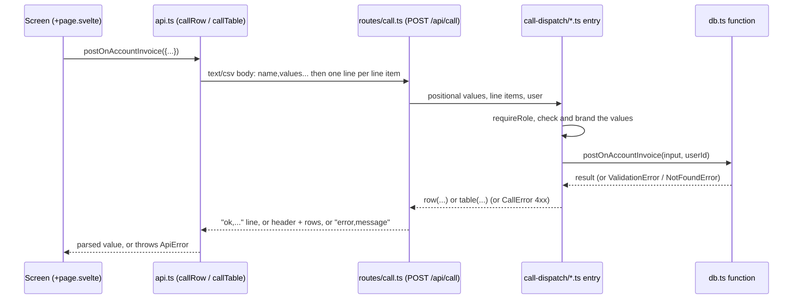

# Frontend Reference

## How much of Svelte this application actually uses

**Reactivity.** Most components use runes (`$state`, `$derived`,
`$props`); a few still use the legacy `$:` statement
(`docs/svelte-5-runes-migration-plan.md` tracks them).

**Shared state** is one module, `frontend/src/lib/state.svelte.ts`,
built on runes: `auth`, `session`, `translations`, the menu
(`menuTree`, `screenTitle`) and the unsaved-changes flag. A component
reads a value through its `current` property (`auth.current`,
`translations.current['Save']`). There are no `svelte/store` stores for
shared state and no state-management library.

**Components.** Most screens are one `+page.svelte` (markup, `<style>`
and `<script>` together). Shared pieces live in
`frontend/src/lib/components/` where the same shape is needed in more
than one place (`AddressList.svelte`, `TreeEditor.svelte`,
`CashTransaction.svelte`, …). Many transaction and report screens are
generated from `application/application.entities` ("Generated
transaction and report screens", below).

**Dependencies** beyond Svelte and SvelteKit: `@keenmate/svelte-treeview`
(the Entity Tree page's tree) and `svelte-dnd-action` (drag and drop in
`AxisChooser.svelte`). Every other button, table and form is plain HTML
and CSS.

## CSS: one shared stylesheet, one panel standard

`frontend/src/lib/app.css`, imported once, globally, from the root
layout (`frontend/src/routes/+layout.svelte`). Holds the CSS custom
properties for color (`--paper`, `--paper-dim`, `--ink`, `--ink-soft`,
`--rule`, `--brass-dark`, and a few more), the native `fieldset`/
`legend` reset, and the single most load-bearing rule in the file,
`fieldset.page-title`.

**Every screen is exactly one, single, outer `<fieldset
class="page-title">`**, with its own name on the top border (a native
`<legend>`) and, when a screen has instructions, those instructions in
a directly-nested, tinted sub-box (`.intro`) — never a separate,
floating element above the panel, never a second, independent box
below it. Further, legitimately-distinct sub-panels a screen may need
(Business Setup's tree and detail panes; a Balance Sheet's own
Assets/Liabilities/Equity) nest *inside* the one outer box, never
beside it as separate panels.

```css
fieldset.page-title {
  display: flex;
  flex-direction: column;
  flex: 1;
  width: 100%;
  box-sizing: border-box;
  border: 1px solid var(--rule);
  border-radius: 6px;
  background: var(--paper);
  padding: 0 1.2rem 0.9rem;
  margin: -14px 0 0;      /* see below */
}

fieldset.page-title:has(> .intro),
fieldset.card-legend:has(> .intro) {
  background: var(--paper-dim);
}
```

`:has(> .intro)` tints only a panel that has an `.intro` child. The
`margin: -14px 0 0` corrects for a native
HTML rendering fact: a `<legend>` straddles its own fieldset's top
border (half above, half below), so the fieldset's visible border
line sits below its raw bounding-box top — the negative margin pulls
the visible border up to align with a plain, non-fieldset sibling
(e.g. `<aside class="sidebar">`) that has no such offset.

`fieldset.card-legend` is the same pattern's sibling, used where a
panel's title and its direct content (a login form, a picker) are
conceptually one thing from the start, rather than a title merged into
an existing content area afterward.

**`<fieldset>` can never legally carry an interactive ARIA role** —
its fixed, implicit "group" semantic can't be overridden
(`role="toolbar"` is rejected outright by Svelte's a11y linter;
`role="group"` is redundant and still non-interactive to the linter).
The fix: move interactive semantics (`role="toolbar"`, `tabindex="0"`,
the keydown handler, `aria-describedby`, `aria-keyshortcuts`) onto a
plain, inner `<div>` wrapping just the list content, leaving the outer
`<fieldset>`/`<legend>` purely for its visual role. A test script
driving such a panel must target this inner element (e.g.
`.tree-panel [role="toolbar"]`), not the outer fieldset.

Each `+page.svelte` also has its own `<style>` block, and some restate
rules the shared stylesheet already sets.

**The top bar** (`.top-bar`, in `+layout.svelte`) uses the same
`fieldset`/`legend` mechanism, with a two-part flex row
(`justify-content: space-between`) so the current user/business/
ledger/language context sits at the left edge while "Change
password"/"Log out" sit at the right — both still genuinely part of
the one, same native legend.

## The data-entry screen pattern

```svelte
<fieldset class="page-title">
  <legend>{translations.current['Screen Name'] ?? 'Screen Name'}</legend>
  <p class="intro">{...instructions...}</p>

  {#if loading}
    <p>Loading…</p>
  {:else}
    {#if error}<p class="error">{error}</p>{/if}
    {#if message}<p class="success">{message}</p>{/if}
    <!-- fields or list -->
    <button class="btn" onclick={save} disabled={saving}>Save</button>
  {/if}
</fieldset>
```

Every field group inside is its own plain, nested `<fieldset>` (no
class needed — the global stylesheet's plain `fieldset` reset already
gives it a border and embedded legend), never a `<label>`-wrapped
`<input>` — the same native mechanism as the outer panel, all the way
down.

### Every transaction-posting screen, its backend calls, and how it posts

| Screen (route) | Backend calls | Posts via |
|---|---|---|
| Invoiced Sale (`/arap/ar-sale`) | `postOnAccountInvoice` | `postJournalEntry` |
| AR Receipt (`/arap/ar-receipt`) | `stageARReceipt`, `postARReceipt` | `postJournalEntry` |
| Invoiced Purchase (`/arap/ap-purchase`) | `postOnAccountInvoice` | `postJournalEntry` |
| AP Payment (`/arap/ap-payment`) | `stageAPPayment`, `postAPPayment` | `postJournalEntry` |
| Cash Sale (`/arap/cash-sale`) | `completePosSale` | `postJournalEntry` |
| Cash Purchase (`/arap/cash-purchase`) | `completeCashPurchase` | `postJournalEntry` |
| POS Terminal (`/pos`) | `completePosSale` | `postJournalEntry` |
| General Journal (`/post`) | `stageLine`, `postJournalEntry` | `postJournalEntry` |
| Purchase Order (`/stock/po`) | `stagePurchaseOrder`, `postPurchaseOrder` | `postJournalEntry` (On Order) |
| Sales Order (`/stock/so`) | `stageSalesOrder`, `postSalesOrder` | `postJournalEntry` (On Order) |
| Stock Receipt (`/stock/stock-receipt`) | `stageOrderReceipt`, `postOrderReceipt` | `postJournalEntry` and `commitStagedQuantityMovement` |
| Stock Dispatch (`/stock/stock-dispatch`) | `stageOrderDispatch`, `postOrderDispatch` | `postJournalEntry` and `commitStagedQuantityMovement` |
| Stock Transfer (`/stock/transfer`) | `transferItems` | `commitStagedQuantityMovement`, then `postJournalEntry` (the value, when it has a cost) |
| Stock Take (`/stock/stock-take`) | `completeStockTake` | both |
| Write-offs & Expiration (`/stock/write-offs`) | `writeOffItems` | both |
| HR wage payment (`/hr`) | `payEmployeeWages` | `postJournalEntry` |
| Recurring transactions (`/post`, recurring) | `createRecurringJournal` | written directly (*The Journal API*, "The three posting paths") |

Every one of these stages into the one `journal_entry_staging` table
(*The Journal API*, "Staging").

Screens not built yet are stub pages (template `not-implemented`,
marked ⚠️ in the menu): `/cash`, `/exchange-rates`, `/gl/fx-adjustment`,
`/goods-services`, `/jobs`, `/logistics/assembly-bom`,
`/order-entry/generate-invoices`, `/order-entry/generate-po`,
`/reconciliation`, `/recurring`, `/setup/currencies`, `/setup/taxes`,
`/shipping`, `/vouchers/general-ledger`, `/vouchers/payable` and
`/vouchers/payment`. The Screens Inventory below marks them "Not
implemented".

## Screens inventory

The Screens Inventory, every route with its source file, size and
whether it is implemented, is generated from the route tree by
`make screens-inventory` (`scripts/generate-screens-inventory.ts`) into
`docs/screens-inventory.md`; the manual build regenerates it and
includes it after this chapter. It counts the generated pages too, so
the manual is built after `make generate`.

## `frontend/src/lib/api.ts` — the request wrapper and its design notes

Every backend call is one `POST /api/call` whose body is CSV: the
first line is the call's name and its positional values, and any
further lines are line items (a cart's lines, a journal's lines).
`callRaw`/`callRawWithLines` send it with the bearer token from
`auth.current`, turn an `error` response line or an unreachable
backend into an `ApiError`, and clear the session on a `401`.
`callRow` reads a one-line result (`ok,value,…`) and `callTable` a
header row and data rows. Each call's positional order is documented
at its entry in `backend/src/call-dispatch/`. The one other request,
`request<T>`, fetches `/health` for `checkVersion`.
`frontend/src/lib/matrix-api.ts` makes its own `/api/call` requests
(below).



**Branded types are declared again here, not imported**: the frontend
and backend are separate TypeScript projects. `BusinessName`,
`LedgerName`, `AccountName` and the rest, with `asBusinessName`,
`asLedgerName` and the other `as…Name()` functions, mirror the
backend's (*Core Domain Reference*, "Entity identity resolution:
scoped lookups, and branded types").

**`checkVersion()`** compares the frontend's own build-time
`__APP_VERSION__` against the backend's live-reported version
(`compareVersions`, a proper numeric dot-separated comparison, never a
lexical string compare — `"0.0.0.99" > "0.0.0.100"` lexically but not
numerically). Whichever side is older is out of date: the frontend
reloads itself fully; the backend can't be restarted from here, so a
console warning is the most this call can do.

**Pass the resolved account id, not only the name.** Two accounts can
share a name (Open Container's `Remaining`/`Occupied` leaves, one per
combination), so wherever the backend has resolved an account id
(`StagedLine.accountId`, `CloseBooksPreview`'s per-line `accountId`,
the Storage Capacity accounts) the frontend sends that id back when
staging. The backend's `findLedgerScopedAccount` (`db-journal.ts`)
applies the same rule (*The Journal API*).

**Canned entries posted from the frontend.** Open Container, Receive
Into Storage, Close Books and Rollover build their journal lines in the
frontend (`frontend/src/lib/canned-journal.ts`, or the screen itself)
and post them with `stageLine`/`postJournalEntry`. The backend gives
them two narrow kinds of call instead of one that does everything:

- **resolve calls** (`resolveOpenContainerAccounts`,
  `resolveReceiveAccounts`, `resolveRolloverLines`), which find or
  create the accounts the lines need (with each item's unit cost) and
  post nothing;
- **a physical-only call** (`receiveIntoStorageStock`), which makes the
  quantity and capacity movement with no journal entry.

The screen calls them in order and posts the lines. Every other
posting screen makes one backend call that does the whole operation
in one transaction (`completePosSale`, `completeCashPurchase`,
`transferItems`, `postOnAccountInvoice`, `createLocation`, …).

**Notes on particular calls:**

- `createProvider`/`createCustomer`/`createEmployeeContact` give the
  new entity its Contact Type at once.
- `saveLocation` and `createLocation` both pass the business, so the
  backend finds the location under that business, not its same-named
  Storage node (*Core Domain Reference*, "Locations are found under
  their business").
- `getActiveLedger`, `getProfitCenters`, `createProfitCenter` and
  `setSessionProfitCenter` back the Session screen's ledger and Profit
  Center pickers.
- `getUserRoleMatrix`/`setUserRoleInBusiness` are the per-business
  User × Role matrix, beside the global `getUsers`/`setUserRolesApi`.
- `ItemSourceInput.currency`: `null` means the business's own home
  currency; a non-null value is a separate, independently-priced row
  for the same item/provider pair, never a currency conversion.
- `listItems` and `listLocations` require the business.
- `convertStorageSpace`/`openStorageContainer` use the product
  combination mechanism, with groupings set up on `/setup/hierarchy`.
- `LocationInput.timezone` is a real IANA identifier, required, since
  a location's transactions record against that location's own local
  calendar day (see `todayAtLocation` in the Stock API chapter).
- `getLocationCurrencies`/`nominateLocationCurrency`: the further
  currencies a location trades in, usually none.
- `getStorageSpaceReport`: Storage Capacity accounts live under each
  Location, structurally outside Chart of Accounts, so the Trial
  Balance never shows them — this report reads them directly, grouped
  by location and storage-unit currency (`SPACE-CARTON`,
  `SPACE-BOTTLE`).

Some exports in `api.ts` are commented out with `// UNUSED
(checkpoint N)`; `docs/unused-functions.md` lists them.

## `frontend/src/lib/canned-journal.ts` — the canned-journal computation module

The frontend half of the canned entries above: pure functions from a
screen's form values and the accounts a resolve call returned to a
balanced set of lines, which the screen posts with `stageLine`/
`postJournalEntry`. They create no account, move no stock and make no
call.

A line has no division or category field. Every dimension (location,
item, storage tier or pack size) is part of the account itself, as
`ensureItemLocationInventoryAccount` names it
(`<item> (<tier>) — <location>`). `CannedLine.accountId` carries a
resolved id ("Pass the resolved account id", above).

The two canned shapes (`canned-journal.ts`):

- **`openContainerLines`** (Open Container) — returns two independent
  results, since they're posted as two separate journal entries: the
  storage-space movement (container's "Remaining" up / "Occupied" down
  by `cartonsOpened`; unit's "Remaining" down / "Occupied" up by
  `unitsProduced`; no contra accounting) always posts, while the
  dollar Inventory-value movement (container tier's Inventory account
  to the unit tier's) posts only when the per-unit cost is known.
- **`receiveIntoStorageLines`** (Receive Into Storage) — relevant only
  for a combination-tracked receipt (an ordinary receipt posts no
  dollar journal entry at all): debits the item's combination-tier
  Inventory account, credits Accounts Payable, for the real cost of
  the quantity received. Returns an empty line list when no
  combination was given, or cost isn't known yet.

**`freshReference`** makes a reference of the form
`<PREFIX>-<timestamp>-<random>`.

## `frontend/src/routes/editor/+page.svelte` — the generic entity editor

**`entitiesById`** maps id to entity, built once per load, so each
table row's parent and relation names are found without scanning the
whole list (the table can have thousands of rows).

**`parentableEntities`** is the parent/relation picker's list: it
leaves out Vocabulary's direct children that have no children of their
own (UI words and help-text sentences), but keeps the ones that do,
such as `Customers`, `Vendors` and `Relationship Types`, which are
real parents. The table above the picker still shows everything.

**The re-parent guard rail** (`originalParent`/`originalName`/
`originalRelation`/`originalAccountnumber`, §5 of
`docs/translator-form-and-guard-rails-plan.md`) records the entity's
state at selection time, compared against the edit fields at save
time, so a structural re-parent — as opposed to an ordinary rename or
relation change — always gets its own explicit confirmation showing
both the current and proposed parent together.

The page sets `hasUnsavedEdit` (`state.svelte.ts`), so Esc warns before
leaving an unsaved edit.
**`contact`** holds only the fields that still live directly on the
contact record; address/phone are handled entirely by the shared
`AddressList`/`PhoneList` components. **`hierarchyLinksIn`** is a
second guard rail (§5): every entity that reaches the currently
selected one via a hierarchy link, so the editor shows a visible
"why is this here" trail rather than requiring a structural link to
be discovered by accident.

**`normalizeForDuplicateCheck`** warns before creating an entity whose
name matches an existing one ignoring case, spaces and punctuation. A
new provider is created with `createProvider`, which gives it its
Contact Type (`docs/contact-types-and-translations.md`). `setContact`
replaces every contact field: a field left out is cleared, so the
page always sends the whole form.

## `frontend/src/routes/login/+page.svelte` — the login screen

The brand name itself is never line-broken mid-phrase: a non-breaking
space joins each word, regardless of which translated language wraps
around it, without forcing the whole sentence onto one line (which
would risk overflow on a narrow screen).

**Display language on login** sets only the login form's language.
It is the person's earlier choice if they made one, else the system
default (`getDefaultLanguage`, *The Entity Model*), else English. If the
language list fails to load, the form stays in English.

RTL mirroring here needs an explicit override because absolute
left/right positioning does not automatically flip with `dir="rtl"`
the way `text-align` or `flex-direction` do.

Tests (*Testing: Unit*, "Running the tests"):
- "installation-check" (`shared-fixtures/tests/installation-check.csv`)

## Smaller files: short design notes

- **`setup/users/+page.svelte`**: the per-business User × Role matrix
  is kept beside the global roles and never changes them
  (`docs/user-business-role-matrix-design.md`).
- **`setup/hierarchy/+page.svelte`**: a new shape is entered as a list
  of (dimension name, grouping name) rows, the shape
  `defineProductShape` takes.
- **`reports/storage-space/+page.svelte`**: storage space is counted in
  cartons and bottles, so it is shown as whole numbers, not through
  `formatAmount`.
- **`reports/new-stock-on-hand/+page.svelte`**: the axis choices are
  Item, Category, Location and Consolidated, plus the business's other
  hierarchies once they load (*Core Domain Reference*, "Hierarchies and
  multi-dimensional reporting").
- **`setup/bank-accounts/+page.svelte`**: a bank account can be
  registered for any group of any of the business's hierarchies.
- **`lib/treeAdapter.ts`**: converts the flat, `parent_id`-based entity
  list into the dot-separated path format `@keenmate/svelte-treeview`
  expects (`"1"`, `"1.1"`, `"1.1.2"`, ...), assigning each node's
  position among its siblings by name order.
- **`lib/components/WeeklyHoursGrid.svelte`**: the local working copy
  is one row per day of the week, always all 7, with an "on" flag
  driving whether that day's times are actually included in the
  emitted `lines`.

## `frontend/src/lib/components/AddressList.svelte` — the combined address box

Address line 1/2 are combined into a single multi-line "Building &
Street Address" box in the UI, not two separate fields. Still stored
as `address_line1`/`address_line2` on the backend (no schema change):
the first line a person types becomes `address_line1`, everything
after becomes `address_line2`, joined back into one box the same way
when re-displayed.

## `frontend/src/app.d.ts` — SvelteKit app types

`version` is the frontend's own build-time version, injected by
`vite.config.ts` from the same single `VERSION` file the backend reads
at startup (see `checkVersion` in the api.ts chapter above).

## `frontend/src/lib/matrix-api.ts` — self-contained fetch wrapper

Its own small `/api/call` wrapper for the matrix reports, with the same
request shape as `api.ts`'s `callRaw` (which `api.ts` does not export).

## `frontend/src/lib/components/AxisPLNode.svelte` — the P&L axis tree node

The disclosure's initial open/collapsed state deliberately captures
`openByDefault`'s value only once, per its own name — this sets the
starting state of a further, user-togglable disclosure, never meant
to force-collapse or force-reopen an already-interacted-with node if
a parent later re-renders with a different default (hence the
`svelte-ignore state_referenced_locally`).

## `frontend/src/lib/components/HierarchyGroupTreeNode.svelte` — group display stripping

A group made for a single location is named after it with the
hierarchy name added (`Head Office Division`), so a lookup by name
cannot confuse it with the location. This component and
`HierarchyGroupTreePicker.svelte` show it without the suffix; the
selected value keeps the full name.

## `frontend/src/routes/setup/chart-of-accounts/+page.svelte` — the CoA tree

**Structural anchors**: the five top-level report categories cannot be
renamed or deleted here, even where `revokeEntity` would allow it,
because the Balance Sheet and P&L are built on them.


## The remaining screens, by route

Hand-written pages (`frontend/src/routes/…/+page.svelte`):

- `/account/password` — Account Settings: the user's own password
  (`changeOwnPassword`), page size, number format and date format.
- `/customer-terminal` — Customer Registration at a self-service
  terminal, no staff login: `registerCustomer` (*Core Domain
  Reference*, "Customer self-registration").
- `/journal/[id]/[date]` — one journal entry's occurrence
  (`getJournalEntry`), with Reverse (`reverseJournalEntry`).
- `/reports/stock-out-risk` — `getStockOutRiskReport` (*The Stock API*,
  "Reorder, lead times, and stock-out risk").
- `/setup/bank-accounts` — register and unregister bank accounts, with
  their balances (`registerBankAccount`, `unregisterBankAccount`,
  `getBankAccounts`).
- `/setup/business-structure` — the Business Structure popup
  (`BusinessStructurePopup.svelte`).
- `/setup/tree` — the whole entity tree, read-only (`getEntityTree`).
- `/setup/users` — users and their roles per business
  (`getUsers`, `createUserAccount`, `setUserActiveApi`,
  `changeUserPassword`, `getUserRoleMatrix`, `setUserRoleInBusiness`).

Section pages of tiles, one per screen in the section (template
`tiles`): `/arap`, `/stock` and `/reports`.

Hand-written list pages: `/invoices` (Sales and Purchase Invoices:
`listInvoices`, `countInvoices`, `getInvoiceById`,
`getInvoiceOutstanding`; *Core Domain Reference*, "Reading invoices")
and `/projects` (clocking employees in and out of projects:
`clockInToProject`, `clockOutOfProject`, `getOpenProjectClock`; *The
Journal API*, "Employee project-clock functions").

Generated report pages (template `report`, `screen-runtime.ts`
`reports.…`): `/reports/sales` (`reports.sales`), `/reports/trial-balance`, `/reports/balance-sheet` and
`/reports/statement` (next section), `/reports/below-reorder`
(`reports.belowReorder`), `/reports/business-configuration`
(`reports.businessConfiguration`), `/reports/cash-flow-forecast`
(`reports.cashFlow`) and `/reports/reminders` (`reports.reminders`).

## Generated transaction and report screens

The Invoiced Purchase and Sale, Purchase Order, Stock Transfer,
Statement, Trial Balance and Balance Sheet screens are generated from
`application/application.entities` (*Application Configuration as
Entities*): their pages are not source. What each does is the named
behaviour in `frontend/src/lib/screen-runtime.ts` it calls:

- **Invoiced Purchase and Sale** (`actions.purchase`, `actions.sale`).
  To the `Cash` party, the purchase or sale is completed and paid at
  once (`completeCashPurchase`, `completePosSale`); a location is
  required. Otherwise `onAccount` calls `postOnAccountInvoice`, which
  creates the invoice, receives or dispatches the lines whose item is in
  the business's catalogue at the chosen location (then required), and
  posts it, in one transaction (*Core Domain Reference*, "Cash Sale
  and Cash Purchase"). Tax comes from the tax-rate field
  (`totals.taxRate`).
- **Purchase Order** (`actions.purchaseOrder`). Choosing an item fetches
  its sources (`reactions.itemSources`): the provider list becomes the
  item's known providers, preferred first, with the preferred price
  filled in; an item with no sources leaves the list open. Choosing a
  provider fills that source's price (`reactions.providerPrice`). The
  order is staged and posted in one step.
- **Stock Transfer** (`actions.transfer`). The destination list holds
  only locations in the source's city (`filters.sameCityAsFrom`), and
  the on-hand quantity follows the item and source
  (`reactions.onHand`, `reactions.fromLocationChanged`). One call,
  `transferItems`, moves the stock and its value at first-in-first-out
  cost, as every other caller does (*Stock API*).
- **Statement** (`reports.statement`): the customer's invoices as of a
  date, with total, paid and outstanding, from `getCustomerStatement`.
- **Trial Balance** (`reports.trialBalance`): one group per currency,
  each flagged when out of balance; a `SPACE-` currency is shown as a
  whole-number count, every other as money; an account with quantity
  postings carries a `qty` badge.
- **Balance Sheet** (`reports.balanceSheet`): Assets, then Liabilities
  and Equity, each a collapsible tree with its total in the debit or
  credit column by its sign; a contra amount is shown in parentheses;
  the status line says whether Assets = Liabilities + Equity.

Tests (*Testing: Unit*, "Running the tests"):
- "purchase-order-known-suppliers" (`shared-fixtures/tests/purchase-order-known-suppliers.csv`)

## `frontend/src/routes/reports/stock-movement/+page.svelte` — the Stock Movement report

The report groups by location, provider, category (`Hierarchy:
Category`, "(No category)" when untagged) or "group", which is the
business's first configured hierarchy (such as Division); with no
hierarchy, or if it fails to load, the report still works. Groups
start collapsed, showing subtotals. A transfer has no provider or
group, so grouping by location uses its destination.

Tests (*Testing: Unit*, "Running the tests"):
- "stock-movement-by-grouping" (`shared-fixtures/tests/stock-movement-by-grouping.csv`)

## `frontend/src/lib/components/HierarchyGroupTreePicker.svelte` — the nested group picker

Groups can nest (a location's group under a city's), so the picker
is a tree, Consolidated → group → location, and any level can be
chosen. The caller passes the hierarchy name. A group whose parent is
not itself a group is at the top level.

## `frontend/src/routes/stock/restock/+page.svelte` — the restock suggestions screen

**Suggestions** list every product below its reorder level at the
selected outlet, with the quantity that tops it up to its maximum. The
per-outlet total is computed inside the function rather than read from
`suggestions`, which has not yet been recomputed for the new outlet
when the function runs.

Tests (*Testing: Unit*, "Running the tests"):
- "restock-retail-outlet" (`shared-fixtures/tests/restock-retail-outlet.csv`)

## `frontend/src/routes/reports/compare/+page.svelte` — the period comparison report

A net loss is shown in parentheses and red, never with a minus sign.
An unfavourable variance is shown in parentheses too; whether it is
unfavourable depends on the section (more Income is good, more Expense
is bad), so it is passed in, not read from the sign. The intro is
split on `{NAME}` so the business name is inserted as text, not
through `{@html}`.


## `frontend/src/lib/org-chart-layout.ts` — laying out the org chart

`layoutOrgChart(nodes)` places the boxes of the org chart
(`OrgChartNode.svelte`) without any layout library: depth gives the row,
the in-order leaf position gives the column, and a parent is centred
over its children (`BOX_WIDTH`, `BOX_HEIGHT`, `H_GAP`, `V_GAP` fix the
spacing). A box whose `parentId` is not in the set is a root; a
`managerId` pointing outside the set draws no connector; no two boxes
overlap; an empty chart lays out to nothing, zero by zero. It has no
Svelte or DOM dependency, so `frontend/test/org-chart-layout.test.ts`
tests it directly.

Tests (*Testing: Unit*, "Running the tests"):
- "layoutOrgChart: no two boxes ever overlap, and depth strictly matches containment" (`frontend/test/org-chart-layout.test.ts`)
- "layoutOrgChart: a managerId pointing outside the chart (or to a box that got filtered out) is simply ignored, never a crash" (`frontend/test/org-chart-layout.test.ts`)
- "layoutOrgChart: a dangling parentId (parent not present in this box set) is treated as a root, not dropped" (`frontend/test/org-chart-layout.test.ts`)
- "layoutOrgChart: an empty chart produces an empty, zero-sized layout" (`frontend/test/org-chart-layout.test.ts`)

## `frontend/src/lib/money.ts` — currency and quantity parsing

`parseMinorUnits` and `parseQuantity` return a non-negative amount:
direction (debit or credit, receipt or payment) comes from the field
or screen, never from a typed minus sign. Empty or invalid input is 0,
as in `journalGrid`'s `toMinorUnits`.

`parseMinorUnits` always multiplies by 100, so it is right only for
two-decimal currencies (`docs/TODO.md`; *Core Domain Reference*,
"Money"). `decimalPlacesFor(unitCode)` (`format.ts`) has each
currency's scale but is not used here yet.

## `frontend/src/routes/stock/listing/+page.svelte` — the Stock Listing report

Locations are grouped by the business's first configured hierarchy
(such as Division), using the group `getInventoryListingByLocation`
returns; a location with none is under "(No group)". With no hierarchy
the report still works. Groups and locations start collapsed, showing
totals.

Tests (*Testing: Unit*, "Running the tests"):
- "stock-listing-by-division" (`shared-fixtures/tests/stock-listing-by-division.csv`)
- "stock-listing-over-capacity" (`shared-fixtures/tests/stock-listing-over-capacity.csv`)

## `frontend/src/routes/session/+page.svelte` — the Business/Ledger/Profit Center picker

**Default ledger**: the business's active ledger (set when the
business is created, moved by a rollover; `docs/active-ledger-design.md`).

**Profit Centers** (`docs/profit-centers-design.md`): with none, the
picker is not shown and the session stores no Profit Center
(`undefined`, not an empty value).

**Translation**: elsewhere `translations` follows
`session.current.languageName`; there is no session while picking one,
so this page loads its translations itself, as the login page does.

## `frontend/src/lib/components/Form.svelte` — the generic form component

The generic form (`docs/one-file-per-page-consolidation-plan.md`). Its
field types are text, number, select, password and date; it has no
conditional or computed fields, so a page that decides something from
an answer does so in its own code.

Enter in any field submits the form. (In runes mode a component's
exports cannot be reached with `bind:this`, so a caller could not
trigger submit itself.)

## `frontend/src/routes/pos/+page.svelte` — the POS terminal screen

A POS terminal is one cash drawer in one currency
(`docs/multicurrency-design.md`): an ordinary outlet has none and sells
in the home currency; a border-town outlet may have one per currency.
The location's terminals, each with its currency, are reloaded when the
location changes; if they fail to load, the register still sells in
the home currency.

A combination item's price comes from the server
(`getItemPriceForCurrency`, its exact combination first); the screen
never falls back to the item's base retail price or to 0. A scan tries
an exact UPC match first, then the first item found by name.

## `frontend/src/routes/setup/yearend/+page.svelte` — Close Books and Rollover

**The close-books breakdown** is by Location, then by the business's
other hierarchies (such as Division); if those fail to load, by
Location only.

**Close Books** posts `previewCloseBooks`'s `preview.lines` with
`stageLine`/`postJournalEntry` (`acceptAndClose`); nothing is
recomputed.

**Rollover**: `resolveRolloverLines` creates each carried-forward
account under the new ledger and returns the opening-balance lines,
which the screen posts the same way. The new ledger may already exist
from an earlier, unfinished rollover; rolling into it works.

**Reporting period**: when `getReportingPeriods` returns periods, a
picker fills in `asOfDate` from the period's `endDate`
(`applySelectedPeriod`) and, when the rollover target is a new ledger
with no name yet, suggests `Actual <period label>`, which the person
can change (*Core Domain Reference*, "Reporting periods").

Tests (*Testing: Unit*, "Running the tests"):
- "year-end-close-and-rollover" (`shared-fixtures/tests/year-end-close-and-rollover.csv`)

## `frontend/src/routes/setup/vocabulary/+page.svelte` — per-business word-choice overrides

A choice is saved as a business-level preference
(`setVocabularyPreference(concept, 'business', businessId, word)`),
with the business's id taken from the entity tree. Each concept opens
on the word the business sees now: `translations.current` for its
`defaultAlternate`, matched to the alternate that gives that text.
Choosing the default word again removes the preference. After saving,
the translations are reloaded.

## `frontend/src/lib/components/PaymentReceipt.svelte` — the shared AP Payment/AR Receipt screen

The screen behind both AP Payment and AR Receipt, set by `direction`
(provider or customer, Accounts Payable or Receivable), which does not
change while the component lives (hence `svelte-ignore
state_referenced_locally`, as in `CashTransaction.svelte`).

**Outstanding invoices** of the chosen party, each with its remaining
balance, are fetched when the party changes. If they fail to load, the
payment can still be recorded.

**Allocation** to invoices is optional and done per invoice after the
payment posts: a failed allocation does not undo the payment. Each
allocation has its own reference, since the payment's reference is
already used by its journal entry.

## `frontend/src/routes/setup/translations/+page.svelte` — the translator screen

**Pending edits** are kept per language, apart from `words`, and only
for the words the translator has changed; any other word shows its
current translation, or a copy of the reference text to start from.
A saved value is shown at once, without reloading.

**Text direction** comes from each language's own setting, loaded
with the language list, for every input and reference column (no
language is special-cased).

**Reference language** is whichever language the translator reads
while working, falling back to English (itself a translation under the
`English` language) when it has no translation of a word.

Tests (*Testing: Unit*, "Running the tests"):
- "help-text-in-german" (`shared-fixtures/tests/help-text-in-german.csv`)

## `frontend/src/routes/post/+page.svelte` — the General Journal posting screen

**Accounts offered** (`postableAccounts`): postable accounts with no
children, of the business's own Chart of Accounts prototype (the
relation each prototype account and each business carries,
`backend/schema/00-core.sql`), plus accounts with no prototype at all
(contacts, and the business's own copied accounts).

**One side per line**: typing a debit clears the line's credit, and the
other way round.

**Insert** adds a row at the end, whatever has focus. **Delete** removes
the row only from the account dropdown or an empty text field, so it
still deletes characters in a field with text.

Tests (*Testing: Unit*, "Running the tests"):
- "general-journal-one-side-per-line" (`shared-fixtures/tests/general-journal-one-side-per-line.csv`)
- "general-journal-own-chart-of-accounts" (`shared-fixtures/tests/general-journal-own-chart-of-accounts.csv`)
- "general-journal-account-currency" (`shared-fixtures/tests/general-journal-account-currency.csv`)

## `frontend/src/routes/contacts/+page.svelte` — the Customers/Providers screen

**Contact fields** on this screen are the ones on the contact itself;
addresses and phones are separate typed records, saved by
`AddressList`/`PhoneList` as they are edited. So although `setContact`
replaces every field, leaving the address and phone out loses nothing.

**Categories** (customers, providers, employees, …) are separate
branches of the tree; a person who is both an employee and a customer
is two entities, one in each.

**The category shown first** comes from the menu link: Customers under
Accounts Receivable, Providers under Accounts Payable.

Tests (*Testing: Unit*, "Running the tests"):
- "contacts-focus" (`shared-fixtures/tests/contacts-focus.csv`)
- "contact-addresses-by-keyboard" (`shared-fixtures/tests/contact-addresses-by-keyboard.csv`)
- "contact-persons" (`shared-fixtures/tests/contact-persons.csv`)

## `frontend/src/routes/reports/profit-and-loss/+page.svelte` — the two-axis P&L breakdown

**Each axis is one dropdown**: Consolidated, then each axis as a
heading with its values beneath. The value `Location` groups by every
location; `Location::Riverside Cellars` shows that location only, still
grouped by location so drill-down works. If the values fail to load,
only the headings are offered.

**One axis from each side.** Location and the business's location
groupings (such as Division) are one side, where a sale happened;
Item and Category are the other, what was sold. Crossing two axes from
the same side adds nothing, so each dropdown offers only the other
side's axes. When a change would leave the other dropdown on an axis
from the same side, that one resets to Consolidated. The guard is a
function called on change, not a reactive statement, which Svelte
would reject as circular (`outerAxis` depends on `outerSelection`,
which the guard sets).

`allowedOuterAxes` and `allowedInnerAxes` are `$derived` from
`opposingHierarchyAxes`, which reads `locationHierarchy` and
`groupableAxes` (themselves `$derived` from `axisValues`), so a further
hierarchy such as Division becomes selectable as soon as the axis
values load.

Tests (*Testing: Unit*, "Running the tests"):
- "profit-and-loss-by-division-and-category" (`shared-fixtures/tests/profit-and-loss-by-division-and-category.csv`)

## `frontend/src/lib/components/TypedList.svelte` — the generic typed sub-list

The list behind every typed sub-list of an entity (addresses, phones,
contacts): loading, saving and deleting, adding a type, Insert/Delete
keys and selection. Each kind supplies its fields and display as
snippets.

Props include the block's legend ("Addresses", "Phone numbers",
"Contacts"), which property of `T` holds its type string
(`address_type`, `phone_type`, `contact_type`), whether the
in-progress form values are complete enough to save, a factory for a
fresh blank entry, a field-specific form-body snippet (receives the
live values object to mutate via `bind`, plus a ref-setter for the
field that should receive focus after Insert), and a field-specific
read-only display snippet for one item.

Each instance has its own id linking the panel to its keyboard-hint
text for screen readers. It reloads when given another entity. After
Insert, focus goes to the field to type in. Insert and Delete are
handled on the component's own root, not the window, and are the only
way to add or remove an item (there are no buttons).

## `frontend/src/lib/components/TreeEditor.svelte` — the shared tree+Insert/Delete shell

The shell of every tree screen with Insert/Delete (Business Setup,
Items; `docs/shared-tree-editor-component-plan.md`). It owns the
toolbar (`role="toolbar"` on an inner `<div>`, since a `<fieldset>`
cannot take an interactive role; "CSS", above), the id linking it to
its keyboard-hint text, the guard that ignores Insert/Delete typed in
an input, select or textarea, and turning those keys into the
caller's `onInsert`/`onDelete`. What a node is, and what Insert or
Delete means for the selection, is the caller's.

Props: the legend; the hint text (from the caller, which knows what
the keys will do); `onInsert`/`onDelete`; the tree itself as the
default snippet.

## `frontend/src/lib/components/SelectableListEditor.svelte` — the shared flat-list+Insert/Delete shell

The same shell for flat lists (`bank-accounts`, `hierarchy`'s
groupings and values, `translations`' words and languages,
`locations`' main list), keyed by `getId: (item: T) => string | number`.
As with `TreeEditor.svelte`, the caller owns the selection
(`selectedId`/`onSelect`) and whether a row is being inserted
(`inserting`, set from `onInsert` and cleared when its `form`
snippet's Enter or Escape finishes, through `Form.svelte`'s
`showSubmitButton`/`onCancel` or the field's own `onkeydown`).

Each item is drawn by the caller's `row: Snippet<[T]>` inside a
selectable wrapper (`role="button"`, Enter selects); the insert row is
the `form` snippet, shown while `inserting`. The toolbar handling is
the same as `TreeEditor.svelte`'s and `TypedList.svelte`'s, so the keys
behave the same everywhere. `emptyText` is shown when there are no
items and none is being inserted. Like the other components, it has no
unit test (the frontend tests cover plain TypeScript modules only);
the step-runner tests drive the screens that use it.

## `frontend/src/routes/setup/new-business/+page.svelte` — the new-business wizard

**Chart of Accounts prototype**: the person picks the country prototype
(English, German, …); the screen lists its leaf accounts
(`loadPrototypeAccounts`, called in `onMount`, not during server-side
rendering) and the new business gets its own copy (*The Entity Model*,
"Chart of Accounts").

**Second currency** is optional and collapsed by default.

**Legal structure** defaults to Sole Trader, which needs nothing more
(Owner's Equity exists). The choices come from the `Business Type`
entities (Sole Trader, Partnership, Pty Ltd Company, Incorporated
Company), mapped to `EntityStructure`, so `setupEquityStructure`
creates the equity accounts each needs.

**Financial year start and reporting frequency** (optional, beside the
free-text `financialYearLabel`) are passed to `createBusiness`, which
stores them with `setBusinessReportingPeriod` (*Core Domain
Reference*, "Reporting periods").

**Bank accounts by currency**, after creation
(`docs/user-manual-ch2-configuration.md`): the person names bank
accounts and currencies, then ticks which bank-account × currency
pairs exist; only the ticked ones are created.

## `frontend/src/lib/components/BusinessStructurePopup.svelte` and `StructureTreeNode.svelte` — the Business Structure popup

An editable picture of one business's locations, divisions, item
categories and other hierarchies, using the same calls as the
Locations, Setup → Hierarchies and Items screens.

It is a wizard: a stepper (Org Chart → Item Categories → Other
Hierarchies), a line of explanation per step, and Back/Next/Finish.
Every step can be skipped; a business may have no locations,
divisions or categories at all. `activeTab` is `$derived` from
`stepIndex`, and each step loads when first shown (`loadStep`).

The quick-add Location form has optional bottle and carton capacity;
`parseOptionalInt` turns a blank into `null` (no capacity tracked),
not 0.

**Entry points**: a "Set up your business structure" button on
`setup/new-business/+page.svelte`, shown right after creating a
business, alongside (not instead of) its existing links to the
General Journal, Entity Tree, and Locations; and a standalone
`setup/business-structure/+page.svelte` route, reachable at any later
time via a "Business Structure" entry under Configuration
(`migrateForMenuEntities`, `backend/src/db-seed.ts`), which opens the
same popup for `session.current.businessName`.

**Every reposition in this popup is a hierarchy *tag*, never a
structural reparent** — Locations ↔ Division, Item Category value ↔
parent Category value, and Employee ↔ Department/Manager are all the
same kind of move, carried through the component without being
collapsed into one mechanism only because each targets a different
named link:

- **Locations ↔ Division membership** is a tag on the Location
  (`setHierarchyTag`/`deleteHierarchyTag`, `frontend/src/lib/api.ts` —
  `setHierarchyParent`/`deleteHierarchyParent` on the backend,
  `backend/src/db.ts`). A location's real `parent_id` never changes —
  it stays under the business's `Locations` root forever. "Moving" a
  location between divisions, or to "Unassigned", only changes or
  clears this tag.
- **Item Category value ↔ parent Category value** is a tag on the
  category value itself, via the exact same `setHierarchyTag`/
  `deleteHierarchyTag` pair — "moving" a category re-tags its own
  `Hierarchy: Category` link (clearing it for "Top level"), the same
  as moving a Location between Divisions. A category value's real
  `parent_id` never changes either — it's a lightweight entity
  registered once under the business's Hierarchy registry
  (`ensureHierarchyValue`/`createHierarchyValue`) and never nested in
  the real Items catalog tree, so arbitrarily deep category-under-
  category nesting is free: a value can be tagged under a further
  value of the same grouping to any depth, the identical mechanism
  Division itself could use but conventionally doesn't.
- **Employee ↔ Department/Manager** is two entity links on the
  employee (`setEmployeeDepartment`/`setEmployeeManager`, over
  `setEntityLink`), since neither is a reporting hierarchy (*The Entity
  Model*, "Departments and the Org Chart").

**`StructureTreeNode.svelte`** is the generic, recursive node renderer
shared by the Item Categories and Other Hierarchies tabs (the Org
Chart tab uses the separate `OrgChartNode.svelte`, described above) —
unlike the read-only, select-only `HierarchyGroupTreeNode.svelte`,
each node can offer an "+ Add" action (opens a type-specific form the
caller owns) and a "Move…" action (an inline destination picker
rendered by the node itself). The component has no opinion on Item
Categories vs a generic Hierarchy; the caller supplies
`canAddChild`/`canMove` per node and the valid move destinations, and
makes no API call of its own.

The popup reads groups with `getHierarchy(business)`, which is scoped
to the business. A new location's capacity account goes in the
business's active ledger (`getActiveLedger(business) ?? 'Actual'`,
in `createAndConfigureLocation` and `postLocation`), so a location added
after a rollover is not filed in the closed ledger.

## `frontend/src/routes/locations/+page.svelte` — Locations setup and storage actions

A refrigerated section is a location of its own (its own entity and
capacity), named with a suffix, since cold storage is separate space
from the shelves. The page finds the business's `Locations` root in the
entity tree by id.

**Timezones** are every IANA identifier `Intl` knows (the same data
Luxon uses on the backend). **Location types** can be added
(`getLocationTypes`/`createLocationType`), as address and phone types
can.

**Storage actions** (Open Container, Convert Storage Space) use the
groupings set up under Setup → Hierarchies. Open Container builds its
lines with `openContainerLines` ("`frontend/src/lib/canned-journal.ts`",
above) after `resolveOpenContainerAccounts`, and posts them; it moves
no stock quantity, only which tier the stock is in.

**Nominated currencies** (`getLocationCurrencies`,
`docs/multicurrency-design.md`) are the further currencies a location
trades in, usually none.

Creating a location waits for the whole backend call, which also posts
its Storage Capacity accounts, so the submit button stays disabled
until it finishes.

Tests (*Testing: Unit*, "Running the tests"):
- "location-addresses-by-keyboard" (`shared-fixtures/tests/location-addresses-by-keyboard.csv`)
- "location-type-added-on-the-fly" (`shared-fixtures/tests/location-type-added-on-the-fly.csv`)

## `frontend/src/lib/components/CashTransaction.svelte` — the shared Cash Purchase/Sale screen

The screen behind both Cash Purchase and Cash Sale, set by `direction`
from the route (`<CashTransaction direction="purchase" />`) and never
changed (hence `svelte-ignore state_referenced_locally`).

**The party is always `Cash`**: the provider under `Accounts Payable`
and the customer under `Customers`
(`migrateForCashCustomerAndProvider`, `backend/src/db-seed.ts`), shown
as a label. A purchase or sale paid at once to a named party is an AP
Purchase or AR Sale.

**Lines**: when every line has an item, an empty one is added at the
end, so there is no Add button. The empty last line is left out when
submitting.

**Submitting** makes one call, `completeCashPurchase` or
`completePosSale` (as the POS Terminal does), which in one transaction
posts an invoice to `Cash`, receives or dispatches the stock, and
allocates the payment (*Core Domain Reference*, "Cash Sale and Cash
Purchase").

Tests (*Testing: Unit*, "Running the tests"):
- "cash-sale-storage-origin" (`shared-fixtures/tests/cash-sale-storage-origin.csv`)

## `frontend/src/routes/setup/business-setup/+page.svelte` — org chart: groups, locations, employees

**The grouping used for locations** (`locationHierarchyName`) is the
business's hierarchy whose values are its org-chart groups, else its
first hierarchy (`getHierarchy`), else `Division` for a new business;
typing another name into "Add a `<name>`" the first time uses that
instead. **`otherHierarchies`** are the business's other hierarchies
(such as Storage or Size), each a field on the Location form.

**A new location** is created under the business's `Locations` root
and tagged with its group (`setHierarchyTag`), which the reports that
group by location read (Stock Listing, Stock Movement, Bank Accounts,
Year-End). `getBusinessHierarchy` never lists `User` and `Role`, the
role matrix's groupings (`ROLE_MATRIX_GROUPINGS`, *Core Domain
Reference*, "Access control"), so nothing groups locations by them.

**Insert/Delete on the tree** (`TreeEditor.svelte`): with a group
selected, Insert adds a location in it; with a location, an employee at
it; otherwise a top-level group. `handleInsert`/`handleDelete` decide
this from the selection, and `hintText` says what the keys will do.

**Location detail**: this location's currently-tagged value for each
`otherHierarchies` dimension is loaded fresh via `getHierarchyTag`
whenever a location is selected, and saved back via
`setHierarchyTag`/`deleteHierarchyTag` on Save.

**Employee detail**: "Additional locations" lists the locations where
the employee has a schedule (`setEmployeeSchedule`/
`getEmployeeSchedule`) besides their Place of Employment. Its "+ Add" is
a button, since it is inside the detail panel, not the tree. After a
schedule is saved the employee is reloaded, so `fullEmployeeSchedule`
and the list are current.

Tests (*Testing: Unit*, "Running the tests"):
- "business-setup-divisions" (`shared-fixtures/tests/business-setup-divisions.csv`)
- "employee-second-location-schedule" (`shared-fixtures/tests/employee-second-location-schedule.csv`)
- "hr-pay-hourly-and-salaried" (`shared-fixtures/tests/hr-pay-hourly-and-salaried.csv`)

## `frontend/src/routes/items/+page.svelte` — the Items catalog tree

**Category is an optional hierarchy tag**, like Division
(`setHierarchyParent`, `getHierarchyAssignments`), never a position in
the Items tree. Every item is created directly under the business's
`Items` root (`createEntity`, then `setItem`); a category is a tag
added or removed with `setHierarchyTag`/`deleteHierarchyTag`, and a
category value is an entity in the business's Hierarchy registry
(`createHierarchyValue`/`ensureHierarchyValue`). Every category control
is optional: a business with one item and no categories works the
same way (*Core Domain Reference*, "Hierarchies and multi-dimensional
reporting").

- **`categoryValues`**: the business's `Category` values
  (`getHierarchy(business)`), so an empty category still shows.
- **`categoryAssignments`**: every `Hierarchy: Category` link in one
  call (`getHierarchyAssignments('Category')`, entity name → value), for
  items and for values tagged under another value.
- **`categoryTree`**: built from those two. A value with no parent value
  is top level; values nest to any depth. Items hang under their
  category by name.
- **`uncategorizedItems`**: items with no category.

**Selection** is a category value or an item. With a category
selected, Insert adds an item in it; Delete removes the selection
(a category with `deleteHierarchyValue`, which removes no item). "+
Subcategory" adds a value under the selected one.

**`entities` vs. `globalEntities`**: `entities` is the business's
subtree (`getEntityTree(session.current?.businessName)`), used for the
category and item tree, `itemsRoot`, and every create, rename and
move. Manufacturers and providers are global, not under any business,
so they come from `globalEntities`, the whole tree (`getEntityTree()`),
loaded in the same `Promise.all`.

**`doReceiveIntoStorage`** receives stock into a storage combination
(such as Secure), using the groupings from Setup → Hierarchies. The
quantity is moved first (`receiveIntoStorageStock`); for a
combination-tracked receipt the value entry is then built by
`receiveIntoStorageLines` after `resolveReceiveAccounts`, and posted.

**`itemsRoot`** is the business's `Items` root in `entities`; every item
is created directly under it (`createEntity({ name, parentId: root.id
})`).

**`addUncategorizedItem`** ("+ Item (no category)", or Insert with an
uncategorized item selected) creates an item with no category:
`createEntity` and `setItem`, as `addItemUnderCategory` does, without
its `setHierarchyTag`.

**`addSubcategory`** ("+ Subcategory") calls `createHierarchyValue(business,
'Category', name, parentCategoryName)`; `addTopLevelCategory` makes the
same call without a parent.

**`addItemUnderCategory`** calls `setItem` straight after
`createEntity`, because `listItems` lists only entities with contact
details, which `setItem` gives; then `setHierarchyTag` puts it in the
category.

**`handleInsert`/`handleDelete`** decide what the keys do for a
category or an item, and `hintText` says it (as on Business Setup).

Tests (*Testing: Unit*, "Running the tests"):
- "items-categories-insert-delete" (`shared-fixtures/tests/items-categories-insert-delete.csv`)

## `frontend/src/routes/+layout.svelte` — the app shell: menu, sections, keyboard nav, clock

**The menu** comes from `getMenuTree` (`docs/menu-as-entity-tree-plan.md`);
the layout filters it by role and translates it. If it fails to load,
the menu is empty and the app still works.

**The active top-bar section** is worked out from the URL on every
navigation (so a bookmark, refresh or back button shows the right
section): the section with a link to exactly this page, query
included (`/contacts?focus=customers` is Accounts Receivable's
Customers); else the current section, if one of its links opens this
page; else the first section that has one. Matching on the path alone
would send Customers to Inventory, whose Providers link also opens
`/contacts`. `/setup` has no menu link and is matched explicitly, since
a `/setup` prefix would also catch `/setup/periods` and
`/setup/yearend`, which are General Ledger's. With no match and no
earlier choice, General Ledger is active. `setActiveSectionHighlight`
only moves the highlight; `onTopBarSectionClick` also opens the
section's first link.

**Keyboard navigation** (`moveFocusWithinContainer`,
`onTopBarKeydown`, `onSidebarKeydown`, `onMainKeydown`): arrow keys move
focus to the next or previous item, stopping at the ends, and
activate it as a click would. SvelteKit focuses `<body>` after `goto()`,
so focus is set again once navigation finishes. Esc in the main panel
(`onMainKeydown`) returns to the sidebar, asking first (`confirm()`)
when `hasUnsavedEdit.current` is set.

**Redirects** (two `$effect`s): to login when not logged in, then to the
session picker when no business, ledger or language is chosen. Both
check `browser`, since `goto()` throws during server-side rendering.

**Right-to-left** (`textDirection`, `loadTextDirection`): for a
right-to-left language (`getLanguageDirection`) the sidebar is mirrored
and the menu order reversed. The CSS (`.shell[dir="rtl"] .sidebar`)
overrides only margin, padding and border, which do not flip with
`dir`; `flex-direction: row` already follows `dir`, so `row-reverse`
would reverse it twice.

**The clock** (`now`, `liveClockText`) shows the browser's date, time
and time zone (`Intl`), updated every 30 seconds. It is hidden when
`navigator.webdriver` is set, so test screenshots do not change from
run to run.

## `frontend/src/lib/format.ts` — number and date display

**`todayIsoDate`** returns today as `YYYY-MM-DD`, the default date of
several reports (an empty date would mean all of history).

**`UNIT_SCALE`/`scaleFor`/`decimalPlacesFor`**: how many smallest units
make one of a unit (a currency or any other unit). From ISO 4217: JPY,
KRW, ISK, VND and others have none (scale 1); BHD, KWD, OMR, JOD and
others have three decimals (1000); anything not listed has two (100).

**`formatAmount(smallestUnits, numberFormat, unitCode?)`** applies the
user's `number_format` pattern, not `Intl` (which formats `en-AU` with
commas, where the user may have chosen spaces). Callers pass
`auth.current?.user.number_format ?? '1 000.00'`. `unitCode` sets the
scale (default two decimals). A negative amount is shown in
parentheses, `(1,234.56)`.

**`formatDate(isoDate, dateFormat)`** applies the user's `date_format`
pattern to a `YYYY-MM-DD` date, likewise without `Intl`.

Tests (*Testing: Unit*, "Running the tests"):
- "formatAmount applies each explicit pattern directly — never Intl locale inference" (`frontend/test/format.test.ts`)
- "formatAmount respects a currency's real ISO 4217 precision when an explicit unit code is given — zero-decimal, three-decimal, and the ordinary two-decimal default all correct" (`frontend/test/format.test.ts`)
- "formatAmount's unit-code mechanism generalizes beyond currency — any unit with its own real precision, same lookup" (`frontend/test/format.test.ts`)
- "formatAmount handles small amounts, negatives, and zero correctly under every pattern" (`frontend/test/format.test.ts`)
- "formatDate applies each explicit pattern directly to a real ISO date" (`frontend/test/format.test.ts`)
- "formatDate handles null/undefined/empty gracefully, and a datetime string by taking just the date item" (`frontend/test/format.test.ts`)

## `frontend/src/lib/state.svelte.ts` — consolidated shared application state

All shared application state, as runes:

- **Auth** (`auth`, `hasRole`): the logged-in user, kept in
  `sessionStorage`, so it survives a reload but not closing the tab.
- **Unsaved edit** (`hasUnsavedEdit`): a page sets it while it has an
  unsaved edit and clears it after saving or discarding; the layout
  reads it to warn on Esc.
- **Menu** (`menuTree`, `screenTitle`): the menu tree the layout loads,
  from which a page takes its title, so renaming a menu item renames
  the page heading too (`docs/menu-as-entity-tree-plan.md`).
- **Session** (`session`, `SessionContext`): the chosen business,
  ledger and language, and the Profit Center (`profitCenterId`,
  `profitCenterName`; `undefined` for a business without any). Nothing
  checks that the user may use the business or Profit Center chosen.
  Values read back from storage are cast to `BusinessName`/`LedgerName`
  here.
- **Translations** (`translations`): each vocabulary word's English name
  to its text in the session's language (`translations.current['Save']`
  may be `'Speichern'`), falling back to the English name, as the
  backend's `localized_text` view does. The layout reloads it when the
  language changes.

## `frontend/src/lib/pagination.ts` — the shared paginator

**`createPaginator(fetchPage, pageSize?)`** gives a list its paging:
first, previous, next and last, hiding the buttons it cannot use, and
"page n of nn" when the total is known. Each page component makes its
own. `pageSize` defaults to the user's `page_size`.

```ts
const journal = createPaginator((limit, offset) =>
  listJournalEntries(business, ledger, limit, offset)
);
onMount(journal.load);
// in the template: {#each $journal.items as item}...
// pager: <Pager paginator={journal} />
```

`PaginatedState.showPager` is false when everything fits on one page.
`totalCount`/`totalPages` are `null` when the list's call reports no
total (`FetchPageResult.totalCount` is optional); then only Newer and
Older are offered.

Tests (*Testing: Unit*, "Running the tests"):
- "invoices-source-filter-and-pages" (`shared-fixtures/tests/invoices-source-filter-and-pages.csv`)

## `frontend/src/lib/entityTree.ts` — filtering the entity tree down to real products

**`isDescendantOf`** says whether an entity is under a named ancestor
(such as `Items`). Being a postable leaf does not say that: Cash and Bank
is a leaf too.

**`isInternalItemRecord`** says whether an entity is, or is under, one of
an item's own records rather than an item: the names in
`INTERNAL_ITEM_RECORD_NAMES` (`On Order`, `Units Sold`, `Count
Adjustment`, `Write-off`, `Item Source`, `Contact`) and item-source
records (`… — Source — …`, from `addOrUpdateItemSource`). It checks
every ancestor up to `Items`, since an item source's own `Item Source`
child is two levels below the item.

**`filterToItems`**, the item dropdowns' filter: entities under `Items`
that are leaves once their internal records are set aside, so an item
with stock movements is still offered. It does not require
`is_postable_account`, which items never have.

Tests (*Testing: Unit*, "Running the tests"):
- "isDescendantOf correctly identifies real ancestry, not just any postable leaf" (`frontend/test/entityTree.test.ts`)
- "filterToItems excludes every non-product leaf, and does NOT require is_postable_account — real items never have that flag set at all" (`frontend/test/entityTree.test.ts`)
- "filterToItems still finds a tagged item once mergeContactDetail has given it its own "Contact" attribute-holder child — the real stock/po tutorial regression" (`frontend/test/entityTree.test.ts`)
- "isDescendantOf never infinite-loops on a malformed/cyclic tree" (`frontend/test/entityTree.test.ts`)

## `frontend/src/lib/journalGrid.ts` — the General Journal entry grid

The General Journal grid's logic, with no network calls. A row is
`{account, debit, credit, memo}`.

Rows are added by Insert (`addRow`), or by
`autoExpandIfTrailingRowFilled` when the last row becomes complete and
the entry still does not balance; removed by Delete (`removeRowAt`).
Nothing else changes the number of rows.

- Amounts are magnitudes: the column (debit or credit) gives the
  direction, never a minus sign.
- **`isRowFilled`**: an account and an amount. Only filled rows are
  submitted.
- **`rowsWithAmount`**: rows with an amount, account or not, for the
  footer totals and the balancing suggestion, so a suggested amount
  counts at once. `isBalanced` still needs complete rows.
- **`hasIncompleteRow`**: an amount with no account, which stops saving.
- **`ensureAtLeastOneRow`**: one blank row when the grid would be empty.
- **`addRow`**: adds a row at the end and suggests its balancing amount
  (it passes `-1` as the changed index, so the suggestion is always
  recomputed).
- **`removeRowAt`**: removes a row (a last row becomes blank instead)
  and recomputes the suggestion.
- **`computeSuggestedFill`**: the amount the last row needs to balance
  the others, or `null` when there is nothing to balance.
- **`autoBalanceTrailingRow(rows, changedIndex)`**: fills the last row
  with that amount, on the side that balances, when another row
  changed; never when the change was to the last row itself (checking
  only whether the last row is empty would leave a stale suggestion).
  It adds and removes no rows.
- **`autoExpandIfTrailingRowFilled`**: adds one blank row when the last
  row has just become complete and the entry is still unbalanced.

Tests (*Testing: Unit*, "Running the tests"):
- "an empty row is empty and not filled" (`frontend/test/journalGrid.test.ts`)
- "a row needs both an account and a nonzero amount to count as filled" (`frontend/test/journalGrid.test.ts`)
- "debit/credit totals only count active (filled) rows" (`frontend/test/journalGrid.test.ts`)
- "isBalanced requires at least two real rows and an exact zero difference" (`frontend/test/journalGrid.test.ts`)
- "addRow/removeRowAt are the only ways the row count changes — never automatic" (`frontend/test/journalGrid.test.ts`)
- "ensureAtLeastOneRow is a no-op on a non-empty grid and adds exactly one row to an empty one" (`frontend/test/journalGrid.test.ts`)
- "computeSuggestedFill returns the amount needed to balance, or null if nothing to suggest" (`frontend/test/journalGrid.test.ts`)
- "autoBalanceTrailingRow fills the last row to the correct side and amount, without changing the row count" (`frontend/test/journalGrid.test.ts`)
- "autoBalanceTrailingRow never overwrites the last row when the edit that just happened was to that row itself" (`frontend/test/journalGrid.test.ts`)
- "the exact feedback-loop bug from before: changing an already-filled row must not use its own stale value" (`frontend/test/journalGrid.test.ts`)
- "the exact bug just fixed: picking an account for the auto-balanced trailing row must not spawn a new row" (`frontend/test/journalGrid.test.ts`)
- "the real bug just fixed: building a 4-line entry incrementally (Cash, Revenue, COGS, then realizing Rent is still needed) must correctly suggest the remaining amount the instant Insert is pressed, not leave the new row blank" (`frontend/test/journalGrid.test.ts`)
- "the real reported bug: an auto-suggested amount must count toward the visible running totals immediately, even before its row has an account chosen" (`frontend/test/journalGrid.test.ts`)
- "the requested "just keep typing" workflow: completing the last row reveals a new one only if the entry is STILL unbalanced — not just because a row became filled" (`frontend/test/journalGrid.test.ts`)
- "typing a negative number into an amount field is never treated as negative — direction comes from which column, never from a typed minus sign" (`frontend/test/journalGrid.test.ts`)

