# The General Storage Model: An Implementation-Independent Specification

## 0. Status and purpose

This document is the primary, authoritative description of how this
application's data is organized. It is written to be read and acted on
without knowing, or caring, whether the underlying storage is a relational
database, a Lisp/Scheme data structure, a Prolog fact base, or anything
else — no table, column, row, trigger, record type, cons cell, or predicate
is named anywhere below. A reader should be able to take this document
alone and build a correct implementation in any of those technologies
without having seen any of the others.

That is a deliberate, load-bearing property, not a style preference: this
project currently maintains **two** real implementations of part of this
model — a relational one (described in `docs/entity-model.md` and
`docs/pm-entity-model.md`) and an experimental Scheme one (under
`/home/claude/kaappi-experiment/entity-model/`) — and the two must agree
with each other because they both agree with *this* document, not because
either was copied from the other. Every concrete implementation is a
**derivation** of what follows, never the other way around. Where the two
existing documents above describe real SQL tables, triggers, and
TypeScript functions, treat them from now on as *one particular
implementation's* answer to the requirements stated here — useful for
"how does the real app actually do it," not as the definition of what
"it" is.

## 1. Reading guide

- **Part A** — the generic entity/hierarchy model: identity, versioning,
  structural containment, and lateral reference. This is the foundation
  everything else sits on.
- **Part B** — cartesian products and prototypes: how a business models
  "this thing, in this specific combination of circumstances," and the
  two genuinely different patterns that answer two genuinely different
  questions.
- **Part C** — a checklist any implementation must satisfy, and a
  glossary mapping this document's neutral vocabulary onto the terms
  used by each of this project's two real implementations.

Every section gives at least one concrete, worked example; most are
illustrated with a diagram placed directly alongside the prose it
supports, rather than collected at the end, on the view that a diagram
and the paragraph it belongs to should be read together, not separately.

---

## Part A — The Entity Model

### A.1 Identity, versions, and "current state"

Everything this application tracks — a business, a location, an account,
an item, a category, a language, a person, a relationship between two of
these — is an **entity**. An entity has:

- A **stable identity**, assigned once when the entity first comes into
  being, and never reused or reassigned to anything else, ever — even
  after the entity is renamed, moved, or withdrawn (§A.4).
- One or more **versions**, each one a complete snapshot of everything
  true about that identity as of some point in logical time: its name,
  its position in the structural hierarchy (§A.2), and its one lateral
  reference, if any (§A.3).

A version is never changed or deleted once recorded. Renaming an entity,
moving it to a different structural parent, or pointing its lateral
reference somewhere new are all the same kind of operation: **record a
new version sharing the same identity**. Nothing is ever overwritten.
This gives every entity a complete, honest history for free, and it is
the single most important property of the whole model — every rule in
the rest of this document assumes it.

The **current state** of an identity, at any point in time, is simply
its most recent version. Ordinary use of the system — building a tree,
looking up an account, listing a business's locations — only ever reads
current state; the full version history exists for audit, "what did
this used to be called," and undo-style questions, not for everyday
reads.

| Diagram | What it shows |
|---|---|
|  | One identity, renamed once and moved once, producing three versions. The identity itself never changes — only which version is "current" does. Nothing is edited in place; each change is a new, additional fact. |

### A.2 Structural containment: the hierarchy

Every entity has **at most one structural parent** — the entity it
genuinely "lives under." This is strict containment, not mere
association: "Amber Ale 330ml" lives under "Amber," which lives under
"Beer," which lives under this business's own catalog of sellable
things. A structural parent/child relationship is walked recursively in
both directions — down, to list every descendant of a node (its full
subtree), and up, to recover a node's full ancestor chain back to the
root.

Two different entities may share the same structural parent (siblings)
provided they are not given the same name while doing so — name
uniqueness is scoped to "siblings under one parent," never global across
the whole system. The same name is perfectly fine for two entities that
live under different parents.

Taken together, the whole set of entities and their structural parents
forms a single, simple **tree**: one root, every other entity reachable
from it by exactly one downward path, no cycles, no node with more than
one parent.

### A.3 Lateral reference: tags and typed relationships

Structural containment answers "where does this live," which is not the
only kind of fact an entity can carry. Each entity version may also
carry **one lateral reference** — a pointer to any other entity,
representing a fact that is not containment at all. An entity's
structural parent and its lateral reference are two separate, orthogonal
facts; moving an entity never touches its lateral reference, and
changing its lateral reference never touches where it structurally
lives.

The bound of **at most one** lateral reference per version is a real
design constraint, not an oversight: a single entity cannot, at the same
time, carry two unrelated lateral facts (say, "this account is this
report's Cost-of-Goods category" and "this account is this other
report's Balance-Sheet category") unless the two facts happen to be the
same reference. In practice this is rarely a problem, because the
lateral reference is general enough to express two different *shapes*
of fact with the same one mechanism:

**Shape 1 — classification tag.** The lateral reference points directly
at a category/type entity. "This entity belongs to that bucket." Nothing
further needs to be known — the type entity alone is the complete
answer.

**Shape 2 — a full relationship (two facts, not one).** Sometimes a
single pointer isn't enough, because the fact itself has two parts: what
*kind* of relationship, and with *whom*. This is handled by the exact
same one mechanism, one layer deeper: the entity's lateral reference
points not at the type directly, but at a small, otherwise-ordinary
**relationship record** entity, created only when the fact first needs
recording. That record's own structural parent gives the *kind* (it
lives under a category of relationship kinds), and that same record's
own lateral reference gives the *target*. A plain classification tag
(Shape 1) is simply the special case of this general shape where there
is no second fact worth recording — the type entity alone is already a
complete relationship record with nothing further to add.

| Diagram | What it shows |
|---|---|
|  | Left: ordinary structural trees — a business's Locations and Items, each entity with exactly one parent. Right: lateral reference in both of its shapes — a plain tag ("this item needs cold storage"), and the two-step relationship record ("Smith Prototype Trust is Trustee Of Boutique Wine Company") built from the identical, one mechanism. |

**Worked example, Shape 1 (tag).** "Amber Ale 330ml Can" structurally
lives under Amber, under Beer, under this business's catalog. Separately,
it carries one lateral reference pointing at "Cold," one of the values
under "Storage Origin." Reading that one reference answers "does this
item need refrigeration" with no further lookup.

**Worked example, Shape 2 (relationship record).** "Smith Prototype
Trust" needs to record that it is Trustee Of "Boutique Wine Company" — a
fact with two parts, not one. Its lateral reference points at a small
relationship-record entity; that record structurally lives under
"Trustee Of" (itself one of the recognized kinds of relationship), and
that same record's own lateral reference points at "Boutique Wine
Company." Reading "what relationship, and with whom, does Smith
Prototype Trust have recorded" means following the one reference and
then reading the two facts the record itself carries.

### A.4 Withdrawal: a derived operation, not a new primitive

An entity is never truly deleted — doing so would destroy its version
history and potentially orphan anything still structurally beneath it or
still pointing at it laterally. Instead, "removing" an entity from
ordinary view is expressed entirely in terms of the two primitives
already defined:

1. A separate, append-only record is kept noting that this identity has,
   at some point, been withdrawn. This record exists purely so "has this
   ever been withdrawn" can be answered directly, without having to infer
   it from the entity's current structural position.
2. The entity is given a new version whose structural parent is a
   dedicated "Withdrawn" location. Because an ordinary listing of an
   entity's former parent only ever shows its *current* children, the
   withdrawn entity disappears from that listing automatically, with no
   special-case filtering logic required anywhere — the same, one
   mechanism (§A.1's "a change is a new version") that handles every
   other move handles this one too.

Withdrawal has exactly two general preconditions, both there to prevent
something from being silently stranded:

1. **No current structural children.** An entity that still has current
   structural children cannot be withdrawn — those children must first
   be moved or withdrawn themselves. Withdrawing it anyway would leave
   its children's own structural parent pointing at an identity that has
   just been removed from ordinary view.
2. **Nothing else currently references it laterally.** An entity that
   any other, still-live entity currently points at via a lateral
   reference (§A.3) cannot be withdrawn either, until every such
   reference is retargeted or its holder is itself withdrawn first.
   Withdrawing it anyway would leave that other entity's lateral
   reference silently dangling — pointing at an identity nothing can
   any longer discover by ordinary means. This is the exact, lateral
   counterpart of precondition 1: one guards the structural "who lives
   under this," the other guards the lateral "who refers to this."

Nothing about lateral references is cleared or rewritten as part of
withdrawal itself — precondition 2 exists precisely so that never
becomes necessary: an entity only ever reaches the point of being
withdrawn once nothing still depends on it laterally.

### A.5 Worked example drawing the whole of Part A together

A small, realistic structure: a business, with a Locations tree and a
Chart-of-Accounts-shaped tree underneath it.

```
Root
└── Application
    └── Businesses
        └── Wine Retail Business
            ├── Locations
            │   ├── Eastside Cellar Door
            │   └── Harbourside Bottle Shop  ·· lateral reference → "Retail" (a Location Type)
            └── Chart of Accounts
                └── Asset
                    └── Cash and Bank
```

Renaming "Cash and Bank" to "Cash & Bank" appends a new version under the
same identity; its full history (both names, in order) remains readable.
Moving "Harbourside Bottle Shop" under a newly-created "Divisions →
North" subtree appends a new version whose structural parent has
changed; its lateral reference to "Retail" is untouched by the move.
Withdrawing "Eastside Cellar Door" (once it has no children of its own)
appends a version reparenting it under "Withdrawn," and records the
separate, append-only fact that it was withdrawn — Locations' own current
children list now shows only "Harbourside Bottle Shop" (relocated to
North), with no filtering logic needed to make that true.

---

## Part B — Cartesian Products and Prototypes

### B.1 Dimensions and values

A **dimension** is a named axis along which things genuinely vary —
Size, Packaging, Storage Origin, Location, Container. Each dimension
owns a flat, open-ended set of **values** — Size owns {330ml, 700ml, …},
Storage Origin owns {Hot, Cold}. A value is itself an ordinary entity,
structurally living under the dimension it belongs to (§A.2); nothing
new is required to represent a dimension or its values beyond the
primitives already defined in Part A.

Two or more dimensions, considered together, define a **cartesian
product**: the full space of every possible combination, one value
chosen from each dimension. Three dimensions with four, two, and two
values respectively define a space of 4 × 2 × 2 = 16 possible
combinations, whether or not every one of the sixteen is ever actually
used.

### B.2 Two genuinely different questions a business can ask

A business working with dimensions is always really asking one of two,
genuinely different questions, and the correct pattern depends entirely
on which one it is:

1. **"How should I classify a thing I already have?"** The thing already
   has its own identity, its own history, its own associated facts and
   figures. Tagging it along one or more dimensions doesn't create
   anything new — it just records a further, independent fact about an
   existing subject.
2. **"I need one specific, addressable thing for this exact combination
   of circumstances, and there is no prior 'base' thing it's merely
   describing."** The combination of values *is* the entire identity;
   nothing existed before it that the combination is simply decorating.

These two questions are answered by two different patterns, built from
the exact same Part-A primitives, and a worked, concrete pair of
examples makes the difference concrete rather than abstract.

### B.3 Pattern 1 — Classification tagging

When the question is "how do I classify an existing thing," the subject
keeps its single, one, existing identity untouched. Each dimension is
applied independently, as an ordinary lateral reference (§A.3, Shape 1)
from the subject to one value per dimension that applies. Nothing new is
created to represent "this subject, in this combination" — there is no
such entity; there is only the subject, carrying several independent
tags.

| Diagram | What it shows |
|---|---|
|  | The subject keeps its one identity and everything already associated with it. Three separate lateral references record three separate, independent facts. Adding a fourth dimension later means adding one more lateral reference — nothing about the subject's own identity changes. |

**Worked example.** A retail item, "Amber Ale 330ml," already has its own
full identity and its own associated financial facts. It is additionally
tagged Size = 330ml, Packaging = Aluminium Can, Storage Origin = Cold —
three independent lateral references, applied to the one, unchanged
subject. A second worked example generalizing this past one kind of
business: a thrift shop's donated "Bag" is tagged Size = Small, Colour =
Red, Origin = Italian, Material = Leather — four independent tags on one,
still-singular subject, never four nested or combined entities.

When displaying several such tags together as one name — "a small, red,
Italian, leather bag" — the values should be supplied in the order a
fluent description would naturally say them (adjective order: opinion,
size, age, shape, colour, origin, material, purpose), since nothing in
the tagging mechanism itself imposes an order; the caller who joins the
values together is responsible for choosing one that reads naturally.

### B.4 Pattern 2 — Prototype and Instance

When the question is instead "I need one addressable thing for this
exact combination, with no prior base thing it's merely describing,"
the combination of values itself becomes a new, first-class entity, by a
two-part mechanism:

**A Prototype** names an ordered list of dimensions — a *shape* — with no
values chosen yet. "Location, then Product, then Size, then Container,
then Storage" is a prototype: a declaration of which dimensions
participate, and in what order, for any future combination built to this
shape. A prototype is pure structure; it contains no combination of
actual values.

**An Instance** is one concrete point within a prototype's cartesian
space: one specific value chosen for every dimension the prototype
names, in the prototype's own order. "Riverside Cellars, Lager, 330ml,
Can, Cold" is one instance of the shape above. Unlike Pattern 1, the
instance itself *is* the addressable thing — it is the one, canonical
identity that any number of further, independent facts (a stocked
quantity, a sale, a cost figure) can each refer back to, each by its own
lateral reference to this one instance.

| Diagram | What it shows |
|---|---|
|  | Dimensions own their own flat value-sets, independent of any prototype. A Prototype is an ordered list of dimension names with no values chosen. An Instance is one concrete value per dimension, in that order — the one combination this whole diagram is about. Three separate addressable facts (here, three financial accounts) each carry an independent lateral reference back to the same instance, rather than being nested underneath it. |

**Two requirements an instance's identity must satisfy, regardless of
implementation:**

1. **Stability under rename.** An instance's identity must be built from
   the *stable identities* of the values chosen, never from their
   display names or from any representation of its position relative to
   other instances. Renaming a value ("Cold" to "Chilled") must never
   require rewriting a single instance or anything that refers to one —
   every reference was built from the value's identity, which never
   changes, not from a name, which can.
2. **Uniqueness and idempotence.** Two requests for "the instance at this
   exact combination of values" must always resolve to the same one
   identity — an instance is found-or-created once, by its full,
   ordered (or, if order doesn't matter to the lookup, canonically
   sorted) set of chosen value-identities, never created afresh on every
   request.

**A further requirement, carried over from Part A rather than specific
to Part B:** when an instance is the thing a reporting/roll-up hierarchy
(§A.2) needs to aggregate over — a financial statement, a stock summary —
whatever addressable entity is attached to the instance (an account
leaf, say) must remain genuinely, structurally reachable from that
hierarchy's own root. The cartesian identity itself is carried
*laterally*, exactly as in Part A; it must never be the reason an
addressable fact becomes structurally unreachable from the hierarchy
that needs to roll it up.

### B.5 Choosing between the two patterns

The test is the one posed in §B.2, restated as a direct question: *does
a prior, separate, "base" thing already exist, independent of this
combination, that the combination would merely be describing?*

- If yes — an item that already has its own accounts and history, a
  donated bag already sitting on the shelf — the combination is
  **classification** (Pattern 1): tag the existing subject along each
  dimension independently; create nothing new.
- If no — a currency pair, where no separate "the pair" entity existed
  before USD and EUR were put together; a specific stock-location-size-
  container-storage combination, which has no identity at all until that
  exact combination is actually needed — the combination **is** the
  whole identity, and it is an **Instance** of some **Prototype**
  (Pattern 2).

Picking the wrong pattern for a given case is a real, concrete mistake,
not just an inelegance: routing an already-identified subject's own
facts through Pattern 2 either duplicates whatever machinery the subject
already needed (its own history, its own associated accounts) under a
second, redundant identity, or loses that machinery outright. Routing a
Pattern-2 case (no prior base thing) through Pattern 1 leaves nothing for
the "combination itself" to actually attach to — there is no subject to
tag.

---

## Part C — From specification to implementation

### C.1 Checklist any implementation must satisfy

A correct implementation of this specification, in any technology,
provides at minimum:

1. A way to mint a new, never-reused stable identity.
2. A way to record a new version under an existing identity, carrying a
   name, a structural parent (or none, for a root), and an optional
   lateral reference — without ever altering or removing a previously
   recorded version.
3. A way to read the current (most recent) version of a given identity,
   and the full version history of a given identity, in order.
4. A way to list the current children of a given structural parent, and
   to walk a subtree or an ancestor chain.
5. Enforcement that no two current children of the same structural
   parent share a name.
6. A way to record that an identity has been withdrawn (as a separate,
   append-only fact, per §A.4), and to carry out the ordinary reparent
   described there — including refusing to withdraw an identity that
   still has current structural children, or that any other current
   entity still references laterally.
7. A way to define a dimension and its values (ordinary entities,
   structurally parented under the dimension), a way to tag an existing
   entity along a dimension (Pattern 1), and a way to declare a
   prototype and find-or-create an instance of it whose identity is
   built from stable value-identities (Pattern 2), satisfying the
   stability and uniqueness requirements of §B.4.

### C.2 Mapping this document's vocabulary onto each real implementation

| This document's term | The project's relational (SQL) implementation | The experimental Scheme implementation |
|---|---|---|
| Identity | `entity_id` | the `<entity>` box itself — object identity, not a number (see note below) |
| Version | one row in the append-only `entities` table | a `<version>` record, held in the box's own `current` field or its `historical` list |
| Current state | the `current_entities` view (latest row per `entity_id`) | the box's own `current` field, read directly — no separate lookup table |
| Record a new version | `INSERT` into `entities` under the same `entity_id` | `supersede!` — mutates `current` in place, pushes the old value onto `historical` |
| Structural parent | `parent_id` | a direct reference to another box, held in the current version's `parent` field |
| Lateral reference | `relation_id` | a direct reference to another box, held in the current version's `relation` field |
| List current children | `WHERE parent_id = ?` against `current_entities` | `entity-children` (scans the flat `*all-entities*` registry for a matching reference) |
| Full version history | `WHERE entity_id = ?` against `entities`, ordered | `entity-history` |
| Withdrawal fact log | the separate `entity_revoke` table | `revoked-by`, a second, non-versioned field on the box itself |
| Withdraw (reparent under "Withdrawn") | `revokeEntity` (reparents under `Application → Revoked`) | `entity-revoke!` (reparents under a caller-supplied bucket) |
| Withdrawal precondition: no dangling lateral references | `getEntityLinksPointingAt` | `entity-links-pointing-at` |
| Dimension / value | a Hierarchy grouping and its values (`ensureHierarchyGrouping`/`ensureHierarchyValue`) | not yet built in the experimental mirror |
| Pattern 1 (classification tag) | `setHierarchyParent` | not yet built in the experimental mirror |
| Pattern 2, Prototype | `defineProductShape` | not yet built in the experimental mirror |
| Pattern 2, Instance | `ensureProductInstance`, identified by a stored, flat array of the chosen values' own stable ids (`combination_ids`) — satisfying §B.4's stability requirement by construction | not yet built in the experimental mirror |

Neither implementation gets to redefine any of the terms on the left —
this table exists precisely so the next person extending either one can
confirm, before writing a line of SQL or Scheme, that what they're about
to build is a correct implementation of a concept already defined above,
not a third, independent, undocumented notion of its own.

**A note on "Identity," since the two implementations satisfy it two
genuinely different ways.** §A.1 only requires identity to be "stable,
assigned once, never reused" — it does not require identity to be a
*number*. The SQL implementation uses one because a relational table has
no native pointers, only foreign keys, so an integer plus an index is
the mechanism available to it. The Scheme implementation needs no such
mechanism: an entity is a mutable record whose `current` field is
superseded in place on every write, so the record itself — an ordinary
Scheme object — never changes identity across any number of renames or
reparents, and a direct reference to it (held by another entity's own
`parent`/`relation` field) stays correct automatically, with no lookup
at all. The *one level of indirection* §A.1's versioning model always
requires between "what something points at" and "the current version of
the thing pointed at" is still there in both cases — it has simply moved
from a separate, global table (SQL's indexed `current_entities`; the
Scheme mirror's own earlier, now-superseded design) onto the entity
itself, as a single mutable field. Where an external, portable label is
still needed (replaying the real system's own ids; formatting a
response), the Scheme implementation keeps a small, separate `ext-id` —
but that label is never used for internal traversal, which always
follows the real reference instead.
